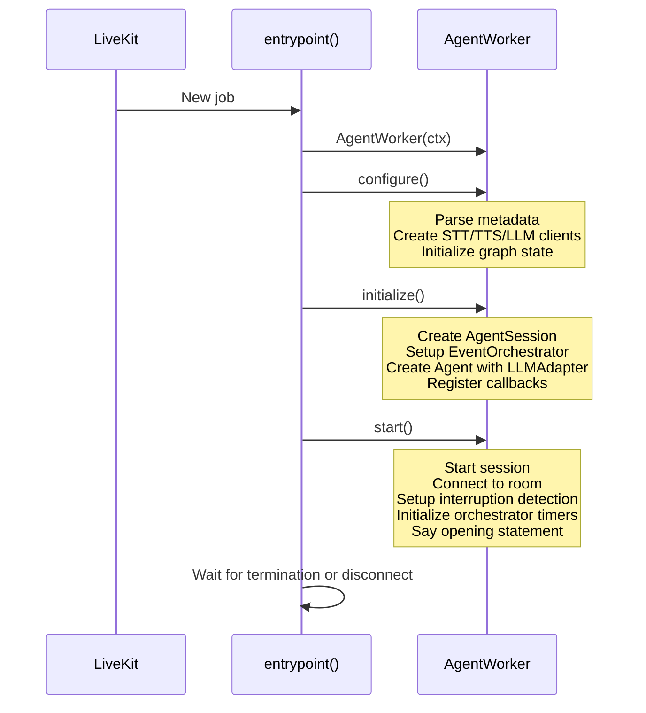
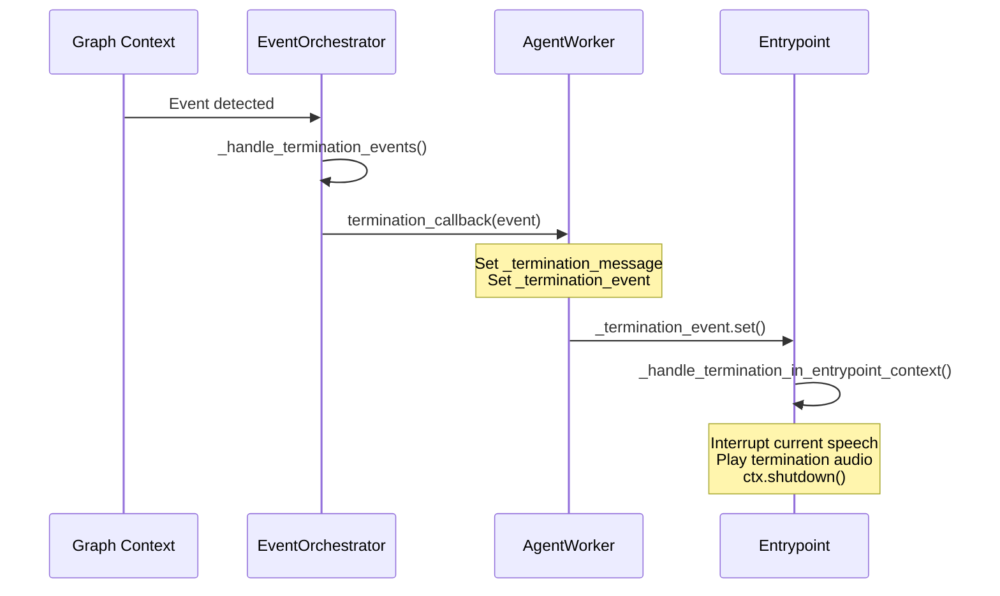

# Worker Lifecycle

**Purpose.** This document describes the three-phase lifecycle of `AgentWorker`, the VAD prewarming step, and the termination flow.

---

## Overview

Every LiveKit agent session is managed by an `AgentWorker` instance. The worker progresses through three phases:

1. **Configure** -- parse metadata, create provider clients
2. **Initialize** -- create session, agent, orchestrator, register callbacks
3. **Start** -- connect to room, initialize orchestrator, say opening statement



## Phase 1: Configure

`AgentWorker.configure()` performs:

1. **Create embedding client** -- `OpenAIEmbeddingClient` for semantic similarity events
2. **Parse room metadata** -- `parse_room_metadata()` extracts the `Scenario` object (including events, voice config, prompt data, language config)
3. **Create STT client** -- via `configure_stt_client()` using scenario voice/language config
4. **Create TTS client** -- via `configure_tts_client()` using scenario voice config
5. **Create LLM client** -- via `configure_llm_client()` using scenario language config
6. **Initialize graph state** -- `initialize_agent_state()` sets up the LangGraph thread

After this phase, `worker.scenario`, `worker.tts_client`, `worker.stt_client`, `worker.llm_client`, and `worker.embedding_client` are all populated.

## Phase 2: Initialize

`AgentWorker.initialize()` performs:

1. **Create session** -- `AgentSession` with STT instance, TTS instance, and prewarmed VAD
2. **Setup event orchestrator** -- `EventOrchestrator` with scenario events, termination callback, and room reference
3. **Create agent** -- `create_agent_with_adapter()` builds a LiveKit `Agent` with a `LLMAdapter` wrapping the LangGraph pipeline
4. **Register callbacks** -- conversation handler, connection state handler, shutdown handler

## Phase 3: Start

`AgentWorker.start()` performs:

1. **Initialize events** -- create `asyncio.Event` objects for termination and room disconnect signaling
2. **Start session** -- `session.start()`, with Krisp BVC noise cancellation only when the LiveKit deployment can run it (`supports_noise_cancellation()` in `app/core/livekit/audio_filters.py`): the filter is a LiveKit Cloud feature, and a self-hosted SFU rejects it and runs the session unfiltered
3. **Connect to room** -- `ctx.connect()`
4. **Setup interruption detection** -- monitors for user interruptions during agent speech
5. **Initialize orchestrator** -- `event_orchestrator.initialize()` sends initial score events and starts TIME event timers
6. **Say opening statement** -- randomly selects and speaks an opening statement from the scenario

## VAD Prewarming

The `prewarm()` function runs before any session starts. It pre-downloads the Silero VAD (Voice Activity Detection) model so the first session does not have a cold start:

```python
def prewarm(proc: JobProcess):
    proc.userdata["vad"] = silero.VAD.load(
        activation_threshold=DEFAULT_VAD_ACTIVATION_THRESHOLD  # 0.7
    )
```

The prewarmed VAD is retrieved in `_create_session()` via `ctx.proc.userdata.get("vad")`.

## Termination Flow

Termination can be triggered by:

- A **termination event** detected by the EventOrchestrator
- The **agent's own room connection** dropping (`connection_state_changed` -> `CONN_DISCONNECTED`)
- The **last human participant leaving** while the agent's own connection stays healthy (`room.on("participant_disconnected")` -> `AgentWorker._shutdown_if_room_emptied_of_humans()`, `app/worker.py`). The bot (and any commissioned avatar) is still a room participant in this case, so the room never goes empty and the connection-state path above never fires on its own -- without this second path the job (and the backend's session record) would keep running until a scenario TIME/SCORE termination or `max_duration_exceeded`, and a learner who left mid-session could not start a fresh one.



The termination message is played in the **entrypoint context** (not the graph context) to ensure reliable audio playback. The graph context signals the entrypoint via `asyncio.Event`.

The entrypoint keeps alive by waiting on either `_termination_event` or `_room_disconnected_event` using `asyncio.wait(return_when=FIRST_COMPLETED)`.

## AgentWorker Attributes

| Attribute | Set In | Description |
|-----------|--------|-------------|
| `scenario` | configure | Parsed scenario with events, voice, prompt |
| `tts_client` | configure | TTS provider client |
| `stt_client` | configure | STT provider client |
| `llm_client` | configure | LLM provider client |
| `embedding_client` | configure | OpenAI embedding client |
| `session` | initialize | LiveKit AgentSession |
| `event_orchestrator` | initialize | Event registry and orchestration |
| `agent` | initialize | LiveKit Agent with LLMAdapter |
| `final_score_sent` | runtime | Whether final score has been sent on disconnect |
| `_termination_event` | start | Signals termination to entrypoint |
| `_room_disconnected_event` | start | Signals room disconnect to entrypoint |

---

## Key Source Files

- `app/worker.py` -- `AgentWorker`, `entrypoint()`, `prewarm()`
- `app/core/agent/factory.py` -- `parse_room_metadata()`, `configure_stt_client()`, `configure_tts_client()`, `configure_llm_client()`, `create_agent_with_adapter()`
- `app/core/events/handlers.py` -- callback creation functions
