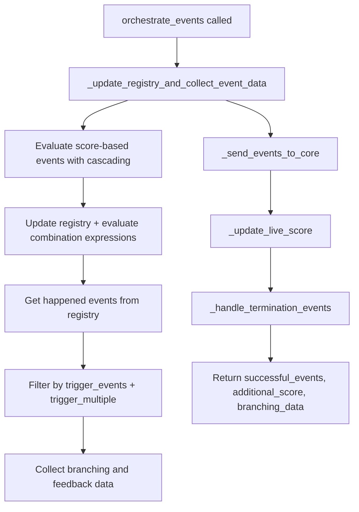

# Event System

**Purpose.** This document describes the event detection and orchestration system: `BaseEvent`, `EventOrchestrator`, the event registry, scoring mechanics, eligibility rules, and the ACTIVE/PASSIVE distinction.

---

## Overview

The event system detects counseling skills and behaviors during a conversation, scores them, and delivers feedback to both the UI (for the counselor) and Core (for analytics). The system has three main components:

1. **BaseEvent** -- abstract interface for event detection
2. **EventOrchestrator** -- registry, scoring, and delivery coordination
3. **EventSender** -- SQS and UI event delivery

## BaseEvent

**File:** `app/core/events/base.py`

All event types extend `BaseEvent`, a Pydantic `BaseModel` with an abstract `detect_event()` method:

```python
class BaseEvent(BaseModel, ABC):
    event_id: str
    visibility_type: VisibilityType = VisibilityType.ACTIVE
    detection_type: DetectionType = DetectionType.SENTENCE_SIMILARITY
    data: Any = Field(default_factory=lambda: {})
    score: Optional[int] = None
    emoji: Optional[str] = None
    emoji_message: Optional[str] = None
    branching_instruction: Optional[BranchingInstruction] = None
    show_feedback: Optional[bool] = True
    detection_config: Optional[DetectionConfig] = Field(default_factory=DetectionConfig)

    @abstractmethod
    async def detect_event(self, conversations: List[ChatMessage]) -> bool:
        ...
```

### DetectionConfig

Controls when and how often an event can trigger:

| Field | Type | Description |
|-------|------|-------------|
| `start_time` | `Optional[float]` | Earliest time (seconds) the event can trigger |
| `end_time` | `Optional[float]` | Latest time (seconds) the event can trigger |
| `min_score` | `Optional[int]` | Minimum cumulative score required |
| `max_score` | `Optional[int]` | Maximum cumulative score allowed |
| `min_gap_time` | `Optional[float]` | Minimum seconds between occurrences |
| `max_occurrences` | `Optional[int]` | Maximum total trigger count |

### ChatMessage

Input format for `detect_event()`:

```python
class ChatMessage(BaseModel):
    role: str        # "counselor", "user", "assistant"
    content: str     # Message text
    start_time: Optional[float]  # Start time in seconds
    end_time: Optional[float]    # End time in seconds
```

## EventOrchestrator

**File:** `app/core/events/event_orchestrator/event_orchestrator.py`

The `EventOrchestrator` inherits from `ScoreEvaluatorMixin` and `EventSender`. It manages the complete event lifecycle.

### Event Registry

The registry is a dict mapping event IDs to `EventRegistryEntry` objects:

```python
class EventRegistryEntry(BaseModel):
    happened: bool = False
    trigger_multiple: bool = False
    occurred_at: Optional[datetime] = None
    occurrence_count: int = 0
```

- `happened` -- whether the event is currently active
- `trigger_multiple` -- `True` for SENTENCE_SIMILARITY, SEMANTIC_SIMILARITY, BINARY_CLASSIFIER, HELPER_INTERRUPTED, HELPER_PARAPHRASED (can fire multiple times); `False` for TIME, SCORE, COMBINATION (fire once)
- `occurred_at` -- timestamp of last occurrence (used for cooldown checks)
- `occurrence_count` -- total times the event has triggered

### orchestrate_events()

The main coordination method, called from `process_events` graph node:



### Combination Expression Evaluation

Combination events use boolean logic (`AND`, `OR`, `NOT`) over other events. The `update()` method:

1. Sets `happened=True` for newly detected events
2. Iterates through `expression_list` evaluating each combination expression against the registry
3. Checks eligibility constraints (time window, score window, cooldown, max occurrences)
4. Updates the combination event's `happened` state

Expressions are represented as `ExpressionNode` trees:

```python
class ExpressionNode(BaseModel):
    type: str          # "IDENTIFIER", "NOT", "AND", "OR"
    id: Optional[str]  # event_id (for IDENTIFIER)
    left: Optional[ExpressionNode]   # left operand (for AND, OR)
    right: Optional[ExpressionNode]  # right operand (for AND, OR)
    operand: Optional[ExpressionNode] # operand (for NOT)
```

### Initialization

`EventOrchestrator.initialize()`:

1. Sends initial score-based events to Core (e.g., events with `score < 5` condition that are immediately true)
2. Updates graph state with initial branching data
3. Starts `TimeEventScheduler` timers for all TIME events

## ScoreEvaluatorMixin

**File:** `app/core/events/event_orchestrator/score_evaluator.py`

Handles score calculation and cascading:

- `live_score` -- cumulative score updated after events are sent to Core
- `_evaluate_and_handle_cascade_score_events()` -- evaluates SCORE events against `live_score + current_cycle_score`, then cascades if triggered SCORE events have their own scores
- `_update_live_score()` -- updates `live_score` with an `asyncio.Lock` to prevent race conditions

### Cascading Example

If the current `live_score` is 0 and an event with `score=5` triggers, the working score becomes 5. A SCORE event with condition `score >= 5` would then trigger in the same cycle, and if that SCORE event itself has `score=2`, the working score becomes 7, potentially triggering more events.

## EventSender

**File:** `app/core/events/event_orchestrator/event_sender.py`

Handles sending events to external systems:

- `_send_events_to_core()` -- sends events to SQS via `msg_event_queue.send_message()`. Termination events are **deferred** (stored in `deferred_termination_event`) to ensure the agent finishes speaking before the backend closes the room.
- `_collect_branching_and_feedback_data()` -- creates `BranchingAndFeedbackData` objects from triggered events. Only ACTIVE events get `EventFeedback` objects.
- `_handle_termination_events()` -- selects the highest-magnitude termination event and calls the termination callback.

## ACTIVE vs PASSIVE Events

| Property | ACTIVE | PASSIVE |
|----------|--------|---------|
| UI feedback | Yes (emoji, message, score) | No |
| Sent to Core (SQS) | Yes | Yes |
| Creates EventFeedback | Yes | No |
| Can have branching_instruction | Yes | Yes |

ACTIVE events always have a `feedback` object in `BranchingAndFeedbackData` (even if `message` is `None`). PASSIVE events have `feedback=None`.

## Event Factory

**File:** `app/core/events/factory.py`

`build_events_from_metadata(metadata)` converts scenario metadata into `BaseEvent` instances:

1. Iterates through `metadata["events"]`
2. For each event dict, determines `DetectionType` from `detectionType` field
3. Calls `_create_event_by_detection_type()` to instantiate the correct subclass
4. Parses `DetectionConfig` from `detectionConfig`
5. Parses `BranchingInstruction` from `branchInstruction`
6. Expands combination event expressions to reference only simple events

---

## Key Source Files

- `app/core/events/base.py` -- `BaseEvent`, `ChatMessage`, `DetectionConfig`
- `app/core/events/factory.py` -- `build_events_from_metadata()`
- `app/core/events/event_orchestrator/event_orchestrator.py` -- `EventOrchestrator`
- `app/core/events/event_orchestrator/event_sender.py` -- `EventSender`
- `app/core/events/event_orchestrator/score_evaluator.py` -- `ScoreEvaluatorMixin`
- `app/core/events/schemas.py` -- `EventRegistryEntry`, `ExpressionListEntry`
- `app/core/events/schedulers.py` -- `TimeEventScheduler`
