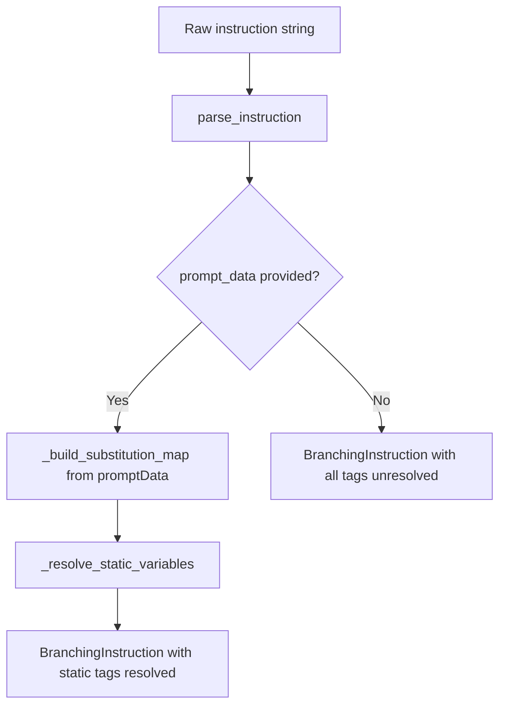
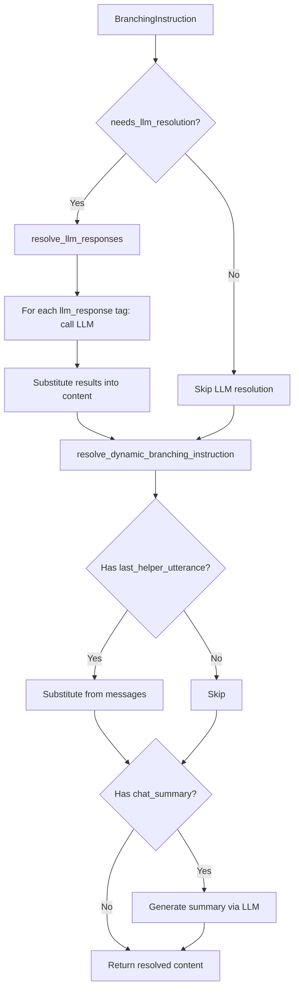

# Branching Instructions

**Purpose.** This document describes the branching instruction system: variable types, parsing, resolution flow, and integration with the graph pipeline.

---

## Overview

A **branching instruction** is a text directive attached to an event that guides the LLM's response when that event fires. Instructions can contain variable tags that are substituted with runtime values.

Example instruction:
```
The counselor said: <last_helper_utterance>. Respond with empathy about <your context>.
Use these facts: <llm_response(facts about grief counseling)>.
```

## Variable Types

Variables in branching instructions fall into three categories:

### 1. Static Variables

Resolved once at event creation time from `promptData`. These are substituted during `BranchingInstruction.create()`.

| Variable | Source |
|----------|--------|
| `<your context>` | `promptData.context` |
| Custom field tags | `promptData.customFields[].field` values |

Static variables are matched case-insensitively against a substitution map built from `promptData`.

### 2. Dynamic Variables

Resolved at runtime each time the instruction is used. These require the current conversation state.

| Variable | Resolution Function | Description |
|----------|-------------------|-------------|
| `<last_helper_utterance>` | `resolve_last_helper_utterance()` | Last message from the counselor |
| `<chat_summary>` | `resolve_chat_summary()` | LLM-generated summary of conversation so far |

### 3. LLM Response Variables

Resolved once (lazily) when the instruction is first used. These call an LLM to generate content.

| Variable | Format | Description |
|----------|--------|-------------|
| `<llm_response(...)>` | `<llm_response(prompt text)>` | LLM generates content from the prompt text |

LLM response tags are extracted by `extract_llm_response_tags()` and resolved by calling `generate_llm_response()` for each tag.

## BranchingInstruction Class

**File:** `app/core/branching_instructions/base.py`

```python
@dataclass
class BranchingInstruction:
    content: str            # Instruction text (with substitutions applied progressively)
    variable_tags: List[str]  # All variable tags found
    static_tags: List[str]    # Tags pre-computed from promptData
    dynamic_tags: List[str]   # Tags requiring runtime evaluation
```

### Creation Flow



`BranchingInstruction.create(instruction, prompt_data)`:
1. Calls `parse_instruction()` to extract and categorize all variable tags
2. If `prompt_data` is provided, builds a substitution map from `context` and `customFields`
3. Resolves static variables by case-insensitive replacement
4. Returns a `BranchingInstruction` with `content` partially resolved

### Resolution Flow (at runtime)

In the `resolve_branching_instruction` graph node:



1. **`needs_llm_resolution()`** -- checks if `_llm_resolved` is `False`
2. **`resolve_llm_responses(llm_config, language_code)`** -- extracts `<llm_response(...)>` tags, calls LLM for each, substitutes results. Marks `_llm_resolved = True`.
3. **`resolve_dynamic_branching_instruction(messages, llm_config, language_code)`** -- substitutes `<last_helper_utterance>` and `<chat_summary>` from current conversation state.

## Reserved Variables

**File:** `app/core/branching_instructions/constants.py`

```python
class ReservedBranchingVariable(str, Enum):
    CHAT_SUMMARY = "chat_summary"
    LAST_HELPER_UTTERANCE = "last_helper_utterance"
    LLM_RESPONSE = "llm_response"
```

`BRANCHING_DYNAMIC_VARIABLES` includes `chat_summary` and `last_helper_utterance`. `llm_response` is not dynamic because it is computed once (lazily) and does not change during the conversation.

## Integration with Graph Pipeline

1. **Event Factory** -- `BranchingInstruction.create()` is called during `_create_event_by_detection_type()` when parsing the `branchInstruction` field from metadata
2. **process_events** -- events with `branching_instruction` are placed in `branching_and_feedback_data`
3. **resolve_branching_instruction** -- selects the highest-score branching event and resolves all tags
4. **generate_response** -- uses the resolved `next_instruction` text in the system prompt

---

## Key Source Files

- `app/core/branching_instructions/base.py` -- `BranchingInstruction` class
- `app/core/branching_instructions/constants.py` -- `ReservedBranchingVariable` enum
- `app/core/branching_instructions/parser.py` -- `parse_instruction()`, `extract_llm_response_tags()`
- `app/core/branching_instructions/functions/last_helper_utterance.py` -- `resolve_last_helper_utterance()`
- `app/core/branching_instructions/functions/chat_summary.py` -- `resolve_chat_summary()`
- `app/core/branching_instructions/functions/llm_response.py` -- `generate_llm_response()`
