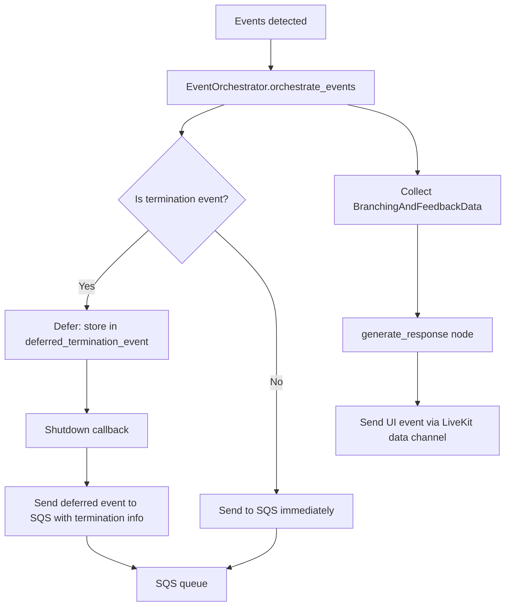

# Queue Messaging

**Purpose.** This document describes the AWS SQS integration for event delivery, the message format, deferred termination events, and LocalStack setup for local development.

---

## Overview

The system publishes events to AWS SQS so the backend can process them for analytics, scoring, and session management. Events are sent via the `SQSQueue` class, which wraps the `boto3` SQS client.

## SQSQueue

**File:** `app/core/queue/sqs.py`

```python
class SQSQueue:
    def __init__(self, queue_url: str, region_name: str = "us-east-1"): ...
    async def send_message(self, message_body: str, ...) -> bool: ...
    def send_message_sync(self, message_body: str, ...) -> bool: ...
```

### Initialization

The `SQSQueue` constructor:

1. Creates a `boto3` SQS client
2. If `AWS_ENDPOINT_URL` is set (LocalStack), uses it as the endpoint
3. If the provided `queue_url` is a queue name (not a URL), resolves it to a URL via `get_queue_url()`

### Async Sending

`send_message()` uses `asyncio.to_thread()` to run the synchronous `boto3` call in a thread pool, avoiding blocking the event loop:

```python
async def send_message(self, message_body: str, ...) -> bool:
    response = await asyncio.to_thread(
        self.sqs.send_message,
        QueueUrl=self.queue_url,
        MessageBody=message_body,
        ...
    )
    return response.get("MessageId") is not None
```

## Message Format

### Core Event Message

Sent to SQS for each triggered event:

```json
{
  "message_type": "event",
  "data": {
    "chat_message": null,
    "event": {
      "event_data": {
        "event_id": "empathy_statement",
        "visibility_type": "ACTIVE",
        "detection_type": "SENTENCE_SIMILARITY",
        "score": 5,
        "emoji": "star",
        "emoji_message": "Great use of empathy!"
      },
      "timestamp": "2024-01-15T10:30:00.000000Z"
    }
  },
  "room_id": "room_abc123",
  "timestamp": 1705312200
}
```

**Schema:** `CoreEventMessageType` (`app/core/events/schemas.py`)

| Field | Type | Description |
|-------|------|-------------|
| `message_type` | `CoreMessageType` | Discriminator -- see [Message Types](#message-types) |
| `data.event.event_data` | `dict` | Serialized event fields |
| `data.event.timestamp` | `str` | ISO timestamp |
| `room_id` | `str` | LiveKit room name |
| `timestamp` | `int` | Unix timestamp |

### Message Types

Every message shares the envelope above (`message_type`, `data`, `room_id`, `timestamp`); only
`message_type` and the one populated key under `data` differ. The other `data` keys are `null`.

`message_type` is a **contract with ally-be**: the consumer
(`ally-be/src/learn/consumer/learn-message-and-event.consumer.ts`) reads the string and dispatches through
`ProcessorRegistry` to the processor registered under that name. An unrecognized value falls through
to `UnknownEventProcessor` and is dropped -- adding a type here means adding a processor there.

**Enum:** `CoreMessageType` (`app/core/events/schemas.py`)

| `message_type` | `data` key | Purpose |
|----------------|------------|---------|
| `message` | `chat_message` | One transcript line (learner or agent turn), persisted as a session message |
| `event` | `event` | A triggered scenario event -- score, emoji, feedback, termination info |
| `behavior_instruction` | `behavior_instruction` | One behavior-instruction detection result (`behaviorInstructionId`, `score`, `category`); one message per detected behavior |
| `turn_metrics` | `turn_metrics` | Per-turn latency breakdown for the latency dashboards; headline is `response_latency_ms` |
| `start_metrics` | `start_metrics` | Once per session: simulation start latency ("time to first word") plus the segment breakdown that stacks where startup time went |
| `llm_usage` | `llm_usage` | Per-AI-call billable usage for the AI-cost dashboard; `service` (`llm` / `stt` / `tts`) selects the unit -- tokens, `audio_ms`, or `characters` |
| `session_memory` | `session_memory` | Once per session at shutdown: the final rolling summary, which Core persists case-scoped and hands to the next session as `previousMemory` |
| `supervisor_note` | `supervisor_note` | One live supervisor note as it goes to the learner; the durable copy the post-session debrief reads back. `seq` is 1-based per session and is Core's idempotency key, so an SQS redelivery collides instead of duplicating |

Each type has its own factory on `CoreEventMessageType` -- `create()` (which picks `message` vs
`event` from whether `chat_message` was passed), `create_behavior_instruction()`,
`create_turn_metrics()`, `create_start_metrics()`, `create_llm_usage()`,
`create_session_memory()`, `create_supervisor_note()`.

Two things about `llm_usage` are unlike the rest: `room_id` can be an empty string, because usage is
also emitted for AI calls with no room (and ally-ai publishes to the same queue for autofill,
translation and embeddings); and it is skipped entirely for `preview-*` rooms, which have no
persisted session in Core.

`room_id` is what attributes a call to a session, so every model call a roleplay session makes
carries one. Inside a graph node (and any task a node spawns) it comes from the graph run's context
var (`get_room_id()`); calls the worker makes from its own tasks -- thinking fillers, the interim
reply, back-channel phrases, clip TTS, the working-memory pool embedding -- are handed the room
name explicitly, because there the context var reads `"unknown"`. The post-session actor
evaluation runs with no room at all and sets `llm_usage.scenario_session_id` instead, which Core
reads before `room_id`.

Two features started over HTTP also call models. A studio rehearsal (scenario report) has no
session: its graph-node calls record under the report id (the graph's `thread_id`, which the node
wrapper falls back to without a room), and its two own calls -- the simulated counsellor, once per
turn, and the judge over the finished transcript -- are handed that id as the room explicitly and
also carry `llm_usage.metadata = {"report_id": ...}` (stored verbatim by Core). Core cannot map a
report id to a session, so these rows carry no session. The V2V tester joins a real session's room
as a simulated learner; its reply (once per exchange) and its end-of-run role-fidelity judge record
against that room and `scenario_session_id`, under tester labels so Core can keep tester spend out
of the session's delivery cost.

Labels the live worker emits (`app/core/llm_usage/tasks.py`, string-for-string with ally-be's
`LlmTask`): `agent_turn`, `agent_stt`, `agent_tts` (the AgentSession's own STT/TTS, via LiveKit's
`metrics_collected`), `rolling_summary`, `client_working_memory`, `supervisor_note`,
`backchannel_phrases`, `interim_reply`, `thinking_filler`, `clip_tts` (the isolated clip TTS
instance, which that hook never sees; recorded per real synthesis, never for a clip-cache hit),
`knowledge_retrieval`, `branching_instruction`, `branching_chat_summary`, `behaviour_detection`,
`guardrail_check`, `binary_classifier`, `helper_paraphrased`, `event_embedding`,
`working_memory_embedding` and `actor_evaluation`; the rehearsal adds `scenario_report_counselor`
and `scenario_report_evaluation`, the V2V tester `v2v_tester_reply` and `v2v_role_fidelity_judge`.
Embedding rows carry input tokens only.

### UI Event Message

Sent to the frontend via LiveKit data channel (not SQS):

```json
{
  "version": "1.0",
  "data": {
    "score": 5,
    "emoji": "star",
    "message": "Great use of empathy!",
    "show_feedback": true,
    "detected_event_ids": ["empathy_statement"]
  },
  "timestamp": "2024-01-15T10:30:00.000000Z"
}
```

**Schema:** `CustomUIEventMessageType` (`app/core/events/schemas.py`)

## Event Delivery Flow



### Deferred Termination Events

Termination events are **deferred** -- they are not sent to SQS immediately. Instead:

1. The event is stored in `EventSender.deferred_termination_event`
2. The agent plays the termination audio message
3. In the shutdown callback, the deferred event is sent to SQS with `autoTerminationStatus=true`

This prevents the backend from closing the room before the agent finishes speaking the termination message.

If a termination event is also in `trigger_events`, it is sent immediately **without** termination info. The deferred version (with termination info) is sent separately during shutdown.

## Configuration

| Variable | Description | Default |
|----------|-------------|---------|
| `AWS_ACCESS_KEY_ID` | AWS access key | -- |
| `AWS_SECRET_ACCESS_KEY` | AWS secret key | -- |
| `AWS_REGION` | AWS region | `us-east-1` |
| `AWS_ENDPOINT_URL` | Custom endpoint (for LocalStack) | -- |
| `SQS_MESSAGE_EVENT_QUEUE_NAME` | SQS queue name or URL | -- |

## LocalStack Setup

For local development, use LocalStack to emulate SQS:

```bash
docker-compose up -d
```

This starts LocalStack on port `4566` with SQS enabled.

Configure `.env`:
```
AWS_ACCESS_KEY_ID=test
AWS_SECRET_ACCESS_KEY=test
AWS_REGION=ap-southeast-1
AWS_ENDPOINT_URL=http://localhost:4566
SQS_MESSAGE_EVENT_QUEUE_NAME=your-queue-name
```

The `SQSQueue` constructor detects `AWS_ENDPOINT_URL` and uses it as the boto3 endpoint, routing all SQS calls to LocalStack instead of AWS.

When running inside Docker Compose, the app reaches LocalStack at `http://localstack:4566`. When running outside Docker Compose, use `http://localhost:4566`.

---

## Key Source Files

- `app/core/queue/sqs.py` -- `SQSQueue`
- `app/core/events/schemas.py` -- `CoreMessageType`, `CoreEventMessageType`, `CustomUIEventMessageType`
- `app/core/events/event_orchestrator/event_sender.py` -- `EventSender._send_events_to_core()`
- `app/core/graph/utils.py` -- `serialize_event()`
- `app/core/events/handlers.py` -- `send_event_to_ui()`, and where `turn_metrics` is emitted
- `app/core/graph/nodes.py` -- where `behavior_instruction` is emitted
- `app/worker.py` -- `_emit_start_metrics()` (`start_metrics`)
- `app/core/llm_usage/emitter.py` -- `llm_usage`
- `app/core/queue/utils.py` -- `session_memory`
- `app/core/supervisor/service.py` -- `supervisor_note`
- `docker-compose.yml` -- LocalStack configuration

Consuming side in ally-be:

- `ally-be/src/learn/interface/learn-message.interface.ts` -- the envelope and per-type payload interfaces
- `ally-be/src/ai/constants/processor.constants.ts` -- `PROCESSOR_EVENT_TYPES`, which must match `CoreMessageType`
- `ally-be/src/ai/processors/processor-registry.ts` -- dispatch by `message_type`
- `ally-be/src/learn/processor/*.processor.ts` -- one processor per type
