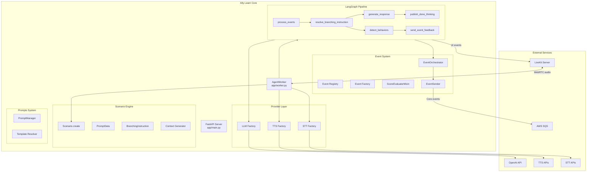

# Architecture

**Purpose.** This document describes the high-level architecture of Ally Learn Core, the component inventory, factory patterns used throughout the codebase, and key design decisions.

---

## System Diagram



## Component Inventory

| Component | Location | Responsibility |
|-----------|----------|----------------|
| FastAPI Server | `app/main.py` | Health check, API routers (voice preview, scenario report), CORS |
| AgentWorker | `app/worker.py` | Session lifecycle: configure, initialize, start |
| LangGraph Pipeline | `app/core/graph/` | 6-node simulation graph; separate report graph for text-only runs |
| EventOrchestrator | `app/core/events/event_orchestrator/` | Registry, scoring, event delivery |
| Event Factory | `app/core/events/factory.py` | Build `BaseEvent` instances from metadata |
| Event Types | `app/core/events/event_types/` | 9 concrete event implementations |
| TTS Factory | `app/tts/factory.py` | Create TTS clients (5 providers) |
| STT Factory | `app/stt/factory.py` | Create STT clients (3 providers) |
| LLM Factory | `app/llms/factory.py` | Create LLM clients (4 providers) |
| Scenario Engine | `app/core/scenario/base.py` | Parse metadata into `Scenario` objects |
| Agent Factory | `app/core/agent/factory.py` | Parse metadata, configure clients, create agent |
| Branching System | `app/core/branching_instructions/` | Variable substitution in instructions |
| Prompts System | `app/prompts/` | Template loading, backend override resolution |
| Scenario Report | `app/core/scenario_report/` | N-turn text simulation, webhook delivery |
| ScoreKeeper | `app/core/scoring/score_keeper.py` | Behavior instruction score tracking |
| Embeddings | `app/core/embeddings/` | OpenAI embeddings for semantic similarity |
| SQS Queue | `app/core/queue/sqs.py` | Async message delivery to AWS SQS |
| Configuration | `app/core/config.py` | Pydantic `Settings` from environment |

## Factory Pattern

The codebase uses the factory pattern extensively to decouple provider selection from business logic. Each provider subsystem follows the same structure:

```
app/<subsystem>/
    base.py      # Abstract base class (BaseTTSClient, BaseSTTClient, BaseLLMClient)
    factory.py   # Factory function (create_tts_client, create_stt_client, create_llm_client)
    <provider>.py  # Concrete implementations
```

The factory reads a config dict (typically from scenario metadata) and returns the appropriate client instance. All clients implement the same abstract interface, so consuming code never depends on a specific provider.

The event factory (`app/core/events/factory.py`) follows a similar pattern: `build_events_from_metadata()` reads event dicts from scenario metadata and returns `BaseEvent` instances via `_create_event_by_detection_type()`.

## Design Decisions

### Why subgraphs for resolve_branching_instruction and retrieve_knowledge?

LangGraph's `LLMAdapter` (used by LiveKit) streams all LLM outputs from every node in a graph. The `resolve_branching_instruction` and `retrieve_knowledge` nodes make internal LLM calls that should not be streamed to the user. By wrapping these nodes in subgraphs and using `subgraphs=False` (default in LLMAdapter), their outputs are isolated from the main streaming pipeline.

This is a workaround for [LiveKit agents issue #2836](https://github.com/livekit/agents/issues/2836).

### Why is OpenAI always required?

OpenAI is always required because:

1. **Embeddings**: The `OpenAIEmbeddingClient` is used for semantic similarity event detection. There is no alternative embedding provider currently.
2. **Default LLM**: OpenAI (`gpt-4o-mini`) is the default LLM provider and the fallback when other providers fail.
3. **Branching resolution**: The default branching LLM config uses OpenAI for structured output support.

Even when using Ollama or vLLM for the main conversation LLM, OpenAI is needed for embeddings and branching resolution.

### Why LangGraph?

LangGraph provides:

- **Stateful conversation management** with typed state and reducers
- **Node-based processing pipeline** that clearly separates concerns
- **Checkpoint/thread support** for conversation persistence
- **Streaming integration** with LiveKit via `LLMAdapter`

### ACTIVE vs PASSIVE events

- **ACTIVE** events have UI feedback (emoji, message, score) and are displayed to the counselor
- **PASSIVE** events are logged for analytics but have no UI feedback

Both types are sent to Core (SQS). Only ACTIVE events generate `BranchingAndFeedbackData` with feedback objects.

### How the thinking filler decides what to play, and when

The filler is the character's first sound after the learner stops, played on the
shared `BackgroundAudioPlayer` track so it can never preempt the real reply. Four
decisions sit behind it, each in its own module:

- **Whether to play at all** — `gap_predictor.GapPredictor` keeps a session EMA of
  `llm_ttft_ms + tts_ttfb_ms`, the same timings the latency dashboard uses. At the
  agent's "thinking" state the worker predicts the wait and decides immediately.
  Fast turns get no filler and, crucially, no delay: the previous design *waited*
  300-600 ms to discover whether a gap existed, spending the latency it existed
  to mask.
- **Which clip** — `filler_pool.FillerPool` holds every phrase accumulated this
  session (static Studio words, the session-start seed batch, per-exchange
  batches, in-turn batches) with its type, duration tier and last-played index.
  Selection wants three things at once: a length that fits the predicted gap, a
  phrase not heard recently, and a different type from the previous filler. The
  filters relax in priority order, so a small pool still plays something.
- **What to say** — `predictive_filler` generates at three moments. A *seed* batch
  at session start (character only) means fillers exist before turn one. An
  *exchange* batch when the character finishes speaking refreshes them without
  contending with the reply's own LLM request. An *in-turn* batch, fired from the
  learner's partial transcript mid-utterance, is the only one that can fit the
  turn it answers — a timer-driven batch necessarily predates it. The prompt
  carries the character's linguistic style samples and allowed discourse
  particles, so fillers sound like this character rather than generic.
- **Whether one is enough** — if a filler ends and neither the interim reply nor
  the real reply has started within a natural pause, one more plays, of a
  different type, capped at two per turn. A filler followed by silence draws
  attention to the wait it was meant to cover.

Every played filler is safety-checked in code as well as by the prompt
(`is_safe_filler`): no questions, no digits, nothing long enough to be a
statement, and nothing echoing a content word from the partial transcript — a
cut-off sentence can mean something quite different from how it started.

Per-turn provenance goes into `turn_metrics` as `fillerDecision`, `fillerLeadMs`
(stamped when the first frame actually reaches the mixer, not estimated),
`postFillerSilenceMs` and friends, so coverage and lead time are measurable
rather than assumed. `scripts/filler-bench.py` exercises the same code offline.

The transcript carries the other half. A filler, an interim reply and the real
reply all reach Core as CLIENT lines, and a single turn can emit all three in a
row — so `ChatMessage.utterance_kind` (`reply` | `filler` | `interim`) marks
which is which. Position cannot substitute for it: the moment a continuation
filler plays there are two fillers before the reply, and any consumer inferring
kind from order gets it wrong. The values deliberately match the
`metadata.firstAudioSource` vocabulary on the turn-metrics row so the transcript
and the latency record join cleanly. `None` means an older worker, and is
distinct from `reply` — reading that silence as a real reply would mislabel
every filler already in the backlog.

---

## Key Source Files

- `app/main.py` -- FastAPI application
- `app/worker.py` -- AgentWorker lifecycle
- `app/core/graph/graph_builder.py` -- `build_simulation_graph()`, `build_report_graph()`
- `app/core/agent/factory.py` -- `parse_room_metadata()`, client configuration, agent creation
- `app/core/config.py` -- Settings from environment
- `app/core/constants.py` -- Enums and constants
- `app/core/livekit/filler_clips.py` -- in-memory clip rendering + worker-wide cache
- `app/core/livekit/filler_pool.py` -- per-session phrase pool and selection rules
- `app/core/livekit/gap_predictor.py` -- predicted reply latency for filler timing
