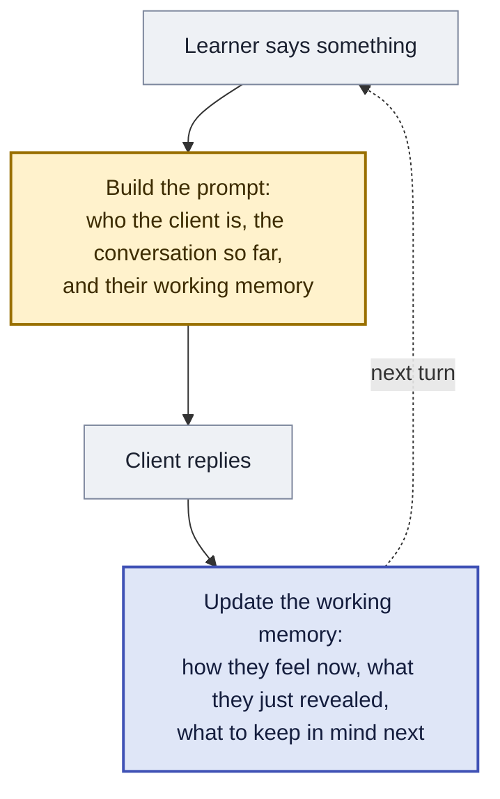
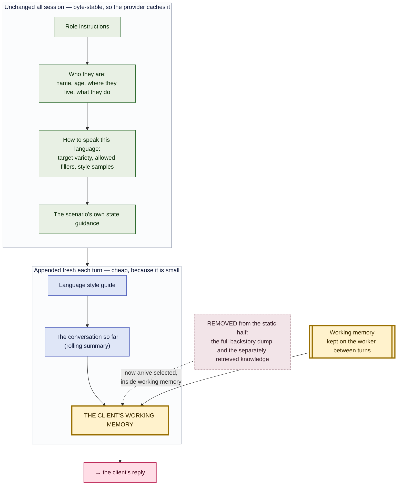
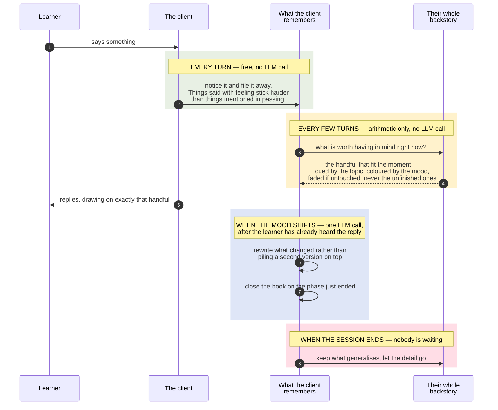

# The Client's Working Memory — one rolling structured context

**Status**: **BUILT AND IN PRODUCTION** (ally-ai-learn v1.39.1). Four things in this
document were superseded by what production taught us — see [§0](#0-what-production-changed)
before trusting any section on the stance ladder, the placeholder, or where the authored
guidance lives.
**Scope**: `ally-ai-learn` actor prompt assembly, memory, and the session-end write-out
**Target template**: a **new main-agent prompt inheriting Main Agent Prompt #2** — see §6.1. #2 is `ally_ai_learn_system_main_agent_prompt_full`, live at **version 6** with `useDashboardOverride: true`, so its authoritative text is in `prompts_versions`, **not** the file of the same name. The new prompt is what carries `{client_working_memory}`, which is also what scopes this design to the simulations that opt in; #2 itself is left untouched so it stays the control arm.
**Related**: [`02-graph-pipeline.md`](02-graph-pipeline.md) · [`03-event-system.md`](03-event-system.md) · [`12-prompts-system.md`](12-prompts-system.md) · [`knowledge-source-retrieval-policies.md`](knowledge-source-retrieval-policies.md) · [`events-off-gate-design.md`](events-off-gate-design.md)

---

## 0. What production changed

Four claims below are now false. They are left in place because the reasoning that produced
them is still worth reading — but each is corrected here and flagged where it appears.

**1. Working memory no longer adjudicates progression (§4).** The stance ladder was built to
be EARNED: an advance required a client-side event, moved at most one rung, and waited two
turns. In production that put it in front of the author's state machine. Scenario 440's
states ran `anxious -> partial resolution -> resolved` and the UI showed them reaching
`resolved`, while the ladder held the client at `guarded` and the prompt said *"Do not move
past this on your own."* Two controllers for one behaviour, and the stricter one won
silently — the client never changed, which is what the scenario author reported.

The states drive progression now, exactly as they do for every other main-agent prompt. The
stance MIRRORS the resolved state; `decide_stance` and its gates survive only for scenarios
that define no states, where there is nothing else to follow. Working memory's job is the
context around the flow: recall, the ledgers, voice, affect, grounding.

**2. The ladder is the scenario's, not the framework's.** §4 and the schema assumed five
fixed stances. An author who writes `anxious -> partial resolution -> resolved` has written a
ladder; the framework made the client climb a different one and mapped between them, which
lost bands whenever an author wrote more than five. `Stance` is now `str`, the ladder is
derived from the scenario's states in author order, and validation moved from the type to
the value.

**3. `state_x_guidelines` did NOT move inside the block (§3.1).** It was moved in, and moved
back out. Folding it in meant a designer opening their own prompt could not see their own
state guidance — it had been absorbed into an opaque placeholder. §3.1's reasoning about the
two provenances is still right; its conclusion about where the authored half renders is not.

**4. One placeholder became seven (§2.3).** `{client_working_memory}` rendered the whole
block, which meant a curator could not see what was being fed to the model or reorder any of
it. The prompt now declares `{working_memory_stance}`, `{working_memory_register}`,
`{working_memory_speech_fragments}`, `{working_memory_withheld}`,
`{working_memory_unresolved}`, `{working_memory_disclosed}` and `{working_memory_salient}`
alongside `{state_x_guidelines}`. The single-placeholder form is still supported by the
runtime; the prompt that used it is retired (`isObsolete`). §2.3's argument that POSITION
should be authorable is unchanged and is why the split was possible at all.

**5. The writer and the reader now use one vocabulary.** The updater prompt and Main Agent
Prompt #3 are the two halves of this design that a human actually reads, and they were
naming the same things differently: the updater asked for `voice_register` where #3 renders
`{working_memory_register}`, and framed the author's states as `{stance_ladder}` /
`{current_stance}` where #3 calls them `{state_x_guidelines}`. Curators read both. The
prompt-facing names are now `register`, `{state_ladder}` and `{current_state}` — chosen to
match what the store, the monologue payload and #3's own placeholders already called them,
so the rename landed on the transient LLM schema rather than on anything persisted.

Three divergences were left alone on purpose, because they are not renames. `opened_threads`
/ `closed_threads` are deltas and `{working_memory_unresolved}` is the net set; the two
withheld lists are paired positionally into one section; and `{working_memory_salient}` has
no updater field at all, because recall fills it. Renaming any of those would assert a
symmetry that does not exist. They are documented in the updater's contract (its `PromptInfo`
description in `app/prompts/contracts.py`), which is what the studio shows a curator. The store's own `stance` keeps its name: it reaches
ally-be as `final_stance` / `stance_path` on the write-out record and as `stanceFrom` /
`stanceTo` on the monologue, so renaming it is a cross-service change with already-persisted
rows behind it, and it buys nothing a prompt reader can see.

**Naming.** The prompt shipped as **Main Agent Prompt #3**, not as a
"client working memory" prompt — it sits in a picker beside #2, and naming it after its
mechanism described how it was built rather than where it sits.

---

## 1. The problem, measured

Every number here is from production, queried 2026-08-19. They are the reason for the design; if they change, revisit it.

**Quality degrades with conversation depth, then plateaus.** Recomputed 2026-08-20 on
16,668 judged turns, test organisations excluded — roughly six times the sample the first
version of this table used. Share of judged AI turns carrying any fault:

| Depth | All languages | en-IN | ta-IN |
|---|---|---|---|
| turns 0–3 | 6.07% | 4.74% | 8.44% |
| turns 4–7 | 8.43% | 3.93% | 16.90% |
| turns 8–11 | **12.68%** | 5.46% | **30.95%** |
| turns 12–19 | 12.04% | 6.48% | 29.37% |
| turns 20+ | 11.33% | 6.58% | 35.25% |
| *turns* | *16,668* | *10,327* | *3,792* |

**The plateau is the correction that matters.** An earlier read of this table had the curve
climbing to 14.77% at turns 20+ and en-IN reaching 9.28%. On the full sample it **flattens
after the 8–11 inflection** and en-IN reaches only 6.58% — a 1.4× rise end to end, not the
2.5× first reported, and not even monotonic (en-IN dips at 4–7). Broken out by mode across
all languages, the same shape: repetition 1.02% → 5.04% then flat near 4.4%, role slip
1.68% → 3.30% then flat, context lock-in 0.23% → 1.39% → 0.64%.

So "degrades with depth" is real, and the inflection at 8–11 is real, but the damage is
done by turn 12 and does not compound after it. A design justified on runaway degradation
at turn 30 would be justified on something that is not happening.

**The persona failure is the exception in size, not in shape.** From the language judge's
annotations, measured on **clean turns only** — turns where the transcript kept at least 70%
of what the model generated, which excludes the cut turns §11.1 is about:

| Depth | Clean turns | persona_break | *same depth, cut turns* |
|---|---|---|---|
| turns 0–3 | 942 | **7.54%** | *3.77%* |
| turns 4–7 | 944 | **11.65%** | *5.24%* |
| turns 8–11 | 752 | **13.96%** | *8.13%* |
| turns 12–19 | 729 | **13.99%** | *5.74%* |
| turns 20+ | 574 | **12.89%** | *10.49%* |

`persona_break` is the **largest annotation category** (1,223) and it **nearly doubles by
turns 8–11 — 7.54% → 14.0% — then holds**. That is the measurement this design rests on.

Three things about that table are worth stating explicitly, because two earlier readings of
it were wrong.

**It is real, and larger than first reported.** On clean turns it reaches 14%, above the
12.67% a mixed population gave. This is not a transcript artefact.

**Cut turns DILUTE it — the earlier "upper bound" warning had the sign backwards.** A
54-character fragment gives a judge less material in which to find the client acting like an
assistant, so cut turns show *fewer* persona breaks at every depth. Mixing them in was
understating this metric, not inflating it.

**It plateaus, and the earlier "rises monotonically to 20+, 2.7×" claim was itself the
artefact.** On clean turns it peaks at 12–19 and falls at 20+, a 1.9× rise rather than 2.7×.
The apparent monotonic climb came from the cut share being U-shaped by depth — 34.9% of turns
cut at 0–3, ~22% in the middle, 31.7% at 20+ — so the mix, not the metric, was changing.

So every signal measured now tells one story: **the damage is done by turns 8–12 and then
holds.** Any-fault plateaus, repetition plateaus, role slip plateaus, persona_break
plateaus. There is no runaway degradation, and this design must not be justified on one.
Its case is the *height* of the plateau — 14% of turns at depth showing the client collapse
into an assistant against 7.5% early — not its slope.

That also narrows what to build first. If the damage is done by turn 8–12, the mechanisms
that matter are the ones acting early: `speech_fragments` carrying voice across the first
compaction, and earned stance transitions blocking premature insight. A decay curve tuned
for turn 40 is tuned for something that is not happening.

One more thing the table settles: `too_formal_diglossia` is **flat** across depth (4.20 /
3.99 / 5.18 / 3.86 / 3.92 on the mixed population), which confirms register failure is a
"never told the target variety" problem rather than a memory one (§11) — though whether the
cause is the *content* or its *position* in the prompt is open, see §9.2.

**Do not read `truncation` as a quality signal at all.** §11.1 has the measurement: it is
overwhelmingly the transcript recording only the part of a reply that reached TTS before the
learner talked over it.

**The actor does not respond to counsellor skill.** Turns preceded by a scored event — the system's own judgement that the learner made a skilled intervention — introduce new information at **65.52%**. Turns with no scored event: **65.51%**. That is 583 versus 2,427 turns, and the difference is 0.01 points.

What the actor *does* do in response to skill is talk more:

| | no scored event | after a skilled move |
|---|---|---|
| all languages, turns 8–15 | 176 chars | 233 chars |
| en-IN only, turns 8–15 | 172 chars | 218 chars |
| en-IN only, turns 16+ | 176 chars | 278 chars |

More words, no more substance. The actor-evaluation rubric already names this: *"Penalize uniform responsiveness that ignores intervention quality."*

**Persona failures at depth are all one failure.** Every critical `persona_social` annotation read at turns 8+ was the client collapsing into the assistant:

> *"That was helpful to notice. Thanks!"* — judge: breaks from a subdued, weary man in severe distress
> *"I'm starting to see the pattern a little more clearly now. Thank you for today!"* — judge: meta-comment, attempting to end the role-play
> *"I can sense that heaviness…"* — judge: **the AI adopted a therapist's persona**

This is not only a quality defect. A client who declares insight at turn 14 hands the trainee a fake success and inflates their score.

**We made role slip worse.** The rolling summary shipped 2026-08-06. en-IN, turns 8+, before versus after: repetition **4.62% → 3.00%** (the feature worked), role slip **0.46% → 3.00%**.

The mechanism is visible in the code. `nodes.py` drops verbatim history once the summary covers it, and `rolling_summary.txt` carries situation, disclosures, counsellor_actions, emotional_arc and unresolved — **no voice**. We removed the actor's own prior turns, which were its only in-context style exemplars, and kept only its facts.

**Prompt size drives latency, and latency drives faults.** Recomputed 2026-08-20. Token
counts come from `llm_usage` where `task = 'agent_turn'` — the worker's own per-turn
record, 2,333 rows — matched to the nearest turn-metrics row in the same session within
5 seconds:

| Prompt tokens | Turns | Cached | Matched | TTFT | Total latency | p50 latency |
|---|---|---|---|---|---|---|
| under 1,500 | 711 | 17% | 601 | 2,298ms | 3,780ms | 3,118ms |
| 1,500–2,199 | 617 | 47% | 496 | 3,187ms | 4,394ms | 3,340ms |
| 2,200–2,999 | 601 | 71% | 445 | 3,066ms | 4,157ms | 3,349ms |
| 3,000+ | 404 | 66% | 295 | 4,116ms | 5,907ms | 4,963ms |

**+2,127ms across the range**, and the p50 column shows the same shape as the mean, so it
is not a tail artefact.

Two caveats on this table specifically, both of which leave the ordering intact and the
absolute values approximate. **79% of turns match** (1,837 of 2,333); the rest have no
turn-metrics row inside the join window, since `llm_usage` and turn metrics are written by
different paths. And the **TTFT column is the least trustworthy**: until 2026-08-20 a
time-to-first-token arriving after the reply began could be attributed to the following
turn, so historical TTFT carries an intermittent one-turn shift that the total-latency
column does not.

Unlike the fault bands below, this table needed **no** `source` correction. It is anchored
on `llm_usage`, which only exists for live agent turns, so transcript-backfilled rows
cannot enter it — filtering for them changes every figure here by zero.

**Slow turns fault more, and the gradient is steeper than we first measured.** Recomputed
2026-08-20 over 90 days of judged turns, counting only live `source = 'pipeline'` rows —
a third of that table is transcript-backfilled, whose "latency" is reconstructed from
message timestamps rather than measured voice-to-voice, and pooling the two diluted this
result:

| Response latency | Turns | Any fault |
|---|---|---|
| under 5.3s | 5,499 | 16.2% |
| 5.3–8.7s | 3,173 | 20.1% |
| over 8.7s | 2,147 | **33.5%** |

A 2.1× gradient from the fastest band to the slowest. Pooled with the backfilled rows the
same three bands read 15.1 / 17.1 / 23.6 — a 1.56× gradient — so the contamination was
hiding roughly half the effect.

Quartiles tell the same story with the boundary in a different place: the slowest quarter
of live turns starts at **7.9s**, not the 8.7s a pooled read gave, and faults at 31.5%
against 19.7% in the fastest quarter. Live p50 is 5.3s and p75 is 7.9s.

One caveat on shape: the relationship is **not** monotonic. The fastest quartile faults
more than the second (19.7% against 12.8%), which is its own finding — very fast replies
are disproportionately short or degenerate — and it means "reduce latency" is the right
goal only from the middle of the distribution upward.

Note what caching does *not* buy: the 3,000+ bucket is the slowest despite 66% cached, and
the 2,200–2,999 bucket is the best-cached of the four at 71% while still slower than the
smallest. Caching is reducing cost, not latency.

The static prompt is the majority of the context. First-turn prompt tokens vary **710 to 2,041** across scenarios while conversation growth is only **340 to 1,140** — so roughly 1,300 tokens of spread is authoring difference, not necessity.

**Prompt size does not directly predict faults.** Tested: the 1,800+ token bucket faulted *less* (0.88%) than the under-900 bucket (5.14%). Trimming is a latency play, not a quality play. It reaches quality *through* latency, which is the strongest single predictor we have.

---

## 2. What the client's working memory is

One structured block, assembled off the critical path, appended last in the system prompt by default, replacing the static backstory dump.

It holds the client's inner state and the subset of their history that is currently live. It rolls forward on triggers rather than being rebuilt per turn, and it is the single thing the actor reads to know who it is and where it stands.

**Why "working memory".** The name places this beside what the worker already has
rather than competing with it. *Episodic* memory is taken: it is the shipped rolling
summary, named that throughout `rolling_summary.py` and shipped to Core as
`session_memory`. *Semantic* memory is the cross-session `previous_memory` slot (§10).
The layer missing between them is the small, currently-active set the client actually
has in mind while speaking — and that is what this is. The mechanics follow: a 4±1
capacity cap (§7.4), decay-based eviction rather than truncation, and selection driven
by cue and mood. §7.7 lays the three layers out together.

It is deliberately **not** an internal monologue. Nothing here runs a per-turn
reasoning pass; the state is emitted by a call that already happens (§5), and the one
monologue-shaped field, `appraisal`, is also the one field that must never reach the
prompt verbatim.

**Its central property is that it is derived, not authored.** Stance, disclosures and
unresolved threads are inferred from the conversation as it happens. That is a
deliberate choice against the alternative, and the evidence for it is in this
repository: `roleplay_v2` built a structurally similar per-turn card whose power came
from *authored* per-scenario content — a disclosure ledger with hand-written
deflections, and a state machine. In six weeks nobody authored any of it. Five specs
have versions, all DRAFT, none published, **zero secrets and zero states between them**
(§9.1). A design that requires content per scenario has to be authored 58 times before
one learner benefits; a design that derives it ships once.

**Topically retrieved** knowledge is **inside** it, not beside it. Today
`{retrieved_context}` is its own block, computed independently of any notion of the
client's state. But it draws on the same source its own `salient_backstory` draws on
(`scenario_characters.knowledge_sources`), so two blocks means two headers, two
framings, and duplicated content — against the whole point of trimming. It also
makes mood-congruent recall (§7) decorative rather than operative: a separately
computed block cannot be weighted by a stance it does not know about.

The qualifier matters. Only knowledge that is *topically* retrieved belongs in working
memory. Content that applies on every turn regardless of subject — how to speak this
language, global safety rails — is not something the client recalls; it is how they
speak. It stays in the static prefix, where it costs nothing per turn. §9.2 draws that
line, and it is the line that resolves the overlap with the retrieval-policies
proposal.


It is appended **last** in the system prompt by default, nearest the reply — §2.2 shows where and why, and §2.3 makes that position authorable so it can be tested.

### 2.1 One turn



Working memory is **read** when the prompt is built and **written** after the reply has
gone out. It is the only thing in the turn that carries across from the last one.

Everything else in this document is detail about those two boxes: what it holds
(§3), what makes it change (§4), where the update runs so it never delays the reply (§5),
and how it decides what to keep in mind (§7).

<details>
<summary>Which code each step corresponds to</summary>

| Step | Code |
|---|---|
| Learner says something | STT, then `process_gating_events` / `detect_behaviors` / `retrieve_knowledge` in parallel |
| Build the prompt | `prompt.py` assembly; `main_agent_prompt_full` v6 plus appended blocks. `resolve_branching_instruction` runs just before |
| Client replies | `generate_response`, then TTS |
| Update the working memory | proposed `update_working_memory`, detached, writing `ClientWorkingMemoryStore` — alongside the existing `compact_history` |

</details>

### 2.2 Inside "build the prompt"

Zooming into the second box. The prompt is assembled top to bottom; **the top half never
changes during a session and stays cached, the bottom half is appended fresh each turn.**



**Working memory goes last by default**, nearest the reply. Stacks, *Rolling Context
Window for Agent Memory*: *"place relevant context near the prompt end to increase
likelihood of use."* Today the persona sits at the very top — furthest from generation —
which is backwards, because persona failures are exactly what rise with conversation
depth (§1).

That is a default, not a property of the design. Position is exposed as a template
placeholder so it can be moved and tested — §2.3.

**Two things leave the static half.** The full backstory dump and the separately retrieved
knowledge both stop being their own blocks and reappear *inside* working memory, reduced
to what the client currently has in mind. That is where the token saving comes from: the
static half of the prompt is 710–2,041 tokens depending on the scenario, and the
difference is authoring, not necessity.

**Appending does not break the cache.** Everything above the append point stays
byte-identical all session, so the provider still caches it — which is already how the
rolling summary and glossary work today. Only the small tail changes.

<details>
<summary>Which code each piece corresponds to</summary>

| In the diagram | Code |
|---|---|
| Role instructions · who they are · how to speak · state guidance | `main_agent_prompt_full` v6 in `prompts_versions` (`useDashboardOverride`) |
| The full backstory dump *(removed)* | `{character_profile_text}` |
| Separately retrieved knowledge *(removed)* | `{retrieved_context}` — inline on #2, suffix on the default template |
| Language style guide | `_ensure_language_glossary`, appended after templating |
| The conversation so far | `_append_rolling_summary` ← `RollingSummaryStore` |
| THE CLIENT'S WORKING MEMORY | `{client_working_memory}` placeholder, else appended ← `ClientWorkingMemoryStore` (§2.3, §6) |

</details>

### 2.3 Position is authorable: the `{client_working_memory}` placeholder

> **Superseded — see §0.4.** One placeholder became seven, one per section, so a
> curator can read what is fed and move each part independently. The argument below
> for authorable position is what made that possible and still holds.

The claim that last is the best position is a hypothesis, and it is cheap to test — so
the block ships as a **real placeholder** rather than a hardcoded append. An author moves
`{client_working_memory}` in the template, and the block renders there.

**The mechanism already exists.** `prompt.py` has a dual-delivery contract used by three
blocks today: render at the placeholder if the template carries one, otherwise append to
the volatile suffix. The idempotence check is the whole trick —
`_append_retrieved_context` and `_ensure_language_glossary` both begin `if text in
message.content: return message`, so a template that rendered the block already
suppresses the append. One code path, and placement belongs to whoever edits the
template. `_append_working_memory` follows it exactly.

**Registering the variable is mandatory, not housekeeping.** `SafeFormatter.__missing__`
in `app/prompts/resolver.py` returns the **literal** `"{key}"` when a key is absent from
the prompt's `availableVariables`, and empty string when it is present but unset. So an
unregistered placeholder does not degrade quietly — it puts the raw text
`{client_working_memory}` into the system prompt the model reads. It has to be added to
`availableVariables` on every template that may carry it, which is also what surfaces it
in the studio's variable list and therefore what makes the experiment possible for
someone who is not editing Python.

An empty model renders the named empty state from §3 — `(first turn — no history yet)` —
never a blank and never a leaked placeholder.

**Default placement, and the ordering rule.** Absent a placeholder, the block appends to
the volatile suffix, and within that suffix the existing rule is ascending churn
frequency: rolling summary (~4 turns), retrieved context (~2 turns), working memory
(**every** turn). Fastest churn goes last, so working memory is last.

**Moving it up is a latency footgun, and that is the point of measuring.** `prompt.py`
records the measured consequence for the block that churns half as often: rendering it
mid-template *"invalidated the provider prompt cache for everything after it on almost
every turn."* Prefix caching means everything after the first changed byte is
re-processed, and working memory changes every turn — so an author who moves it to the
top converts every turn into a full cache miss. §1's bands price that at up to +1,650ms,
and turns over 8.7s fault 49.8% of the time.

So the position experiment **must read the latency distribution alongside quality**, not
quality alone. A position that improves persona adherence and moves the >8.7s share is
not a win; it is a trade, and §1 says the latency side of that trade usually wins.

The branching template is the exception, and gets inline placement for free: branching
turns swap templates and bust the cache regardless, so there is nothing to preserve —
the same reasoning `prompt.py` already applies to `{retrieved_context}` there.

**One variable is coupled to position and must not be read as noise.** §5.1 makes
guardrail precedence a concern *because* the block sits last, at the position of highest
attention, where it can compete with a guardrail arriving through `next_instruction`.
Moving the block earlier weakens that competition; moving it last maximises both the
intended benefit and that risk. Any position test therefore has to check guardrail
adherence, not just clienthood — otherwise "last is best" gets adopted on a quality
number while a safety regression sits inside the same change.

---

### Two update paths, because the parts churn at different rates

`prompt.py` today orders the volatile suffix by **ascending churn frequency** —
summary before retrieved context — so the slower-changing content sits earlier and
more of the prompt stays byte-stable. Folding retrieval into the block would make
the whole block churn at its fastest member's rate and give some of that back.

So the block keeps the same discipline internally, and the updater has two paths:

| Path | Cadence | Writes | Cost |
|---|---|---|---|
| **State update** | client-side event, or summary cadence | `stance`, `affect`, `appraisal`, `register`, `speech_fragments`, `unresolved`, `withheld` | structured output on an existing call |
| **Recall refresh** | ~every 2 turns, as retrieval does today | `salient_backstory` — cue-matched **and stance-weighted** | the existing retrieval call, scoped to semantic sources (§9.2) |

The recall refresh is the existing `retrieve_knowledge` subgraph, given the current
stance and cue set as input and writing into working memory instead of into its own
prompt block. It is not new work; it is the same work with a destination and a
weighting it did not have before.

Slow fields first, fast fields last: the reader still gets the freshest content
nearest generation, and the stable half of the block can still cache.

---

## 3. Schema

Every field exists to serve a measured failure. Nothing is here for completeness.

```python
class ClientWorkingMemory(BaseModel):
    # ── inner state ──────────────────────────────────────────────
    stance: Literal["guarded", "testing", "opening", "disclosing", "reflecting"]
    affect: str                    # one line, current felt state
    appraisal: str                 # why the stance is where it is

    # ── voice: repairs the 6.5x role-slip regression ─────────────
    register: str                  # how this person speaks, now
    speech_fragments: list[str]    # 2-3 VERBATIM fragments of their own recent speech

    # ── the client's own history, as cues ────────────────────────
    disclosed: list[Fact]          # said already — the anti-repetition index
    unresolved: list[Thread]       # opened, not finished  (Zeigarnik)
    withheld: list[WithheldTopic]  # topic + deflection ONLY — never the content

    # ── retrieved, not dumped ────────────────────────────────────
    salient_backstory: list[Fact]  # semantic-bucket retrieval output (§9.2)

    # ── AUTHORED. Not in the store. Merged at render time. See §3.1 ──
    state_id: str                  # active simulation state, by score band
    state_guidance: str            # its {state_x_guidelines}, VERBATIM

    # ── bookkeeping ──────────────────────────────────────────────
    updated_by_turn: int           # monotonic commit key — see §9.1
    updated_at_turn: int
```

### 3.1 Two provenances in one block: derived and authored

> **Partly superseded — see §0.3.** The two provenances are real and the rule that the
> updater must never paraphrase authored guidance still holds. What changed: the authored
> half does NOT render inside the block. It stayed as `{state_x_guidelines}`, because a
> designer who cannot see their own guidance in their own prompt reasonably concludes it
> was deleted.

> **Partly superseded — see §0.3.** The two provenances are real and the rule that the
> updater must never paraphrase authored guidance still holds. What changed: the
> authored half does NOT render inside the block. It stayed as `{state_x_guidelines}`,
> because a designer who cannot see their own guidance in their own prompt reasonably
> concludes it was deleted.

The block is assembled from **two sources that must never be confused**, and separating them
is what keeps the existing state mechanism intact.

**Derived fields come from the store.** Stance, affect, register, speech fragments, the
ledgers and the recalled backstory are inferred from the conversation and written by the
off-path updater.

**Authored fields come from the resolver, at render time.** `state_id` and `state_guidance`
are resolved exactly as they are today — `_resolve_simulation_state_by_score` picks the
active state from the cumulative score, `scoreLower` inclusive and `scoreUpper` exclusive,
with the opening state emergent from a score of 0. That resolution does not move.

Three consequences, and each one answers a question this design would otherwise leave open.

**The authored guidance never enters the store, so the updater can never paraphrase it.**
The consolidation call rewrites derived state; if the scenario designer's instruction lived
in the same record it would eventually be summarised, and a designer's *"do not offer
solutions in this state"* would decay into an approximation of itself. Same rule as
guardrails in §5.1, for the same reason. It also means a stale store cannot serve stale
scenario guidance — the resolver is read fresh every turn.

**`state_x_guidelines` stops being its own mid-template block and moves inside this one.**
That is the point of the design, applied consistently: two blocks means two framings and the
more action-guiding of the two — what the scenario wants from *this* turn — currently sits
mid-template, far from generation, for exactly the reasons §2.2 argues against. Inside the
block it renders **first**, before the derived fields, because it churns slowest: state
guidance changes only when the score crosses a band, less often than the rolling summary or
retrieval. Slow fields first is the same ascending-churn discipline `prompt.py` already
applies to the volatile suffix.

**The authored state becomes a retrieval cue, which is how `ragEnabled` survives.** Today a
state with `ragEnabled: false` blanks `{retrieved_context}` for that turn. Under §9.2's
routing the same control expresses itself as the state contributing no cue and suppressing
the `semantic` bucket, so an authored decision that "this state should not draw on domain
knowledge" keeps working without a second mechanism.

**Stance and simulation state are not the same thing and must not be merged.** One is
authored and score-driven — the designer saying *"once the learner has earned twenty points,
open up"*. The other is derived and conversation-driven — where the client actually is.
Collapsing them would either make scenario design unpredictable or make fidelity a function
of scoring. They sit side by side in one block, from two sources.

`stance` does the real work. Transitions must be **earned** — `reflecting` is unreachable until the unresolved threads that justify it have actually been worked. That is a structural block on the *"Thank you for today"* failure, which prose instructions have not stopped.

`speech_fragments` is the direct repair for what we broke on 6 August: verbatim examples of the character's own voice, carried across every compaction boundary.

An earlier version of this schema also carried a `glossary_slice` — the Tier 0 language
glossary narrowed to the terms live in the current stance and topic. It is **not a field
here**, because vocabulary must not decay: a client does not forget how to speak their own
language, and that is the one place §7's memory analogy breaks. But the glossary is still
this design's business — it is currently the appended block furthest from generation, and
whether that is why register guidance fails to land is untested. §9.2 has the argument.

`withheld` follows `roleplay_v2`'s ledger contract verbatim. A withheld item renders
its **topic and its deflection, never its content** — so the actor knows a subject exists and how to move away from it
without having the material in context to leak. `_render_ledger_section` in
`app/roleplay_v2/actor/prompt_compiler.py` was the reference implementation, removed <!-- docs-path-lint: ignore -->
with Roleplay Studio v2 on 2026-08-31; see git history.

**Framing.** The block is introduced as a *"directors' note for your next reply
only"* — also borrowed from v2's turn card. It is the clearest way found so far to tell
the model this is ephemeral guidance rather than fact, and it is worth keeping the
exact wording.

**Empty states.** Every field renders an explicit sentence rather than a blank, again
following v2: `(nothing is being withheld in this scenario)`, `(no additional memories
retrieved this turn)`, and for turn 1 before any state exists, `(first turn — no
history yet)`. A blank section reads to the model as an absence of constraint; a named
absence does not.

---

## 4. Triggers: a new client-side event type

> **Superseded for scenarios with states — see §0.1 and §0.2.** The events below are
> still detected, still grounded against the transcript, and still drive the ledgers,
> the affect and retrieval. They no longer drive STANCE: the author's states do, and
> the "Drives" column's stance claims (`rupture` regresses, `repair` may advance,
> `resistance_softened` advances) apply only where a scenario defines no states.

The existing event vocabulary is about the **counsellor**. Measured: 27,422 events across 405 of 517 sessions, 53 per session, 172 distinct types — but only 6.3% carry a non-zero score, **96% of unscored events carry no message at all**, and the messages that do exist read:

> *"Ask questions that encourage further thinking about meaning, feelings, or patterns."*
> *"Listen before you fix — the student needs to feel heard."*

Those are assessments of the learner's technique. They cannot key retrieval of *client* memories — the cue and the encoding context don't match. So this design adds a second, client-side event type:

| Event | Fires when | Drives |
|---|---|---|
| `disclosed(topic)` | the client reveals something new | move topic → `disclosed`; retrieval cue |
| `withheld(topic)` | the client deflects | `withheld`; keeps a thread live |
| `affect_shift(from→to)` | felt state changes | `affect`, re-weights retrieval |
| `rupture` | client feels judged or misunderstood | stance regresses |
| `repair` | client feels heard after a rupture | stance may advance |
| `resistance_softened` | a defence gives way | stance advances |
| `thread_opened` / `thread_closed` | a topic opens or genuinely resolves | `unresolved` |

These are the runtime counterpart of what the actor-evaluation rubric already grades offline — *Rupture & Repair Responsiveness*, *Disclosure Pacing*, *Resistance Calibration*, *Contingent Reactivity*. We are instrumenting the thing we already score.

**Trigger composition.** A stance transition requires a client-side event, which is itself gated on the counsellor's move. That is the contingency the 65.51/65.52 null says does not currently exist.

**Cadence fallback is mandatory.** The median session fires **zero** scored events; 317 of 517 have none, average 3.3, p90 of 11. Event-only triggering would leave 61% of sessions with a frozen state. So: update on a client-side event, **or** on the existing rolling-summary cadence, whichever comes first — the same both-triggers shape `compact_history` already uses.

---

## 5. Where it runs

Three properties of the runtime decide this, and between them only one shape is left.

### The updater is not a graph node

LangGraph schedules nodes in **supersteps** with a hard barrier between them: nothing in
the next superstep starts until everything in the current one finishes, including
branches nothing downstream reads.

Nodes *within* a superstep do run concurrently — `detect_behaviors`, the events node and
`retrieve_knowledge` genuinely overlap today. What does not happen is the next superstep
starting early, which is how `process_deferred_events` came to delay the reply every
turn while it was a parallel node, confirmed in production. `Send` is scheduled as tasks
inside the same model, so no fan-out primitive in the framework changes the answer.

So the update work takes one of the two escapes this repo already uses:

1. **Detached asyncio task** via `orchestrator._spawn_background`, as
   `_run_deferred_events` does — outside the scheduler, cannot join a superstep.
2. **Terminal on the reply path**, as `compact_history` does — schedules, never awaits.
   That node's comment records the cost of getting it wrong: a synchronous version
   *"measurably added ~1s to the next turn's voice-to-voice latency in the Malayalam A/B
   run."*

A node is still needed as the *trigger* — something has to fire the update, and
something has to read working memory during prompt assembly. Declare it with
`add_node(..., defer=True)`, which tells the scheduler to run it as the run is about to
end, rather than hand-wiring it after `publish_done_thinking`. With two terminal nodes
both claiming to be last, an ordering that only a comment explains is the thing that
breaks first.

### Store, not graph state

A worker-owned `ClientWorkingMemoryStore`, sibling to `RollingSummaryStore`.

The structural reason is that `agent_graph` is compiled **once at import**
(`app/core/graph/__init__.py`) and shared by every concurrent session in the worker
process. Per-session identity therefore exists in exactly one place: the config that
`LLMAdapter` holds per session (`app/core/agent/factory.py`). That is how
`RollingSummaryStore`, `ScoreKeeper`, `SessionClock` and `retrieved_context_store` all
arrive, and the `ClientWorkingMemoryStore` follows them. The rolling summary's own reason holds
as well — state-sync versioning cost ~1s/turn under the default checkpoint durability.

One consequence worth recording: phase 4 removes `retrieved_context` and
`turns_until_knowledge_refresh` from `SimulationState`, and that is free here.
`PruningCheckpointer` keeps a single in-process checkpoint per (thread, namespace) and
it dies with the session, so there is no migration and no stale checkpoint to
deserialize. Behind a durable checkpointer the same edit would be a compatibility
question.

### No per-turn LLM call — and not on the reply call

The state is emitted as structured output by a call that already runs, never a second
round trip. Latency is a fault driver, so an internal monologue costing a generation
pass would trade Actor responsiveness for Actor clienthood, and responsiveness has the
larger denominator.

The reply call cannot be the one that carries it. `generate_response` is the single
LLM-calling node deliberately **not** wrapped in a subgraph, because its tokens are what
LiveKit's `LLMAdapter` streams to TTS (`astream(..., stream_mode="messages")` with
`subgraphs=False` — the reason every other LLM-calling node *is* wrapped, LiveKit issue
#2836). Structured output on that call would be spoken aloud, and scrubbing afterwards
does not save it: by the time a scrubber sees a token, the synthesiser has it too.

So the emitter is the **consolidation call** — subgraph-isolated, or detached outright —
and never the streamed reply. The `think_scrubber.py` pattern still applies to whatever
that call returns and must not reach the prompt verbatim (`appraisal`, the content of
`withheld`), but it is a prompt-assembly filter, not a TTS one.

### Mechanisms considered and not used

| Mechanism | Why not |
|---|---|
| `durability="exit"` to cut checkpoint writes | The adapter owns the `astream` call and does not expose the parameter, and the config fallback is a private symbol. It is also not free: a run cancelled mid-turn would persist nothing, and `events_accumulator`, `current_score` and `permitted_events` live only in checkpoint state — an interrupted turn would lose triggered-event history and score |
| Node `CachePolicy` instead of the refresh countdown | Caching keys on input content; recall is deliberately cadence- and cue-driven. The existing exact-content-hash cache is already documented as rarely hitting during live conversation for that reason |
| A compile-time `BaseStore` for the live model | On a module-level graph a compile-time store is process-global across concurrent sessions, and the in-memory implementation is per-process anyway — it would trade the per-session isolation config already gives us for no durability gain. The store's *namespace shape* is still worth adopting for the cross-session half (§10) |

---

### 5.1 Operational contract

Nine things this needs in order to be shippable, each following an existing precedent
in this repo rather than inventing one.

> **Two operational facts learned by running it, 2026-08-24.**
>
> **The consolidation timeout is sized for contention, not for the work.** At 8s, nine calls
> timed out in one sweep, four consecutively — those turns produced no update and the memory
> silently stopped tracking the conversation. Measured in isolation the same call takes
> **2.4–3.1s across English, Hindi, Kannada and Tamil** (Hindi and Kannada *faster* than
> English, so the obvious Indic-token-inflation explanation is wrong). 8s was never too tight
> for the work; it was too tight for competing with the agent's own streaming turn calls.
> Now 25s, and the asymmetry picks the number: the call is detached, so waiting costs only
> staleness — which `staleness_turns` already surfaces — while giving up costs the whole
> turn's update.
>
> **"Off" has to mean no work, not invisible work.** The backstory pool was built and
> *embedded* on every session regardless of the flag, so a disabled feature was still making
> an embedding API call per session, fleet-wide, for a pool nothing would read. Behaviourally
> harmless; not harmless in cost, and on the session-setup path in a repo with a documented
> history of setup work becoming "agent joins but doesn't speak". Both the flag and the
> per-scenario opt-in now gate the pool, not just the behaviour.

**Feature flag — REMOVED (2026-08-31).** This section originally specified
`CLIENT_WORKING_MEMORY_ENABLED`, defaulting off, on the principle that nothing ships without a
kill-switch. It has been deleted, and the reasoning that killed it is worth keeping.

The flag was read while the graph topology is built, at import, so it was a **deploy-time**
switch: one topology per worker process, unable to express per-cohort rollout. §6.1 had
already superseded it as the rollout lever — the scoping mechanism is the prompt itself, a
main-agent prompt carrying `{client_working_memory}` (or the `working_memory_*` sections),
selected per simulation via `scenario.metadata.selectedMainPromptCode`. Capability is
body-driven, so presence of the placeholder is what turns this on, per simulation,
reversibly, with no new plumbing.

Leaving the flag in place as a "global kill-switch" turned out to cost more than it bought.
It was a second, invisible gate stacked on a visible one: a scenario could be correctly
pointed at Main Agent Prompt #3 and still run without the feature, producing a complete
transcript, a good score and no errors — the exact invisible-failure shape the `[working-memory]
ENGAGED / NOT ENGAGED` log was added to expose one level up. Prompt selection is already a
per-scenario kill switch that takes effect on the next session with no redeploy, which is
strictly better than the flag it was backing up.

What remains is the store handle in the per-session config as the graph-node no-op guard
(`store = configurable.get("client_working_memory_store")`, `if store is None: return {}`),
which is how the report graph degrades — see below — plus the per-turn opt-in check inside
the node, which is what keeps an unconditional node free for every scenario that has not
opted in.

**Guardrail precedence — the safety-relevant one.** Guardrails are not prompt text;
they are `GuardrailEvent`s that reach the reply through `next_instruction`. Because the
working-memory block sits **last** in the prompt, at the position of highest attention, it can
compete with a guardrail instruction arriving by that route. So: **a guardrail
instruction outranks stance, unconditionally.** When one is active, the block must not
contradict or soften it, and the STT-coherence guard and anti-tutor text keep
precedence over any mood. This is the one place where the design's central mechanism —
put it last so it gets used — works against us.

**Pause.** `compact_history` is pause-gated via `session_clock.is_paused`, and sessions
carry `pausedAt` / `totalPausedMs`. Consolidation takes the same gate. Decay is
turn-based rather than wall-clock, so it needs no adjustment — but that is a
consequence of the choice, not an accident, and changing to wall-clock would require
subtracting paused time.

**The report graph.** It reuses these nodes and has no LiveKit room;
`rolling_summary_store` is explicitly *"absent in the report graph"*. The
`ClientWorkingMemoryStore` degrades identically — absent store means the block renders nothing
and the reply proceeds.

**Language.** `rolling_summary.txt` instructs *"Write in the same language as the
conversation turns."* Working memory takes the same rule. Without it the block
becomes a code-switching vector, and codeswitch errors are already measured (en-IN 2.8,
ta-IN 2.5 per 100 turns).

**Cost.** Consolidation adds one LLM call per ~4 turns, on top of the rolling
summary's. Both are off the reply path, so the cost is money and tokens rather than
latency — but it roughly doubles the off-path spend per session and should be stated
rather than discovered on a bill.

**Observability, and how §7 gets tuned.** The coefficients in §7.3 and the decay curve
in §7.4 are invented starting points, so the first version must make them tunable from
production. `turn_metrics.record(get_room_id(), metadata={...})` already writes to a
metadata jsonb needing no migration — the same route
`knowledgeRetrievalReused` uses. Record per turn: the chosen `stance`, the transition
trigger, the salience score of each selected item, and how many candidates were
considered, plus the **resolved position** of the block (§2.3) and whether it came
from a placeholder or the default append — without that field a position experiment
cannot be attributed.

This has to be written as it happens; there is no reconstructing it afterwards.
`PruningCheckpointer` retains only the latest checkpoint, so state history, time-travel
and superstep replay are all unavailable. Without the per-turn record the tuning in
§7.8 is guesswork twice over.

**State conventions, if any of this ever does enter graph state.**
`app/core/graph/state.py` encodes a three-way contract that cost real debugging: from a
subgraph, `[]` means *"this node did not return the field"* and must be a no-op, while
`None` means *"clear it"*. Every reducer there implements it. A new `Annotated` field
that treats `[]` as "clear" silently wipes state at every subgraph boundary.

**Tests.** The stance machine and the salience function are pure functions over a
snapshot — the most testable part of this design, and they belong in `tests/unit/`.
Specifically worth pinning: an unresolved thread never decays out; a locked withheld
item never renders its content; the selected set never exceeds the 4±1 cap; and a
failed consolidation leaves the previous model intact.

---

## 6. What it replaces

The live #2 template is **761 characters**. Almost all of its weight is in the
placeholders, and only two of them are large. **Today:**

```
## Role
{role_instructions}

## About you
You are {name}, a {age}-year-old {gender} currently located in {current_location}. …
Your character backstory is {character_profile_text}.

Output language: {language_label} (locale: {language_code}).
Use the target language naturally and idiomatically.
Match how a real person from that region would actually speak.

Use any of the following filler words when appropriate: {allowed_fillers}
Use the following samples as reference for tone, and style:
{linguistic_samples}

## Guidelines for generating your next dialogue
{state_x_guidelines}
{retrieved_context}

## Next step
Generate the next dialogue.
```

**After.** Three edits — one line removed, one placeholder retired, one added:

```
## Role
{role_instructions}

## About you
You are {name}, a {age}-year-old {gender} currently located in {current_location}. …

Output language: {language_label} (locale: {language_code}).
Use the target language naturally and idiomatically.
Match how a real person from that region would actually speak.

Use any of the following filler words when appropriate: {allowed_fillers}
Use the following samples as reference for tone, and style:
{linguistic_samples}

## Guidelines for generating your next dialogue
{state_x_guidelines}

## Next step
Generate the next dialogue.

{client_working_memory}
```

| Edit | Why |
|---|---|
| `Your character backstory is {character_profile_text}.` — **removed** | The whole dump becomes the selected 4±1 inside the block (§7.4) |
| `{retrieved_context}` — **removed** | Becomes the `salient_backstory` field, so the stance can weight it (§2) |
| `{client_working_memory}` — **added, last** | The position §2.2 argues for, and the one §2.3 exists to test |

**Note where "last" actually is.** The placeholder sits *after* `Generate the next
dialogue.`, which looks wrong until you check what the appended blocks do today: the
rolling summary and retrieved context are concatenated onto the finished template, so
they already land after that closing line. The placeholder version has to reproduce the
append byte-for-byte, or switching from the default to the placeholder changes the prompt
in a second way and the §2.3 position test loses its baseline.

**Phase order.** Phase 2 adds only the placeholder and registers the variable; both
removals wait for phase 5, when retrieval actually moves inside. Until then the block
renders without `salient_backstory` and the two old blocks stay where they are — which is
what makes phase 2 readable on its own.

So on #2, two blocks collapse into one: `character_profile_text` and
`{retrieved_context}` both become `salient_backstory`. Retrieval stops being an
independent block and becomes a field of working memory, which is what lets the stance
weight it.

**The glossary already reaches the actor.** The live v6 template has no
`{language_glossary}` placeholder, which looks like the glossary is computed and
discarded. It is not. `prompt.py` has a **second delivery path**, `_ensure_language_glossary`, appended after templating for exactly this case:

> *"the runtime body may instead be a dashboard override, a legacy per-language
> variant row, or a translated body — none of which carry the placeholder. Append
> AFTER templating so no studio prompt ever needs editing for the glossary to work."*

It is idempotent — if the template did render the placeholder, the append skips
itself, so the template keeps control of placement when it wants it. Confirmed in
production: a Hindi dispatch carried **1,130 characters** of glossary; the 19 English
dispatches carried none, which is correct because English has no published glossary.

So any change here would be a **scoping** change, not a delivery fix — and §9.2 argues
against making it at all. The figures are worth keeping on the record regardless, because
they size the always-on block. All four non-English
languages have a published glossary, each with ~1,100–1,300 characters injected on
**every turn**:

| Language | always-injected (Tier 0) | retrieved (Tier 1) |
|---|---|---|
| hi-IN | 2 sections, 1,082 chars | 3 sections, 1,879 chars |
| kn-IN | 2 sections, 1,206 chars | 3 sections, 1,372 chars |
| mr-IN | 2 sections, 1,322 chars | 3 sections, 1,518 chars |
| ta-IN | 2 sections, 1,181 chars | 3 sections, 1,594 chars |

Against a static prompt of 710–2,041 tokens, an unconditional ~1,200 characters is a
real share of the budget. But it is *the same content every turn*, which is precisely
what makes it cheap: it sits in the cache-stable region and is paid for once. Moving it
into a per-turn scoped block would trade a cached 300 tokens for volatile ones and a new
way to drop a term the actor needed. The ~1,300-token authoring spread worth attacking is
`character_profile_text`, not the glossary.

**And it sharpens §11 rather than softening it.** Kannada and Tamil have published
glossaries — 1,206 and 1,181 always-injected characters — and still carry the worst
register error rates by a wide margin (49.4 and 35.3, against 0.0 for Hindi and 1.2
for Marathi, which also have them). So register failure is **not** glossary absence.
It tracks `diglossia` exactly, and the input that is genuinely missing is
`targetVariety`. The glossary being present and not fixing it is evidence that a
term list is not a substitute for naming the variety.

---

### 6.1 A new prompt, not an edit to #2

> **Shipped, and named Main Agent Prompt #3.** The reasoning here held up: scoping the
> change to consenting simulations is what made every correction in §0 recoverable by
> re-selecting a prompt.

> **Shipped, and named Main Agent Prompt #3.** The reasoning here held up: scoping the
> change to consenting simulations is what made every correction in §0 recoverable by
> re-selecting a prompt.

**This ships as its own main-agent prompt that inherits #2's body**, rather than as
placeholders added to #2. That is a change from an earlier version of this document, and it
is a better design for three reasons — the third of which removes machinery §5.1 invented.

**It scopes the experiment to consenting simulations.** Only sessions whose scenario selects
the new prompt get the working memory. Everything else keeps running #2 untouched, so the
comparison is between two populations of real sessions rather than before-and-after across a
deploy boundary — and after a day of finding that half our metric movements were measurement
artefacts, that distinction is the whole ballgame.

**The template genuinely differs, so it should be a different template.** This is not one
placeholder added; it is `character_profile_text` gone, `{retrieved_context}` gone,
`{state_x_guidelines}` moved inside the block, and the block appended last. Editing #2 into
that shape leaves no way back for the simulations already on it.

**Capability is already body-driven, so the prompt IS the switch.**
`_get_selected_prompt_has_states` decides whether to compute state guidance by asking whether
the selected variant's auto-reconciled `availableVariables` references
`{state_x_guidelines}` — *"strictly body-driven: the variant's `availableVariables` is the
single source of truth"*. The legacy `hasStates` boolean was deliberately retired in favour
of exactly that. So the presence of `{client_working_memory}` in the body is what turns this
on, by the mechanism the repo already uses.

That **supersedes the rollout lever in §5.1.** That section proposed a deploy-time topology
flag plus store-presence in the per-session config, because a topology flag cannot express
per-cohort rollout. The prompt code can: it is per-simulation, visible in the studio,
reversible, and needs no new plumbing. `CLIENT_WORKING_MEMORY_ENABLED` was removed
outright on 2026-08-31 (§5.1): prompt selection is both the rollout lever and the kill
switch, and a second invisible gate on top of it only created sessions that looked enabled
and were not.

#### The migration path, and why it is one field

**A simulation moves by pointing `scenario.metadata.selectedMainPromptCode` at the new
prompt. That is the whole migration.** It moves back the same way.

That is only true because of a constraint the new template must hold to: **it consumes the
same `PromptData` fields the old one does.** `character_profile_text` still arrives and is
selected from rather than dumped; `knowledge_sources` still arrives and is ranked rather than
concatenated; `states` still arrives and is resolved by the same score-band resolver. Nothing
about the scenario is re-authored, which is the same premise §2 rests on — a design requiring
per-scenario authoring has to be authored 58 times before one learner benefits.

So the migration checklist per simulation is: switch the code, run a session, compare. And
the A/B is available without touching anything live — duplicate a simulation, point the copy
at the new prompt, and run both.

**Two things that make the reversal real rather than theoretical.** The working memory lives
in a worker-owned store, so pointing back leaves no residue in the scenario. And because the
authored fields are merged at render time from the resolver rather than held in the store
(§3.1), a simulation that moves back gets its `{state_x_guidelines}` block rendered exactly
as before.

**What would make migration hard, and is therefore forbidden.** Any new required field on the
scenario; any change to how states resolve; any dependency on content that only exists once
someone has authored it. All three are the failure that killed `roleplay_v2` (§9.1), which
had a sound design and zero authored content.

---

## 7. The rolling strategy

The mechanical question — *when does working memory update* — has a principled answer
rather than an arbitrary cadence. Human memory does not maintain one buffer; it runs
distinct operations at distinct timescales, and the mapping is close enough to be
useful.

**Complementary Learning Systems** (McClelland, McNaughton & O'Reilly) is the
backbone: a fast store that encodes specific episodes quickly but is labile, and a
slow store that extracts regularities and is stable. Within-session state is the
fast store; the session-end write-out (§10) is the slow one. Everything below sits
inside that frame.

### 7.1 What the client remembers, and when

Four operations at four different rhythms. Only the two slowest cost an LLM call, and
neither of those is in the waiting zone above.



Read the middle band as the heart of it: the client does not consult their whole life
before speaking. They bring a handful of things to mind, chosen by what is being talked
about and by how they currently feel — and whatever they left unfinished stays with them
whether they want it or not.

The rest of this section gives each of those rules a name, a source and a formula.

### 7.2 Four operations, four timescales

| Operation | Memory analogue | When | Cost |
|---|---|---|---|
| **Encode** | trace formation | every turn | none — a client-side event writes a trace |
| **Recall** | retrieval / rehearsal | ~every 2 turns | the existing retrieval call, already detached — see below |
| **Consolidate** | reconsolidation | stance transition, or summary cadence | one LLM call, off-path |
| **Transfer** | systems consolidation | session end | one LLM call, no learner waiting |

Three of the four cost an LLM call and none of them sits on the reply gate. The recall
row carries one exception. Selection is arithmetic over existing traces, but getting
the *candidates* is the knowledge-retrieval call, and `KNOWLEDGE_RETRIEVAL_ASYNC`
(default **on**) serves that stale-while-revalidate from a detached task — except for
**the first computation of a session, which stays synchronous**. So turn 1 pays it, and
turn 1 is precisely the turn with no history to select over. The cold start wants
reading separately from §12's "turns 8+".

This is the constraint from §5 expressed as a schedule: latency is a fault driver, so
the expensive operations run at the slowest timescales.

### 7.3 Encode — what gets written, and how strongly

**Levels of processing** (Craik & Lockhart): semantically and affectively processed
material is retained better than shallow material. So traces are not equal. A fact
disclosed alongside an `affect_shift` encodes at higher strength than one mentioned
in passing.

```
encoding_strength = 1.0                       # baseline mention
                  + 0.5 if co-occurring affect_shift    # affect-laden
                  + 0.5 if it answered a scored move    # deep processing
                  + 1.0 if it opened a thread           # see Zeigarnik below
```

This is the design's answer to *"what deserves to be remembered"*. Today everything
in the backstory is equally present, which is the same as nothing being salient.

### 7.4 Recall — the salience function

Every ~2 turns, candidates are re-scored and the top few selected. No LLM: this is
arithmetic over traces that already exist.

```
salience = encoding_strength
         × recency_decay(turns_since_last_recall)   # Ebbinghaus
         × phase_diversity(distinct_stances_seen)   # spacing effect
         × cue_match(current_client_cues)           # encoding specificity
         × mood_congruence(current_stance, affect)  # Bower
         + spreading_activation(neighbours_recalled)
```

Each term is doing real work:

- **Ebbinghaus decay** — retention falls off without rehearsal. This is the eviction
  policy. Facts that stop being cued fade out of the block, which is what keeps the
  context concise *by construction* rather than by a hard truncation that discards
  arbitrarily.
- **Spacing effect** — retrieval distributed across intervals strengthens retention
  more than massed repetition. So salience counts **distinct stance phases** a fact
  has surfaced in, not raw hit count. A fact raised three times in one phase is one
  rehearsal; raised once in three phases it is durable.
- **Encoding specificity** (Tulving) — retrieval succeeds when the cue matches the
  encoding context. The formal reason client-side cues work as a key and
  counsellor-technique events do not (§4).
- **Mood-congruent recall** (Bower) — state biases accessibility. A `guarded` client
  should not have warm memories equally available. This term is the whole reason
  retrieval must live *inside* working memory (§2): a separately computed block has no
  stance to be congruent with.
- **Spreading activation** (Collins & Loftus) — activating a concept primes its
  neighbours. Recalling one fact lifts related ones, so the next turn's recall is
  both cheaper and more coherent than an independent top-k.

**Zeigarnik exemption.** Unfinished business is retained better than finished
business. `unresolved` threads are **exempt from decay** — they cannot fade out no
matter how long since they were cued. That is the structural mechanism against the
failure in §1: a client still carrying live threads has no route to *"Thank you for
today"*, because the thing that would have to be true is written down and false.

**Capacity ceiling.** Cowan's revision of Miller puts focal attention at about
**4±1** chunks. That is the cap on `salient_backstory` — not a token budget guessed
at, but a cognitive one. It is also the sharpest expression of the design's first
expectation: concise context is not a smaller dump, it is a *selected* few.

### 7.5 Consolidate — rewrite, do not append

**Reconsolidation**: a retrieved memory becomes labile and is re-stored, possibly
altered. So when a fact is revisited it should be **rewritten in place**, not
duplicated beside its earlier form.

This is exactly QM's `foldCapture` contract — normalise, dedup by key, and emit
`UPDATE` / `DELETE` / `ADD` rather than only appending — and reconsolidation is why
that shape is right rather than merely tidy. A `disclosed` set that appends is a set
that will eventually contain three versions of the same fact and no way to choose.

Consolidation fires on **stance transition** by preference, and on the summary
cadence as a fallback. Transition-triggered consolidation also produces the phase
summary (§10), so the episodic record is a by-product of the state machine rather
than separate work — Pi's branch-summarisation shape.

### 7.6 Transfer — session end

Systems consolidation moves episodic detail into semantic structure. At session end
the client-side event log plus phase summaries become the episodic record, and
`disclosed` facts consolidate into the character's accumulated history for recurring
scenarios. Detail is deliberately lost; regularities are kept.

### 7.7 Where this maps onto the harness research

| Layer | Here | Status |
|---|---|---|
| Episodic | the rolling summary, plus the client-side event log, phase summaries, `disclosed`, `unresolved` | rolling summary **shipped** 2026-08-06; the rest is new |
| Semantic | `salient_backstory` from the semantic bucket of `knowledge_sources` (§9.2); the session-end write-out into `previous_memory` | the slot exists; the write side is new (§10) |
| Working | **this block** — last in the prompt, capped at 4±1 salient items | new; this is the missing layer |
| Procedural | stance transition rules; the salience function | new |
| Scratchpad | `appraisal`, filtered out of the rendered block | new |

### 7.8 Honest limits

These are **design analogies grounded in named effects**, not claims that the system
implements human memory. Three specific cautions:

- The coefficients in §7.3 and the decay curve in §7.4 are **invented starting
  points**. The effects are real; these numbers are not measured. They need tuning
  against the metrics in §12, and the first version should log its own salience
  scores so that tuning is possible.
- Cowan's 4±1 describes human focal attention, not an LLM's. It is a defensible
  *starting* cap because it forces selection, not because a transformer shares the
  constraint.
- Nothing here has been A/B tested in this product. The measured facts are in §1;
  §7 is the strategy proposed to move them.

## 8. Patterns taken from the harness research

| Pattern | Source | Applied as |
|---|---|---|
| `CompactionDetails` metadata preservation | Pi | `stance`/`affect`/`register`/`speech_fragments` survive **every** compaction, exactly as `readFiles`/`modifiedFiles` do |
| `KEEP_RECENT_FRACTION = 0.25` | OpenWorker | Reserve budget for recent **verbatim** turns — the direct fix for dropping history entirely |
| Branch summarisation on transition | Pi | On stance transition, summarise the span of the outgoing stance; each phase produces its own episode |
| `foldCapture` | QM | Write path for `disclosed`: normalise → dedup by key → cap → periodic `UPDATE`/`DELETE`/`ADD` consolidation |
| `replaceIfRevision` (SHA-256) | QM | **Superseded** — the updater and the live turn do race, but these writes have a natural order, so `RuntimeStateStore`'s monotonic turn-index commit expresses the same guarantee without hashing content (§9.1) |
| No-summary trim fallback (`_TRIM_FRACTION`) | OpenWorker | A failed update keeps the previous model and retries; a turn never blocks on it |
| Dual-view / never mutate raw transcripts | OpenWorker | Working memory is derived. Transcripts stay authoritative |
| Head/tail protection | Hermes | Protect the persona (head) and recent verbatim turns (tail) |
| `think_scrubber.py` | Hermes | `appraisal` and withheld content are filtered out of the rendered block (§5) |
| Single external memory provider | Hermes | One store, one block. Serves the trimming goal |
| `WakeStore` zero-cost waking | OpenWorker | Event-woken updates rather than polling |

---

## 9. What this can replace, and what it cannot

The branching path is the interesting case, because it overlaps this design in one
way that is a clear win and one that is not.

### The duplication is worth removing

`branching_agent_prompt.txt` is not a small resolver output. It is a **second, nearly
complete copy of the persona surface** — character context, backstory, output
language, glossary, linguistic samples, the whole filler-word rule block, competency,
and retrieved context — ending in `Important Instruction: {next_instruction}`.

So the persona is authored twice, in two templates that must be kept in agreement by
hand. They already disagree: the branching prompt renders `{language_glossary}` and
`{linguistic_samples}` inline, while live #2 (v6) renders neither and relies on the
append path. Any change to how the client is described has to be made in both places
or the client becomes a different person on branching turns.

One appended working-memory block fixes that by construction. Both templates shrink to
their genuinely distinct part — *"generate the next dialogue"* versus *"…following
this instruction"* — and the persona has one source. That is a consistency win before
it is a token win, and it is the same argument for merging retrieved context and
glossary into the block (§2, §6).

### The resolver call is a different question

`resolve_branching_instruction` sits between `sync_events_and_behaviors_node` and
`generate_response` — a **blocking LLM call on the voice-to-voice path**, every turn
it evaluates. Given latency is our strongest fault predictor (§1), that is the most
expensive thing in the pipeline that this design comes anywhere near.

But it cannot simply be absorbed. Branching instructions are **authored content** —
scenario `stateInstructions`, `behaviorInstructions`, guardrails — encoding what the
scenario designer intends. They are inputs to the client's behaviour, not properties
derivable from the client's psychology. A stance cannot invent them, and guardrails in
particular (the STT coherence guard, anti-jailbreak text) must never be softened into
a mood.

What *is* plausible, and worth stating as a hypothesis rather than a plan: the
resolver's actual job is **matching** — comparing the last helper message against
trigger conditions. If client-side events (§4) already classify what the learner did
and what it did to the client, the match may reduce to a deterministic lookup over
those events rather than an LLM call. That would take a blocking generation off the
hot path without touching the authored content at all.

That is a real possibility and an unproven one. It needs its own investigation, and it
should not be bundled into this design's phasing — but it is the largest latency prize
visible anywhere in the pipeline, so it belongs on the record.

### 9.1 Salvaging `roleplay_v2` — decommission decided, so this is a parts list

**The decision is made and it is not this document's to make.** Sandeep, who owns that
path: `roleplay_v2` was an experiment, and it is decommissioned once we have taken whatever
we can reuse. An earlier version of this section left the question open on the grounds that
sixty-six spec versions is real effort and a traffic count is not a decision. It was right
to leave it open and it is now answered, so what follows is a salvage list rather than a
recommendation.

**What was measured before that decision** (production, 2026-08-19), because it explains
why the experiment stalled and what this design must therefore do differently:

| | |
|---|---|
| Sessions ever on `engine='roleplay_v2'` | **5**, all test-org, none since 2026-07-15 |
| Sessions on v1, same 90 days | 1,979 (949 non-test), current |
| `roleplay_specs` | 16 rows; 5 have versions |
| Spec status | **all DRAFT, none published**, `roleplay_spec_tenants` empty |
| Authored `disclosure_ledger.secrets` | **0** across every spec |
| Authored `state_machine.states` | **0** across every spec |

The five specs are one prototype character iterated 22 times. So `_render_ledger_section`
renders *"(nothing is being withheld in this scenario)"* for all of them and the state
machine never leaves its initial state. **v2's design was sound and its content was never
written** — which is precisely why this design derives stance, disclosures and threads from
the conversation instead of requiring them per scenario (§2).

#### It is live, tested code — 143 tests, all passing

4,807 lines of implementation against 2,904 lines of tests, and the whole
`tests/roleplay_v2` suite passes as of 2026-08-20. This is not a rotted branch to read for
ideas; it is working machinery to move. **Most of this design's runtime plumbing already
exists there.** What v2 never had is the thing this design adds — deriving the state rather
than being handed it.

#### Take wholesale

**`spec/runtime_state.py` — `RuntimeStateStore` / `RuntimeSessionState`.** The store §5 <!-- docs-path-lint: ignore -->
argues for, with the concurrency problem already solved and solved better than proposed
here. Mutation serialises under an `asyncio.Lock`; readers get deep-copied snapshots so they
never see a torn write; and commits are **monotonic on turn index** — a verdict for a turn
at or before the last committed one is rejected outright, so *"a slow Director can only ever
miss a turn, never rewind the session."*

**This replaces the `revision` field in §3.** SHA-256 optimistic locking was borrowed from
QM's `replaceIfRevision`, which is the right tool when writes have no natural order. These
do: the turn index *is* the ordering key, monotonic commits express the same guarantee
without hashing content, and `test_runtime_state.py` already pins the behaviour.

**`actor/prompt_compiler.py`.** *(Reconsidered 2026-08-21 and deliberately not taken — see <!-- docs-path-lint: ignore -->
phase 2. Its static/volatile discipline is already in `prompt.py`, and its two-message shape
would deliver the block as a suffix, forfeiting the movable position phase 4 tests. Kept here
because the reasoning for wanting it was sound and the reasoning against it is specific.)*
§2.2's design, built. Two system messages around the
history — a byte-stable static prefix compiled once per session so provider caching hits
every turn, and a per-turn card. It already reuses the v1 helpers, resolves through
`load_and_format` so dashboard overrides work, and passes data blocks as `format_map` kwargs
so braces in authored text can never break formatting. That last detail is a trap this
design would have walked into, since the block carries client-authored speech verbatim.

**`actor/retrieval/persona_bible.py`.** `salient_backstory` selection, built, with a <!-- docs-path-lint: ignore -->
three-tier fallback: Director-nominated topics first, then keyword match against the
learner's last utterance, then spec order so the actor always has *some* grounding. A
cumulative character cap bounds the budget, and `_DIRECTOR_TOPIC_BOOST = 0.5` is an additive
term in exactly the shape §7.4's salience function uses.

> **Taken in part, as of 2026-08-21.** The keyword layer is in `recall.py`; the **embedding
> tier is not** — `rank_chunks_semantic`, `build_semantic_retriever` and `_cosine` remain only
> here. That tier is phase 6's input, which makes this file the one thing standing between v2
> and deletion. See phase 7.

**`DirectorService.on_turn_committed`.** The off-path updater shape §5 lands on:
fire-and-forget into a tracked task set, hard timeout, and on timeout it records a *miss*
rather than delaying the actor.

#### Take the principle

**`DirectorService._apply` is the discipline this design needs most, and currently lacks.**
The LLM verdict is **advisory** and re-validated in code before anything commits: scores
come from rubric weights, never from the model; a transition is accepted only through a
satisfied guard on the *current* state with `minTurnsInState` and `minCumulativeScore`
passing; stage directions are truncated to one sentence; time-based events never come from
the LLM at all.

§3 says stance transitions must be **earned** but does not say who enforces that. v2
answers it: code enforces, the LLM only proposes. Adopt that division wholesale — it is the
difference between a state machine and a suggestion.

**Three things §7 treats as new that already exist.** `state_path` (ordered visited states)
is `phase_diversity` for the spacing effect. `retrieve_topics` is the off-path component
nominating next turn's retrieval cues. `direction_staleness_turns` with
`director_commits` / `director_misses` is the freshness observability §5.1 asks for.

#### Do not take

| | Why |
|---|---|
| `spec/models.py`, the `roleplay_specs` authoring surface | Zero authored states or secrets across 66 spec versions. Deriving instead is this design's premise | <!-- docs-path-lint: ignore -->
| `worker_v2.py`, `session/` | Alternative worker entry point; v1 stays the runtime (the evidence in §1 is all v1) |
| `rehearsal/` (~2,000 lines with its own trainee bot and judge) | Overlaps the v2v tester. Probably duplicate — worth one comparison pass before discarding, not assumed |

**One liability to kill rather than inherit.** v2's compiler calls
`_format_language_samples([])` and `_format_allowed_fillers_for_prompt(None)` — hardcoded
empty. Against register and fluency, our worst measures, carrying that across would ship a
regression. Whatever is salvaged must take the v1 call sites, not v2's.

#### What survives from the original three

The ledger contract (topic and deflection, never content), the *"directors' note for your
next reply only"* framing, and the named empty states — all still taken, all in §3. They
were just a fraction of what is there.

### Summary

| Current pattern | Fate under this design |
|---|---|
| Persona surface duplicated across main + branching templates | **Replaced** — one appended block, one source of truth |
| `{retrieved_context}` as an independent block | **Replaced** — its `semantic` bucket becomes `salient_backstory`, stance-weighted (§2, §9.2). The state field is retired, not restructured |
| Always-injected Tier 0 glossary, ~1,200 chars every turn | **Open** — it never decays, but it is currently the appended block furthest from generation, and whether moving or scoping it fixes register is untested (§9.2) |
| `character_profile_text` full backstory dump | **Replaced** — becomes the selected 4±1 (§7.4) |
| `rolling_summary` | **Kept**, and given the `voice` field it lacks (§1) |
| Authored branching instructions, `stateInstructions`, guardrails | **Kept unchanged** — inputs, not derived state |
| `resolve_branching_instruction` LLM call on the hot path | **Open** — possibly reducible to a deterministic match over client-side events. Unproven; separate investigation |
| Simulation states (`hasStates`, `state_x_guidelines`) | **Kept.** The stance layer sits beside them, not instead of them — authored states say what the scenario wants, stance says where the client actually is |
| `roleplay_v2` turn card + runtime plumbing | **Salvaged** — the state store, prompt compiler, retrieval selector and advisory-verdict discipline move across; the runtime stays v1 (§9.1) |
| `roleplay_v2` as a path | **Decommissioned** once salvage lands — its owner's decision, not this document's (§9.1) |

---

## 10. Session end: episodic and semantic write-out

Two things are wrong at the end of a session today. The actor decides when to wrap up — which is the failure in §1. And what the session *learned* is written as prose the next session cannot use.

**Ending.** Termination belongs to the scenario and the learner, never the actor. `unresolved` being non-empty is a hard block on the actor proposing closure. Existing termination machinery ([`13-event-termination.md`](13-event-termination.md)) stays the authority.

**Episodic write-out.** The client-side event log plus one summary per stance phase — a session becomes a readable arc rather than a transcript, following Pi's branch-summarisation shape.

**Semantic write-out.** `disclosed` facts, consolidated via `foldCapture`, become the
character's accumulated history across sessions for recurring-client scenarios.

> **A session ends in THREE ways, and the first implementation only served one.** Written
> 2026-08-24 after a v2v run produced no record at all — which read as the feature having
> nothing to say, and was actually the record never being built.
>
> The record rides inside the existing `session_memory` message (no wire change, no new
> consumer — ally-be already stores `structured` whole). That was the right call, but it
> silently inherited two of that message's properties:
>
> 1. **`EmergencyFinalizer` is a separate path with its own message-building code**, used
>    when the event loop never ran `finalize_session`. It had no working-memory store, so a
>    session ending there produced nothing. It also cannot `await snapshot()`, so it reads
>    the state directly — safe *only* there, because no detached update can still be
>    committing by then, and a torn read beats no record.
> 2. **`_emit_session_memory` returns early when no rolling summary exists**, and the
>    semantic record went with it. An 8-exchange session logged `boundary=0` on every turn —
>    compaction never fired once — so the record was lost for exactly the short sessions
>    where a stance path is most of what there is to keep.
>
> The semantic record does not depend on an episodic one and no longer waits for it. ally-be
> requires a non-empty summary to accept the message, so it travels with a line stating the
> stance path and **nothing else** — deliberately not a narrative, so nothing downstream can
> mistake it for a real summary.

Store the semantic half under a `(tenant, case, session)` namespace. That is the shape
LangGraph's own long-term-memory store uses, so the in-process implementation can later
be swapped for a durable one without the write side changing — which is what turns this
from a session artefact into a real cross-session read.

**There is already a slot for this.** `previous_memory` is an existing `PromptData`
field, preformatted by ally-be as a full sentence — *"You remember from your last
session: …"* — and substituted verbatim into the template. So the semantic write-out
should populate that path rather than invent one, which also means the cross-session
half of this design is a change in ally-be's write side, not a new prompt block on the
worker.

There is a second use worth naming. Feedback groundedness currently runs at **33% of improvement claims contradicted by the transcript**, with only 25 of 230 citing it. A client-side event log gives the feedback generator an independent, checkable record: *"you built rapport"* is verifiable against a `repair` event. That is a second grounding source alongside the transcript quote.

---

## 11. What this does not solve

**Language realism.** Register error tracks the `diglossia` flag exactly:

| | diglossia | register errors /100 turns |
|---|---|---|
| kn-IN | true | **49.4** |
| ta-IN | true | **35.3** |
| en-IN | false | 0.5 |
| hi-IN | false | 0.0 |
| mr-IN | false | 1.2 |

`languages.evalConfig.targetVariety` holds *"colloquial spoken Kannada"* and appears **nowhere in `ally-ai-learn`**. We grade the actor against a target we never give it.

This is not the glossary being missing. All four non-English languages have a
published glossary and it is verified to reach the model (§6) — Kannada's is 1,206
always-injected characters. Kannada still runs at 49.4 register errors per 100 turns
while Hindi, which also has one, runs at 0.0. A term list is not a substitute for
naming the variety, and only the two diglossic languages fail. Separately, fluency is worse in mr-IN (74.7) and hi-IN (59.4) than en-IN (46.4) on the *same model*, and `linguistic_style_samples` lives on `scenario_characters` — per character, not per language.

No memory architecture fixes never being told what variety to speak. That is a separate, much cheaper change, and it should ship first regardless of this design.

---

### 11.1 Truncation — half of it is normal conversation

`truncation` is **1,109 annotations**, second only to `persona_break`, and it appeared to
have the steepest depth curve of anything measured. It is worth the space because a reader
scanning the depth tables will reach for this design to fix it, and it will not — but the
bigger finding is that **just over half of it is not a defect at all**.

Twenty annotated turns were read against their transcripts on 2026-08-20. They are real
cut-offs, not a rubric flagging in-character terseness:

> ACTOR: `Yes, exactly. I'm not sure what` — judge: *unusable fragment, ending abruptly mid-thought*
> ACTOR: `"Honestly,` — judge: *consists of a single word*
> ACTOR: `Even when I put in a lot of effort, it feels like`
> ACTOR: `मुझे डर है कि` — judge: *cut off mid-clause, leaving the client's fear unstated*

**It is mostly barge-in — the learner cutting the actor off.** Measured on the only window
where the `interrupted` flag is actually written (week of 2026-08-17, 390 judged turns,
100% language-judged):

| | Turns | Truncated | Rate |
|---|---|---|---|
| not interrupted | 294 | 13 | **4.42%** |
| interrupted | 96 | 15 | **15.63%** |

Barge-in raises truncation **3.5×**, and barge-in is 24.6% of turns in that window. **15 of
28 truncated turns — 54% — sit on interrupted turns.** A learner interrupting is normal
conversation, so that share should be **conditioned out**, not counted against actor
quality. The mechanism already exists: annotations carry `conditionedOut` and
`inputGarbled`, so barge-in should condition out `truncation` the way garbled input
conditions out other categories. Doing that removes roughly half of the second-largest
category and de-noises every rate on the tab.

**A correction, because the method matters more than the number.** An earlier version of
this section reported "not barge-in: truncated turns are `interrupted` 1.9% against 0.9%".
That was computed across all history, and `interrupted` is **exactly zero for every week
before 2026-08-17** — the column existed and went unwritten until the barge-in
instrumentation shipped. The hypothesis was tested against a flag that was always false and
the null reported as a rule-out. Any comparison on this table must first check that the
column was being written over the window it covers.

The two rule-outs that **do** hold, because they do not depend on new instrumentation:
**not a token ceiling** — truncated turns' length distribution is indistinguishable from
the rest (p50 167 vs 168 chars, p95 359 vs 339), spreading 6 to 493 characters with no
pile-up at any limit; and **not a timeout** — no turn in either group had `llmTimedOut`.

**The predictive interim reply would explain it perfectly, and is not running.**
`app/core/livekit/interim_reply.py` says the interim "IS recorded as a CLIENT transcript
line" and "is cut the instant the real reply's TTS begins" — a truncated client turn by
construction. But `INTERIM_REPLY_GLOBALLY_ENABLED` defaults to `False` and prod carries no
override, so it is off. Recorded here so nobody re-derives it, and as a warning for whenever
it is switched on: it will manufacture truncation annotations unless they are conditioned
out first.

**What is left is smaller and still open.** The residual **4.42%** on uninterrupted turns is
genuine mid-sentence stopping with no known cause. Worth its own investigation, but it is a
fraction of the 1,109 headline.

Two consequences for the rest of this document:

- **The truncation depth curve in §1 is not trustworthy as a quality signal.** Barge-in
  frequency almost certainly rises with depth, so part of 3.24% → 17.29% is learners
  interrupting more in longer sessions, not the actor degrading.
- **The `persona_break` curve is an upper bound.** A half-sentence can read to a judge as a
  non-sequitur, a misinterpreted intent or a persona break, so some share of that 2.7× rise
  is fragments being judged as character failures.

---

## 12. Expected effect, and how we would know

**Read every baseline here on clean turns only.** 27.8% of judged turns kept less than 70%
of the reply the model generated (§11.1), and cut turns move metrics in *both* directions —
they dilute `persona_break` and they manufacture `truncation`. Any before/after comparison
that mixes them measures the interruption rate, not the change. This is the single most
important condition on everything in this table.

| Metric group | Expected | Measured by |
|---|---|---|
| **Actor clienthood** | **Largest, and it is the plateau height that should fall, not a slope.** `persona_break` runs 7.54% at turns 0–3 and 14.0% from turn 8 onward on clean turns. The target is that 14% — earned stance transitions attack over-compliance structurally, Zeigarnik resists premature closure, `speech_fragments` repairs role slip | `persona_break` at turns 8+ on clean turns (baseline **14.0%**); role_inversion / over-compliance / role_slip at turns 8+, baseline en-IN 1.16% / 2.32% / 0.96%, mr-IN 5.13% / 6.54% / 4.49% |
| **Progression & resolution** | Strong. `disclosed` is an anti-repetition index; `unresolved` supplies forward motion | repetition, which itself plateaus (1.02% → 5.04% then flat near 4.4%) — so the target is again the plateau, not the slope |
| **Feedback groundedness** | Moderate, via the event log as a second grounding source | contradicted improvement claims (33%) |
| **Actor responsiveness** | Indirect, via trimming → latency. Note the relationship is **not** monotonic: the fastest quartile faults more than the second, so this only pays from the middle of the distribution upward | latency distribution; share of turns above 8.7s (20.05% on live rows, faulting 33.5%) |
| **Language realism** | **None directly** — but §9.2 leaves open whether the glossary failing to land is a *placement* problem, which this design does own | register errors per 100 turns, segmented by `diglossia` |

**What would falsify this.** If `persona_break` on clean turns at turns 8+ does not fall
below ~14%, the design did not do the thing it was built for, regardless of what else moves.
Stating it this way round matters: the earlier version of this section led with "largest"
and named no number that could disappoint.

**What this design is no longer claimed to fix.** Runaway degradation over long sessions —
because §1 now shows there is none. Every signal plateaus by turns 8–12. A reader who
approved this on the strength of a curve climbing to turn 30 was approving something that is
not happening.

**Guard rail.** The latency distribution must not move. If any of this leaks onto the critical path it will show in the >8.7s band before it shows anywhere else. The turn-conditions panel reads this directly. The position experiment in §2.3 is the most likely way to trip this, because moving the block above the static half invalidates the prompt cache on every turn — so read that experiment against latency and guardrail adherence, never against quality alone.

---

### 12.1 Verified in five languages — and what that took

Written 2026-08-24, after the first end-to-end v2v sweep across English, Hindi, Marathi,
Tamil and Kannada. **Everything above this line was designed and tested in English.** The
sweep is here because that turned out to be the single most consequential omission in the
document.

**Before the sweep, this feature was silently dead in every Indic language.** Not degraded —
dead, with no exception raised and no log line. Four separate defects, each invisible in
English:

| Defect | Effect | Why English never showed it |
|---|---|---|
| `[\w']+` does not match Indic combining vowel signs (category Mn/Mc) | Every Devanagari/Tamil/Kannada/Malayalam word shredded at each matra; a Hindi sentence yielded **zero** content words | Latin script has no matras |
| Zero-width joiners (U+200C/U+200D) are Cf, not `\w` | Words split in two mid-token — `ಅಲರ್ಟ್‌ನೆಸ್` became two words, halving grounding overlap | English never contains them |
| The updater wrote the ledger in **English** during Hindi sessions | Grounding correctly found no overlap with a Devanagari transcript and dropped 13 of 14 disclosures | The instruction to match the conversation's language is a no-op when both are English |
| A 4-character content-word floor | Removes ordinary Indic nouns rather than function words, because an abugida encodes a syllable per codepoint | Calibrated on English word lengths |

The consequences all wore the same disguise: `build_writeout` returned `None`, `same_fact`
never merged a paraphrase, recall never responded to the conversation. **Each looked exactly
like a feature that had nothing to say.**

**After the fixes, on 8 exchanges per language against a 16-fact profile:**

| Language | Kept | Dropped | Grounded | Final stance | Updates committed / missed |
|---|---|---|---|---|---|
| English | 23 | 1 | 96% | disclosing | 8 / 0 |
| Hindi | 11 | 1 | 92% | disclosing | 7 / 0 |
| Marathi | 10 | 2 | 83% | testing | 6 / 0 |
| Kannada | 7 | 0 | 100% | guarded | 4 / 0 |
| Tamil | 4 | 11 | **27%** | opening | 4 / 0 |

**What this establishes and what it does not.** It establishes that the *pipeline* runs
end to end in five languages — consolidation, stance progression, recall, grounding,
write-out, cost attribution. It does **not** establish quality: the test scenario had no
translations, so all four Indic sessions opened with the English opening statement, three of
them rendered phonetically in native script by the TTS. No quality conclusion should be drawn
from these runs.

**Two open items from the sweep.**

*Tamil grounds at 27%, and it is undiagnosed.* It is the only language in the sweep with any
`role_drift` (4), so cause and symptom cannot be separated. Transcripts are not persisted to
`messages` for v2v sessions and the tester's logs truncate at ~99 characters, so there is no
full transcript to compare against. A morphology explanation is plausible — Tamil marks
person as a suffix, so a third-person paraphrase of a first-person utterance shares few
surface forms — but stem-tolerant matching only lifted overlap from 0.20 to 0.40 against a
0.60 threshold in the truncated sample, which is not enough evidence to move the threshold.
**The threshold was deliberately left alone.**

*Prompt caching is worse than §14's English-only figure.* Per language: **0% on Hindi,
Marathi and Kannada**, 10–11% on English and Tamil. The cost tables in §12 count tokens and
say nothing about cache state, so they understate the real cost wherever caching is off.

**The rule this section exists to state.** `CLAUDE.md` already says it — *a fix verified in
English tells you very little about Malayalam, Tamil or Kannada* — and this design ignored it
for its entire first implementation. The test suite had **no non-English test** for a feature
whose stated purpose includes register and voice, in a platform serving nine Indian languages
where each Indic language is roughly one deployment. Hand-written Devanagari fixtures were not
enough either: they contained no zero-width joiners, which is precisely why 40 of them passed
against broken tokenisation. **The Indic defects were only ever going to surface in Indic text
produced by a real model.**

## 13. Open questions

**Retrieval helps, and the turn-level comparison that suggests otherwise is
mis-specified.**

The tempting query — fault rate where `knowledgeRetrievalMs > 100` against everything
else — returns 39% against 15% and reads as an indictment of retrieval. It is not
measuring that. Retrieval is **cadence-based**: `turns_until_knowledge_refresh` counts down and on
non-refresh turns the previous `retrieved_context` is *reused*. So
`knowledgeRetrievalMs > 100` does not separate "has retrieved context" from "has
none" — **both cohorts have it**. It separates *recomputed this turn* from *reused a
cached one*.

The comparison that actually asks the question is at session level: sessions where
retrieval is active at all against sessions that never get it. en-IN, model-clean:

| Cohort | Sessions | Turns | Fault rate |
|---|---|---|---|
| no retrieval at all | 100 | 422 | **12.56%** |
| retrieval active | 154 | 1,930 | **5.44%** |

Less than half. Retrieval is associated with substantially *better* turns, so folding
it into working memory (§2) inherits no quality debt. One caveat in the other direction:
sessions without knowledge sources may be less well-authored generally, which would
inflate the gap.

**What does survive is narrower and cheaper.** Refresh turns fault more than reuse
turns, and the gap persists inside every latency band (+3.31, +2.74, +1.55, +4.26
points), so it is not simply the cost of the extra call. The likely cause is in the
code: the default `main_agent_prompt` moved `{retrieved_context}` into the
cache-friendly suffix, while **`main_agent_prompt_full` — our target #2 — deliberately
keeps it inline** next to `{state_x_guidelines}`. On #2, every refresh therefore
swaps content mid-template and invalidates the provider prompt cache for everything
after it.

Moving `{retrieved_context}` to the suffix on #2 is a small change, independent of
this design, and it is what the design wants anyway (§2: the block goes last). It is
the right pre-work.

Two related facts worth recording: `KNOWLEDGE_RETRIEVAL_REFRESH_ENABLED`,
`KNOWLEDGE_RETRIEVAL_ASYNC` (stale-while-revalidate, detached recompute) and
`KNOWLEDGE_RETRIEVAL_REFRESH_TURNS = 2` are all at their defaults in production — no
env overrides on `ally-prd-td-learn-core` — so the title-selection call is already off
the reply gate. Which in turn means `knowledgeRetrievalMs` is most likely timing the
*detached* task, so the +1,099ms latency correlation drawn from it is not evidence of
blocking cost either.

**The Tamil population is confounded.** ta-IN runs entirely on gpt-4.1-mini from 2026-07-14; every other language runs gpt-4o-mini. So "Tamil is harder" and "that model is worse" are one population. The April–May Tamil cohort — **161 sessions** from before the pin, 154 of them with AI turns and therefore judgeable — is the only thing that separates them, and as of 2026-08-20 00:25 IST **none of it is judged yet**. The backfill runs newest-first and has reached 2026-07-05; that cohort is scheduled to land later the same day. Any Tamil-derived number here stays provisional until it does.

**English is underpowered on contingency.** The 65.51/65.52 null is solid at 2,427 versus 583 turns, but the depth-controlled English cells hold only 11–57 skilled turns each. A dramatic depth effect visible across all languages — repetition rising to 27.7% after skilled moves at turns 16+ — **does not reproduce in en-IN**, where the same figures are 0.0–4.3%. That effect is probably the gpt-4.1-mini population and must not be quoted as product-wide.

---

## 14. Phasing

Re-scoped 2026-08-20 after auditing `roleplay_v2` (§9.1). Most of phase 2's plumbing already
exists there, tested and passing, so the estimates below are smaller than a reading of §3
and §5 alone suggests — what remains is deriving the state, not building the machinery.

**Status, end of 2026-08-24.** Every phase is code-complete and **deployed** —
ally-ai-learn `v1.34.7`, ally-be `v1.77.3`. Phase 5 turned out to have shipped already
(`RETRIEVED_CONTEXT_DEFER_TO_SUFFIX` has defaulted true since 2026-08-18). Phase 7's
write-out is done; its `roleplay_v2` deletion is **not**, and is gated on the precondition
below rather than on reaching phase 7. Phase 4 is the only phase not started, and it is now
the gate on enabling anything.

**The feature is reached only by selecting Main Agent Prompt #3.** Since 2026-08-31 there
is no `CLIENT_WORKING_MEMORY_ENABLED`; a scenario gets working memory when its selected
main-agent prompt declares the placeholders and not otherwise. Since 2026-08-24 a session
that has not opted in does no working-memory work *at all* rather than merely no visible
work — that distinction was a live regression for three releases, where the backstory pool
was built and embedded on every session in the fleet regardless of the gate, and it is what
makes an unconditionally-wired node safe.

**What has been verified, and what has not.** The pipeline is verified end to end in five
languages (§12.1) and against two English scenarios. **Nothing about quality is verified.**
There is no production A/B, no comparison against §12's 14.0% `persona_break` baseline, and
the five-language runs used a scenario with no translations. Three findings stand between
here and enabling it: prompt caching collapses to **0% in three of five languages**, Tamil
grounds at 27% for reasons that could not be isolated, and the write-out's disclosures come
back as verbatim client sentences rather than atomic facts.

**Fourteen defects in this feature were found by running it rather than by reading it**, four
of them in code written the same day, and several by a reviewer reading the diff rather than
by the test suite. The pattern worth carrying forward: every one of them was silent — a
missing row, an empty block, a counter that stayed at zero — because the failure mode of a
memory feature is *having nothing to say*, which is indistinguishable from working.

**0. Get the measurements trustworthy first. — DONE.** Not a phase of this design, but
everything below is read through them. Truncation is conditioned on barge-in (shipped), and
the glossary adherence backlog has **fully drained** — 612 reports from 10, nothing left
unscanned — so the register signal is readable across the corpus rather than on a sample of
ten. That was the stated precondition on phase 3: adherence now has a baseline to compare
against.

**1. Language realism, independent of this design.** Source the register instruction from
`languages.evalConfig.targetVariety` so grading and instruction cannot drift, delivered
through the existing always-injected `core_style` section — the path is proven and needs no
worker change. Also resolve the Kannada conflict, where `core_style` says be colloquial and
`pronouns_kinship` says *always* use honorific plural, with nothing saying which wins.
**That one needs a Kannada speaker, not more data** — it is a linguistic judgement about a
script this document's author cannot read, inferred from error counts.

**2. Salvage from v2 before writing anything new. — DONE (2026-08-21).** Take
`RuntimeStateStore`, `persona_bible` selection, and the advisory-verdict validation
discipline out of `roleplay_v2` and into the v1 path, dropping the `spec`/authoring surface
and taking v1's language call sites rather than v2's hardcoded-empty ones (§9.1).
Behaviour-neutral: nothing reads the store yet. This is what makes phase 3 small.

*What shipped, and where it departed from the plan.* The word above was "move"; what landed
is a **copy-and-adapt** — `app/core/working_memory/` is a second, independent copy and v2's
originals are untouched on disk. With v2 already disabled in production and slated for
decommission, that duplication is temporary by construction and costs nothing meanwhile, but
it does change the precondition on phase 7, below.

- **The store came over close to verbatim, names included.** `snapshot`, `begin_turn`,
  `commit`, `mark_miss`, `last_committed_turn`, the `asyncio.Lock`, the deep-copied snapshots
  and the monotonic turn check are all as v2 had them. Dropped as planned: the `spec` surface,
  and `apply_stage_direction` / `mark_revealed`, which became arguments to `commit`. Added:
  `in_flight` / `discard` for detached-task ownership, and `_fold_facts` for reconsolidation.
- **The state schema could not come over, and this was never a naming problem.** v2's state
  was *authored* from a scenario spec; this one is *derived* each turn. That is the §3.1
  two-provenances distinction, i.e. the design itself, so no literal move was ever available
  here.
- **`prompt_compiler`'s two-message split was deliberately NOT taken**, which is why it has
  been struck from the list above. Its static-prefix / turn-card structure is the same
  discipline `prompt.py` already applies to v1's static prefix and volatile suffix, so there
  was nothing to gain — and adopting it would have meant delivering the block as a suffix,
  forfeiting the author-movable position that phase 4 exists to test (§2.3). Its one genuinely
  load-bearing detail, passing authored text as `format_map` kwargs so braces cannot break
  formatting, v1's resolver already does.
- **`persona_bible` came over in part.** The keyword layer — `_WORD_RE`, `_keywords`, the
  minimum-keyword-length gate, `_stem_matches` — is in `recall.py`, along with a fix to a bug
  that copy introduced (filtering short tokens on the candidate side as well as the cue side
  made short cues unmatchable). The **embedding tier did not**: `rank_chunks_semantic`,
  `build_semantic_retriever` and `_cosine` are still only in `roleplay_v2`, and they are what
  phase 6 wants. See phase 7.

**3. `stance` + `register` + `speech_fragments` + `withheld`, no retrieval. — CODE COMPLETE
(2026-08-24), NOT MEASURED.** The derivation layer — the part v2 never had. Off-path updater
behind the prompt-selection opt-in on the salvaged store, cadence fallback, ledger
contract and framing (§3), guardrail precedence and the rest of §5.1. Read against
`persona_break` **on clean turns** at turns 8+, baseline **14.0%** (§12).

*Shipped:* the stance machine with the advisory-verdict discipline (a transition is refused
unless an advancing event earned it, one rung at a time, and `reflecting` is unreachable while
a thread is open); the detached, timeboxed consolidation call with its own cost label; the
graph wiring, with the turn opened inside `generate_response` and the update fired after the
reply has streamed; and the read path, where the opt-in **is** the `{client_working_memory}`
placeholder in the selected prompt's body — so enabling the flag changes nothing for any
existing simulation.

*Not done, and phase 3 is not finished without them:*

1. **The measurement.** The baseline exists (14.0%); the comparison does not. Nothing has run
   in production, because nothing is deployed and no prompt declares the placeholder.
2. **A human step gates the first session:** the new main-agent prompt has to be authored in
   prompt management, inheriting #2, with the placeholder positioned. It cannot be written
   from the repo — variants live in backend metadata, not as local files.
3. **`recall.py` is built but wired to nothing.** 255 lines, no importers, and
   `salient_backstory` is populated by no caller, so the block renders its named absence every
   turn. This is correct for a phase whose title says *no retrieval* — it is phase 6's input,
   written early — but it is not to be mistaken for working. The same is true of
   `retrieve_cues`: the consolidation call writes them and nothing reads them yet.

**4. Test position — and it is now a COST experiment as much as a quality one.**
Move `{client_working_memory}` with the §2.3 placeholder and read clienthood, the latency
distribution, guardrail adherence *and* glossary-adherence violations together.

> **Measured 2026-08-24, and it changes what this phase is for.** In-body substitution
> **disables prompt caching for the whole session.** `agent_turn` cache hits were **57.7%**
> on the legacy prompt and **15–19%** on the working-memory prompt, and the per-turn detail
> is unambiguous: `cachedTokens` was **0 on eleven of twelve turns**, including turns of
> 1,300–2,000 tokens.
>
> The mechanism is not gradual. A volatile block mid-body means the cacheable prefix is only
> the text *before* it, which fell under the provider's 1,024-token minimum — so nothing
> cached at all. Cached input is half price, and a miss costs TTFT on the latency-critical
> path, so this makes the feature materially more expensive than its token count suggests
> (§12's 0.88×-of-`agent_turn` figure counts tokens, not cache state).
>
> The fix is precedented and already in this codebase: `RETRIEVED_CONTEXT_DEFER_TO_SUFFIX`
> delivers volatile content as a trailing message *after* history for exactly this reason,
> and its config description spells out the same failure. A
> `CLIENT_WORKING_MEMORY_DEFER_TO_SUFFIX` mirroring it would keep the system message
> byte-stable, and landing last also satisfies `prompt.py`'s slowest-churn-first ordering,
> since this block is the fastest-changing thing in the prompt.
>
> **Not implemented, deliberately.** It is a behavioural change to where the actor reads its
> own state — which is the very thing this phase exists to test — so it belongs in the
> experiment rather than in a default. It also changes `generate_system_message`'s return
> arity, which 71 tests unpack. Phase 4 should therefore compare three positions (early
> in-body, late in-body, deferred-after-history) with **cache hit rate as a first-class
> outcome**, not just clienthood. That last one is the point: if violations fall when the block moves, placement —
not content — is why register guidance fails to land, and this design owns placement (§9.2).

**5. Move `{retrieved_context}` to the cache-friendly suffix on #2**, matching what the
default `main_agent_prompt` already does. Small, independent, and the direction this design
goes anyway. Read against the refresh-versus-reuse gap in §13.

**6. Fold retrieval in.** Point the composer's `semantic` bucket at `salient_backstory`,
pass it the stance to weight against, and retire `{retrieved_context}` and
`character_profile_text`. Needs phase 1's policy work landed so the bucket exists (§9.2), and
inherits `persona_bible`'s selector from phase 2. Read against the latency distribution as
much as against quality — the phase with the measured effect size, ≈1,000–1,500ms.

**7. Session-end write-out — DONE (2026-08-24)**, episodic and semantic, plus the
groundedness cross-check. Shipped in `v1.34.7`, including the two finalize paths that
originally lost it (§10).

**Then `roleplay_v2` is deleted — but the precondition is a fact about the code, not a
position in this list.** The original wording assumed that reaching phase 7 meant everything
reusable had moved. Phase 2 shipped as a copy rather than a move (see above), so v2's files
still hold the only copy of anything not yet taken — and one thing has not been taken:
`persona_bible`'s embedding tier (`rank_chunks_semantic`, `build_semantic_retriever`,
`_cosine`), which is exactly what phase 6's semantic bucket needs.

So the gate is: **delete `roleplay_v2` only after phase 6 has taken the embedding tier, or
salvage that one file ahead of it.** Deleting on schedule instead would mean rewriting a
working retriever later, which is the one outcome phase 2 existed to prevent. Everything else
in v2 is either already copied, or `spec`-surface code this design deliberately does not
want.

**Why this order.** Phase 3 is the only phase with a mechanism confirmed in both the data and
the code, and phase 2 exists purely to make it small. Phase 6 has the larger measured effect
size but depends on 1 and 2. Phases 4 and 5 sit between because they are the cheapest things
on the list and each tests one hypothesis alone.

The sequencing constraint has not changed: **phases 3 and 6 touch the same prompt block**, so
doing them together would make a regression in either indistinguishable from a regression in
the other. Phase 4 has to come after 3 and before 6 for the same reason — it moves that block
and nothing else.

**What this design is no longer sized as.** With v2's store, its retrieval selector's keyword
layer and its validation discipline salvaged rather than rebuilt — and its prompt compiler
deliberately left behind — the genuinely new code was the derivation layer in phase 3: the
client-side event triggers (§4), the stance machine, and the salience function over traces
that `persona_bible` already knows how to select from. That is now written. What remains
genuinely new is smaller still: phase 6's retrieval fold, on top of an embedding tier that
already exists and has not yet moved.
