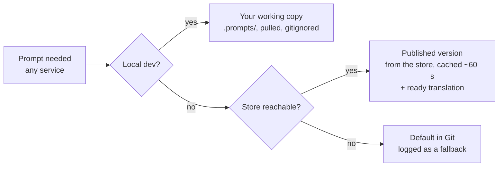

# Prompt Store: one source for prompts across the monorepo

Oct 24, 2026 · @Gopikrishnan S · Status: Draft for review

## Summary

The prompt store (Skills Store, backed by ally-be's `prompts` tables) is the single source of truth for every prompt. Once a prompt exists there, the store holds the only editable copy. Git holds each prompt's contract (the variables code supplies and the output shape it parses) plus a minimal default body that CI keeps working with the current code. The default creates the prompt on its first deploy and is the fallback, never the IP version.

Developers `prompts pull` the latest versions into a gitignored working copy, edit and test locally, then `prompts push` a new version straight to the store, never through Git. A push is rejected if the store has moved on since your pull, the same way `git push` rejects a non-fast-forward. All three services then read the store by one rule. This follows the registry-first model used by LangSmith and Langfuse; the Git-first model (Humanloop, Braintrust) needs a private repo, and ours is public.

## Decisions

Decided on 2026-10-24 by Gopi.

| Question | Decision |
| --- | --- |
| Build now? | Yes. All phases are built and tested end to end locally, in one branch and one PR, before anything ships |
| Does a CLI push go live immediately? | No. A push creates a draft (candidate); publishing is a separate step in the Skills Store |
| What happens when a translation fails? | Report the failure and keep serving English for that language. Retry from production with the per-language Retry |
| Who gets keys? | "System Skills" is renamed **Skills Store**. Anyone with Skills Store access can generate a key there, share it (including with contractors) and revoke it |
| Are experiments running? | None, so the cutover needs no pause |
| Where do contracts live? | **In code**, as typed declarations next to the code that fills each prompt: `definePrompt` in ally-be, a Pydantic model per prompt in ally-ai and ally-ai-learn. Not in `.meta.json` sidecars. The file style can be revisited after the build |
| What stays in Git? | Only each prompt's base version (a minimal default) and its contract. IP is a concern, so the defaults are cut down to minimal bases as the last step of the branch; updates never reach Git |
| Must a v2v run pass before a translated prompt is published? | No |
| Do DB-only prompts get a default and contract in Git? | Migration-seeded ones yes; dashboard variants no |
| Should CI make a cheap model call per structured default? | Yes: one call per prompt whose contract says `output: json` (the code parses free text), checking the answer parses. Prompts whose JSON the provider enforces are `output: structured` and need no call |
| Resolver cache TTL | 60 s |
| Is a diff in the Skills Store enough review? | Yes, no second approver |
| Which judges carry the prompt hash? | All of them, through the session record: every judge row links to a session (directly, or through `kb_retrievals.session_id`), and every session records each prompt's version and content hash. Chosen per Stacks' "Instrument Only What Tests Current Assumptions" and "Validate Prompt and Tool Changes Through Multiple Testing Stages" |

The phases below describe the order of work; they no longer imply separate releases.

## Problem

The prompts we actually run are our IP. They should live in Skills Store, while GitHub (now a public monorepo) holds only contracts and minimal defaults. The intended lifecycle: build and test a prompt locally, deploy so it reaches production automatically, then make every later edit against the latest version, from the dashboard or from local. Three things break that today.

1. **Local can't use production prompts.** There is no way to run evals or tests locally against what Skills Store serves, so improvements are tested against the wrong text.
2. **Stale prompts fail unrelated features.** When testing one feature locally, other prompts run from out-of-date files or local rows. A failure may come from them, and we wrongly conclude the feature is broken.
3. **Each service resolves prompts differently.** The monorepo lets us treat ally-be, ally-ai and ally-ai-learn as one setup with one prompt store, but nothing enforces that yet.

**Goals**

- One editable copy of every prompt's real text: the latest version in the store.
- One resolution rule: every service serves the store's published version.
- A new local setup gets the latest production prompts with one command.
- Prompts edited locally reach production with one command, without the text ever entering Git.
- New prompts still reach production by deploying their default.
- Code changes can't silently break a prompt: the default in Git and the live version in the store always satisfy the code's current contract.
- Every run records which prompt version and text ran.

**Non-goals**

- Moving to a third-party prompt platform.
- Changing the Skills Store editing UI beyond showing the contract, labelling the default and showing version diffs.
- Putting full prompt text back into Git.

## Current state

The store exists: `prompts`, `prompts_versions` and `prompt_translations` in ally-be. What's missing is one rule for when a service uses it. A per-prompt boolean, `useDashboardOverride`, decides between the dashboard version and the service's own local file, and nothing flips it when someone edits in the dashboard.

| Service | Prompt files | How a running service gets dashboard text | Gap |
| --- | --- | --- | --- |
| ally-be | 64 `.txt` in `ally-be/src/prompts/`, synced at boot (`PromptsSyncService.onModuleInit`) | `getPromptByCode` (prompt-shared.service.ts:22): DB version if override is on, else reads the file from disk | Reads disk or the DB on every call, with no cache |
| ally-ai-learn | 30 `.txt` in `app/prompts/`, synced by `scripts/sync_prompts.py` from `start.sh` | Room metadata `prompts` dict from `getPromptsForScenarioSession` | Only override-on prompts are sent; everything else silently uses the local file (`[PROMPT_SOURCE] using LOCAL`) |
| ally-ai | 25 `.txt` in `app/prompts/`, synced from the Dockerfile CMD | Request payload from `AiService.getPromptOverrides()` | Sent under keys like `summary/summary`, but ally-ai looks up `ally_ai_summary_summary` (resolver.py:185). Only connected skills get the second key, so most dashboard edits never reach it |

What this adds up to, from the 2026-10-20 prod audit of 194 rows:

- 73 prompts run from the file, with the override off.
- 41 are overridden, but their file differs from the live text; 6 have file edits newer than live that never shipped.
- About 30 prompts exist only in the database, inserted by migrations or created as dashboard variants.

Other facts that shape the design:

- **Sync never overwrites a live version.** It refreshes `defaultPrompt` and metadata but never touches `prompts_versions`, `currentVersion` or `useDashboardOverride`.
- **There is no draft or staging concept.** The version at `currentVersion` is what's published, and it's only live while the override is on. Only the last 5 versions are kept.
- **No path from prod to local.** `GET /api/v1/prompts/by-codes` returns bodies only, with no versions, model settings or translations. No script pulls prompts from prod or seeds them locally.
- **Translations are checked against the English text.** One is served only when its `sourceHash` matches the current English body, which already gives us a reliable freshness check.

## Edge cases in the codebase

A sweep of every feature that touches prompts found 22 places where the design's assumptions don't hold yet. The three biggest gaps: version writes aren't atomic, some traffic bypasses the store, and nothing reliably records which version ran. The main findings were checked in code on 2026-10-24.

| # | Area | Finding | Where | Design response |
| --- | --- | --- | --- | --- |
| 1 | Writes | The version-write transaction ignores its manager, so read-latest, insert, pointer update and pruning each commit separately. Two saves at once both claim v(n+1); one gets a raw 500 | `prompt.service.ts:223` | Atomic compare-and-swap on `currentVersion` |
| 2 | Writes | The dashboard autosaves a version 700 ms after typing stops, compares against the text as it was when the panel opened, and treats any 409 as the Builder eval gate | `PromptSidePanel.tsx:63, 820, 908` | Explicit save carrying a base version; distinct conflict code |
| 3 | Writes | Experiment Apply writes the winner with no base check, overwriting human edits made since the last 5-minute tick | `skill-experiment.service.ts:391` | One writer API with base version |
| 4 | Writes | Builder eval publishes hours after its baseline with no base recorded, impersonating the suite creator | `builder-eval.service.ts:649-700` | Same; record the base at suite start |
| 5 | Writes | About 32 migrations write fixed version numbers with `ON CONFLICT DO NOTHING`; one edits a published version in place, another deletes versions | `1948…GlossaryAdjudicationPromptV3.ts:94`, `1780400000000-alignBlocklessPromptVersions.ts:55` | No prompt text in migrations |
| 6 | What ran | Judge version labels are code constants while the rubric is read from the DB, so a rubric edit puts two rubrics under one label and new results overwrite old | `ally-ai/app/core/config.py`, `rag-quality-analytics.service.ts:25` | Label derived from the rubric's version and hash |
| 7 | What ran | Model, provider, temperature and the per-language runtime model aren't versioned | `prompt.service.ts:176-192` | Version = body + settings + translations |
| 8 | What ran | Session `promptVersions` comes from a separate query from the shipped bodies; translations record the English version; V2V records none | `scenario-session.service.ts:706`, `scenario-shared.service.ts:843` | Record version and hash from the same response that ships the bodies |
| 9 | What ran | Analytics picks the first code containing `main_agent`; once all prompts are dispatched, `_copy_` variants match too | `drift-judge.repository.ts:280`, `weak-metrics-analytics.repository.ts:90` | Use `selectedMainPromptCode` everywhere |
| 10 | What ran | A selected variant that doesn't resolve falls back silently, and analytics still credit the variant | `ally-ai-learn/app/prompts/resolver.py:363` | Record the code that actually ran; alert on fallback |
| 11 | Bypass | The experiment router serves champion and challenger text directly, skipping the live version, translations and contracts | `skill-experiment-router.service.ts:78-125` | Challengers become candidate versions |
| 12 | Bypass | Always-from-disk reads: `ally_ai_shared_supervisor_note`, ally-ai `lru_cache`, ally-ai-learn import-time constants, branching functions without `prompt_data` | `ally-ai/app/prompts/resolver.py:165`, `scenario_report/service.py:118`, `chat_summary.py:77` | Every read through the resolver |
| 13 | Bypass | Helpline Copilot, WhatsApp inbound and the glossary have their own override checks; Copilot has its own cache | `helpline-copilot.service.ts:523`, `whatsapp-inbound.service.ts:769`, `language-glossary.service.ts:1913` | Same |
| 14 | Bypass | Prompt text outside the store | `lab_skills.system_prompt`, `reportGeneration.ts:45` in ally-web | Move into the store |
| 15 | Bypass | Text and model settings are fetched in separate lookups, so a refresh between them can pair different moments | `prompt-shared.service.ts:22, 122` | One lookup returns both |
| 16 | Contracts | `SafeFormatter` blanks a missing variable with a warning; the required-variable check is never called | `ally-ai-learn/app/prompts/resolver.py:134, 185` | Enforce required variables at render time |
| 17 | Contracts | ally-ai's allowed-variables parse expects strings but gets objects, so missing variables render as literal `{name}`; a format error returns the raw template | `ally-ai/app/prompts/resolver.py:123, 222` | Fix the parse; fail loudly |
| 18 | Contracts | Audio-tag guidance and the glossary are appended after templating, outside any contract | `ally-ai-learn/app/core/graph/prompt.py:809, 871` | Declare appended fragments in the contract |
| 19 | Lifecycle | Retention prunes from the newest version and deletes versions that translations and judge rows point at | `prompt-version.repository.ts:19` | Never prune live, candidate or referenced versions |
| 20 | Lifecycle | `isObsolete` is never read at runtime; renaming a file leaves the old code serving; a sync `name` collision aborts the rest of the sync | `prompt.service.ts:620, 665` | Codes are stable ids; obsolete stops serving |
| 21 | Lifecycle | The UI revert flips the override off while the endpoint creates a version from the default; revert, sync, duplicate and migrations never trigger translation | `PromptSidePanel.tsx:1087`, `prompt.service.ts:888` | One revert path through the writer API |
| 22 | Lifecycle | The Builder agent is told prompts "live as files in src/prompts", so its fix PRs (and Bug Hunter's) edit files that no longer ship | `builder-capabilities.constants.ts:88` | Point agents at `prompts push` |

One ordering hazard: retiring the override flag changes the resolved text for skills now on file text, which changes their hash and resets every live experiment once (`skill-experiment-engine.service.ts:211-228`). Pause experiments before Phase 0 ships.

## Industry practice

The major prompt platforms converge on one model: a registry is the runtime source, labels point at immutable versions, and code fetches by label. The sources are mostly vendor docs; we found no first-hand engineering posts from large product companies, so treat the details as informed opinion.

| Practice | What it means | Where |
| --- | --- | --- |
| Immutable versions + moving labels | Every save is a new version. `production` / `staging` labels point at one; moving the label is the deploy, moving it back is the rollback | [LangSmith](https://docs.langchain.com/langsmith/manage-prompts), [Langfuse](https://langfuse.com/docs/prompts), [Braintrust](https://braintrust.dev/docs/kb/promoting-prompts-across-environments-via-api-complete-workflow-for-dev-staging-and-production), [Humanloop](https://humanloop.com/docs/guides/organization/manage-deployment-environments) |
| Fetch by label, cache, fall back | Code asks for "production", never a hard-coded body. The SDK caches in memory (Langfuse: 60 s) and falls back to a bundled copy if the store is down. Local dev disables the cache | [Langfuse caching](https://langfuse.com/docs/prompt-management/features/caching) |
| Registry is the source of truth | Langfuse calls itself "the deployment source of truth"; Git is a mirror for history and review, fed by webhooks | [Langfuse at scale](https://langfuse.com/resources/engineering/prompt-management-at-scale.md), [GitHub integration](https://langfuse.com/docs/prompt-management/features/github-integration) |
| Version on every trace | Each generation links to its prompt version, so metrics and evals split by version. CI can block a promotion when scores drop | [Langfuse at scale](https://langfuse.com/resources/engineering/prompt-management-at-scale.md) |
| Protected promotion | Only owners can move `production` | [LangSmith](https://docs.langchain.com/langsmith/manage-prompts) |

The most common warning is two editable sources: when a prompt can be edited in both a repo and a dashboard, the two drift ([Agenta](https://agenta.ai/blog/git-vs-prompt-management-tools)). Our 41 drifted rows are exactly that.

Where we deliberately differ: the Git-mirror pattern would publish our real prompt text into a public repo. We keep the database as the only home of the real text, and pulled working copies stay gitignored.

## Proposal

Build the prompt store on ally-be's existing tables, with one resolver per runtime (TypeScript and Python) that every call site goes through.

### Resolution rule

Every service resolves a prompt the same way, in this order:

1. **Local working copy**, only in local dev: the `.prompts/` folder that `prompts pull` writes and you edit. It is gitignored.
2. **Published version** in the store: the version at `currentVersion`, for every prompt, with no override flag involved. Translations are layered on as today, served only when their `sourceHash` matches.
3. **Default in Git**, only when the store is unreachable, or before a brand-new prompt's first deploy. It is logged as a fallback, never used silently.

Production has no working copy, so every prompt comes from the store unless the store is down.

The resolver keeps an in-memory cache with a short TTL (about 60 s, as Langfuse does), so a dashboard publish reaches running services within a minute without a deploy. ally-ai-learn keeps receiving prompts in room metadata so the voice path adds no network hop, but that payload is built by the same resolver and includes every prompt, not only override-on ones.

Every resolution logs `code`, `version`, a short hash and the source (`local` / `store` / `fallback`). The hash goes on traces, judge rows and v2v reports, so any result can say which text produced it.

### Single source of truth: the store

`useDashboardOverride` is retired with no replacement. Editing a prompt in code that the dashboard has moved past is useless, so there is nothing to choose between: every prompt that exists in the store is served from the store. Each copy of a prompt has one job:

| Copy | Where | Editable | Its job |
| --- | --- | --- | --- |
| Latest version | Store (`prompts_versions`) | Yes: dashboard or `prompts push` | The only real text. What production serves |
| Working copy | Your laptop, `.prompts/` (gitignored) | Yes, locally | Pulled from the store; edit and test, then push |
| Contract | Git, in code: `definePrompt` (ally-be), a Pydantic model (ally-ai, ally-ai-learn) | Yes, in the same PR as the code change | The variables code supplies, the output shape it parses, a contract version |
| Default body | Git, `*/prompts/*.txt` | Yes, only to keep up with the contract | A minimal prompt that works with the current code. Creates the prompt on first deploy; last-resort fallback in ally-ai and ally-ai-learn; open-source default. It never overwrites an existing prompt's stored default |
| Stored default | Store, `prompts.defaultPrompt` | No | **Decided 2026-10-26:** the production text at the cutover (each prompt's current version), or a new prompt's first text. What Revert to default restores, and ally-be's fallback when a prompt has no usable version |

A deploy only creates prompts that don't exist yet; it never changes an existing prompt's live text. Editing a default to improve behaviour is pointless, because production never serves it. Improvements go to the store. The default only changes when the code's contract does.

### Contracts keep code and prompts compatible

A prompt's text belongs to the store, but its interface belongs to the code. When code starts passing a new `{placeholder}` or parses a different output, a stale default would break the fallback, new setups that haven't pulled, and open-source users. So the interface is versioned in Git as a contract, the same split [DSPy signatures](https://dspy.ai/learn/programming/signatures/) make between typed inputs and outputs in code and tuned instructions stored apart.

The contract is **declared in code**, next to the code that fills the prompt — `src/prompt/contracts/prompt-contracts.ts` in ally-be (`definePrompt`, which also gives each call site its typed inputs) and `app/prompts/contracts.py` in ally-ai and ally-ai-learn (one Pydantic model per prompt). Sync sends it to the store as JSON:

- **`required`**: placeholders the body must contain, because the code always supplies them and depends on them.
- **`variables`**: every placeholder the code supplies, once a contract is closed; `null` while it is open (the default), so only `required` is enforced.
- **`output`**: how the code reads the answer. `json` when it parses free text as JSON, so the text itself must ask for JSON; CI makes one cheap model call to check the default still answers in JSON (a `_system`/`_user` pair as one call). `structured` when the provider enforces the shape (`jsonMode`, `response_format`, `with_structured_output`), so the text needn't and no call is made.
- **`fragments`** (ally-ai-learn main agent): text appended after templating.
- **`contractVersion`**: bumped on any breaking change.

Three checks enforce it:

1. **CI checks the default.** It renders each default with the contract's variables and fails on a missing required variable or an unknown one. No LLM call is needed. A PR that changes a contract without updating its default can't merge.
2. **The store checks every new version.** `prompts push` and dashboard saves are rejected if the body drops a required variable or uses one the deployed code doesn't supply.
3. **The release checks live versions.** Before deploying code with a new `contractVersion`, the release checks each affected prompt's live version and stops, naming the prompt, if one doesn't satisfy the new contract.

Breaking changes are made in two steps, like a database migration ([parallel change](https://martinfowler.com/bliki/ParallelChange.html)):

1. **Expand.** Code starts supplying the new variable as optional, and the default is updated in the same PR.
2. **Update the live prompt.** Push a version that uses it; the store accepts it because deployed code supplies it.
3. **Contract.** Make it required or remove the old variable. The release check confirms no live version still depends on what was removed.

Most changes only add something, so step 1 is the whole change, and the live prompt adopts the new variable whenever someone next tunes it.

Contracts are also enforced when a prompt is rendered, not only in CI. A missing required variable fails the render loudly instead of becoming `""`, and ally-ai's allowed-variables parsing is fixed so it reads the object form ally-be sends. Fragments appended after templating (audio-tag guidance, the glossary) are declared in the contract, so a check can see the whole prompt that is sent.

### What a version is

A version is everything needed to reproduce what ran, and none of it changes after it's written:

- the English body;
- provider, model and temperature, moved from the `prompts` row onto the version;
- its translations, each with its own per-language runtime model.

Rolling back or moving the live pointer then restores the model settings the text was tuned for. A published version is never edited in place.

### One write path

Every writer goes through one ally-be endpoint that requires the base version it started from and swaps `currentVersion` atomically (`UPDATE … WHERE currentVersion = :base`), with the insert, pointer move and pruning in one real transaction. A stale base gets `409 stale base`, a code distinct from the Builder eval gate's refusal.

| Writer | Base it sends |
| --- | --- |
| Dashboard | The version the editor opened. Saving becomes an explicit action rather than a 700 ms autosave, and each save advances the editor's base |
| `prompts push` | The version in `.prompts/lock.json` |
| Experiment Apply | The version the experiment started from |
| Builder eval publish | The version live when the suite started, recorded on the suite |
| Revert | The current version; the UI and the endpoint use this one path |

Migrations no longer write prompt text. A new prompt arrives as a Git default through sync; a change to an existing prompt goes through the writer API. A CI check rejects migrations that touch `prompts_versions`.

### Recording what ran

The response that ships prompt bodies to a session also returns, for each prompt, the code that actually resolved, its version and its hash, and the translation hash when one was served. That record is written to the session as-is, instead of being re-queried separately. V2V sessions record it too.

- Analytics uses `selectedMainPromptCode` and that record, never a guess by code name.
- A selected variant that fails to resolve logs an error, records the fallback code, and alerts.
- Judge version labels come from the rubric's store version and hash, not a constant in ally-ai, so a rubric edit starts a new, correctly labelled series.

### Every read through the resolver

Disk reads (`ally_ai_shared_supervisor_note`, ally-ai's `lru_cache`, import-time constants, calls without `prompt_data`) and the private override checks in Helpline Copilot, WhatsApp inbound and the glossary all move onto the shared resolver. Lab skills' `system_prompt` and the ally-web `DEFAULT_HELPER_PROMPT` move into the store. One lookup returns text and model settings together.

### Experiments run inside the store

A challenger becomes a candidate version served to a share of traffic, instead of text held by the experiment router. Translations, contracts and the what-ran record then apply to experiment traffic automatically, and Apply is the same promotion as any other candidate.

### Retention and codes

- Retention never deletes the live version, any candidate, or a version that translations, sessions or judge rows reference. It prunes only unreferenced history beyond the limit.
- Prompt codes are stable ids. A rename goes through the store, a deleted Git default doesn't stop a live prompt, and an obsolete prompt stops serving instead of silently falling back.
- The Builder agent and Bug Hunter are told that prompts are changed with `prompts push`, not by editing files.

### Local development: pull, edit, push

One CLI, `prompts`, at the monorepo root, backed by two new ally-be endpoints (`GET /api/v1/prompts/export` and `POST /api/v1/prompts/:code/versions`) and protected by per-developer API keys.

| Command | What it does |
| --- | --- |
| `prompts pull` | Writes every prompt's latest version into `.prompts/<service>/<code>.txt`, with a `.prompts/lock.json` recording each code's version and hash. Also loads them into local Postgres so the local stack serves them |
| `prompts status` | Lists prompts you changed since the pull, and prompts that moved in the store since |
| `prompts diff <code>` | Your working copy against the store's latest |
| `prompts push <code>` | Creates a new version in the store from your working copy, sending the version you pulled as its base |

The workflow is pull, edit, run tests or v2v locally, push. A failing local test points at your change, because every other prompt is exactly what production serves.

### Version check on push

Every push carries the version it was based on, and the store accepts it only if that is still the latest version.

1. Store latest is v7, you pulled v7: the push becomes v8.
2. Someone saved v8 in the dashboard after your pull: the push is rejected with `409 stale base`, and the store's text is shown.
3. You run `prompts pull <code>`. If you have local edits, the CLI shows a three-way diff (your base, your edit, the new latest) to merge, then you push on top of v8.

A dashboard save uses the same check, so a dashboard edit can't silently overwrite a push either. `--force` exists only for an explicit rollback and is logged.

The resolver warns when `.prompts/` is older than about 24 hours, so a stale pull doesn't masquerade as a feature bug.

A pulled working copy is preferred over live calls from laptops to prod:

- **Repeatable.** An eval reads as "against prod as of 14:20, plus my two changes", even if someone edits the dashboard mid-run.
- **Offline.** Local keeps working when prod is down.
- **Safer.** Laptops don't need a production key in every service's env; only the pull script holds one.

### Translations

A push changes more than English. For `main_agent` and `branching` prompts with `translationEnabled`, a new English version triggers Gemini re-translation into hi, mr, ta and kn, and scenarios set to Multilingual for a language are served that translation. Hindi is now the largest share of turns, so this path matters as much as English.

**Today's behaviour, which the CLI would inherit:**

| Moment | What a Multilingual session in that language gets |
| --- | --- |
| New English version saved | Translation starts in the background (`maybeTriggerAutoTranslation`), about 8 s per language, one after another |
| Translation not yet ready | The English template, because `overlayTranslations` serves a translation only when its `sourceHash` matches the current English body. The per-language `runtimeModel` is dropped too, so the session also runs on the default model |
| Translation ready | The translated body and its runtime model |
| Translation failed (3 attempts, for example the placeholder guard rejected it) | English, indefinitely. Self-heal skips `failed` rows, and nothing raises an alert |

The fallback window is about half a minute per push. A failed translation turns it into a silent, lasting switch of every Multilingual session in that language to English.

**The local trap.** A local English test says nothing about the Hindi text, which is Gemini's rewrite made after the push and checked only for placeholders. Gemini isn't deterministic, so a translation made locally doesn't certify the one prod generates. And if you pull prod's translations, edit an English prompt in `.prompts/`, then run a Hindi Multilingual session, the hashes no longer match. The session quietly runs your English edit, and the test looks fine without ever touching Hindi text.

**What the design adds:**

1. **The live pointer moves only when the new English version and all its translations are ready (Phase 3).** A candidate version is translated first, and the live pointer moves only when every enabled language is `ready`. That removes the fallback window, and a failed language blocks promotion instead of quietly falling back.
2. **Test the translation prod will serve.** `prompts pull --candidate <code>` brings down the candidate's translations, so a local v2v run in Hindi tests the exact text that will go live.
3. **Make the window visible until Phase 3.** `prompts push` waits for translations and reports each language as ready or failed. `prompts status` lists stale and failed translations. A failed translation alerts instead of sitting silently.
4. **Make the fallback loud.** When a non-English session gets English because of a hash mismatch, the resolver logs a warning, locally and in prod, with the prompt code and language.
5. **Treat the translation prompt as high risk.** `agent_template_translation` is itself a prompt in the store, and editing it re-translates every translated prompt. Pushing it requires a v2v run in at least Hindi.

What counts as one prompt version in this design is the English body plus its translations.

### Protecting the IP

- Real text lives only in the store. Git holds contracts and minimal defaults written to be safe to publish. Defaults change only to keep up with the contract, never to match live text.
- `.prompts/` is gitignored, and a CI check rejects any commit that adds files from it.
- Push goes to the store over HTTPS, so pushing a prompt never creates a commit, branch or PR.
- API keys are per developer and revocable. Pull keys are read-only, push needs a separate scope, and every export and push is logged with the key that made it.

## Rollout plan

Four phases, each shippable on its own. Phase 0 must land first: until every service reads the store by the same rule, pulling production prompts changes nothing for ally-ai or for file-backed learn prompts.

### Phase 0: one resolution rule

**Prerequisites.** These land before dispatch is widened, because widening makes each of them worse (edge cases 1–22):

- [ ] Atomic version writes: compare-and-swap on `currentVersion`, with insert, pointer and pruning in one real transaction (1).
- [ ] One writer API requiring a base version; the dashboard, experiment Apply, Builder eval publish and revert all moved onto it; distinct `409 stale base` code (2–4, 21).
- [ ] Dashboard: explicit save instead of 700 ms autosave, and the editor advances its base after each save (2).
- [ ] Model, provider and temperature stored on the version (7).
- [ ] What-ran record returned with the shipped bodies and written to the session, including V2V and translation hashes (8).
- [ ] Analytics and judges use `selectedMainPromptCode` and the record instead of the `main_agent` name guess (9).
- [ ] Variant fallback recorded and alerted (10).
- [ ] Judge version labels derived from the rubric's version and hash (6).
- [ ] Required variables enforced at render time; ally-ai allowed-variables parse fixed (16, 17).
- [ ] Retention protects live, candidate and referenced versions (19).
- [ ] Disk reads and private override checks moved onto the resolver; one lookup for text and settings (12, 13, 15).
- [ ] Live experiments paused for the Phase 0 cutover, since retiring the flag resets them once.

**Then:**

- Shared resolver in TypeScript (ally-be) and Python (ally-ai, ally-ai-learn), with the cache, fallback and source logging.
- ally-ai-learn: `getPromptsForScenarioSession` sends every `ally_ai_learn_*` prompt, not only override-on ones.
- ally-ai: `getPromptOverrides` sends entries under the full `ally_ai_*` code that ally-ai looks up.
- Before widening either, settle every row whose file and store disagree, so the store holds the right text:
  - File-backed rows: **decided 2026-10-26, what production runs today becomes the live version**, so no prompt's running text changes. Production's code served an override-off row's file text, not its store version. In production (read 2026-10-26) 98 of 124 such rows hold the same text in both; for the other 26 the migration publishes the served file text as a new version (for example `bug_hunter_decide`: the 5317-char file it runs, not its 2665-char v1, which stays in history). Migration `1980150000000` snapshots the prompt tables first.
  - 41 overridden rows with a different file: the store wins. For the 6 with newer, unshipped file edits, decide row by row.
- Retire `useDashboardOverride` once every service ignores it.

**Done when:** `PROMPT_SOURCE` logs show `store` for every prompt in all three services, and a v2v run reports a version hash per prompt, every prerequisite is checked off, and two simultaneous saves produce one version and one 409.

### Phase 1: pull and push CLI

- `GET /api/v1/prompts/export` and `POST /api/v1/prompts/:code/versions` with a base-version check (`409 stale base`). The dashboard save gets the same check.
- Skills Store keys, generated and revoked in the admin dashboard by anyone with Skills Store access, with separate pull and push scopes.
- The `prompts` CLI: `pull`, `status`, `diff`, `push`, with a three-way merge on a stale base.
- `prompts push` waits for translations and reports each language as ready or failed; `prompts status` lists stale and failed translations.
- An alert when a translation ends `failed`.
- Resolver warning, locally and in prod, when a non-English session falls back to English on a hash mismatch.
- Local resolver reads `.prompts/`, plus the staleness warning.
- CI check against committing `.prompts/`.

**Done when:** a fresh local stack, after one pull, serves byte-identical prompts to production (checked by hash). A prompt edited locally and pushed appears as a new version in Skills Store, and a push from a stale base is rejected.

### Phase 2: contracts and defaults

- Sync creates prompts that don't exist yet and refreshes metadata; it no longer refreshes the body of an existing prompt, and no longer overwrites a dashboard `name`.
- Declare each prompt's contract in code: `variables` (required/optional), `output`, appended `fragments`, `contractVersion`, and the Skills Store details (name, description, category, labelled variables) that the `.meta.json` sidecars used to hold. Built as typed declarations; the sidecars are gone.
- Cut each default down to a minimal, publishable body that satisfies its contract. Only after the store holds the full text (Phase 0).
- CI check 1: render every default against its contract.
- Store check 2: reject pushes and dashboard saves that break the deployed contract.
- Release check 3: block a deploy whose new `contractVersion` a live version doesn't satisfy.
- CI check: migrations may not write `prompts_versions`.
- Stable codes: renames go through the store; an obsolete prompt stops serving; a deleted Git default never disables a live prompt.
- Move Lab skills' `system_prompt` and ally-web's `DEFAULT_HELPER_PROMPT` into the store.
- Update Builder and Bug Hunter instructions to change prompts with `prompts push`, not by editing files.
- Skills Store shows the contract (required variables, output schema) beside the editor, and labels the Git copy "Default" next to Revert to default.

**Done when:** every prompt has a contract; a PR that changes a contract without its default fails CI; and a release that would break a live prompt stops before deploying.

### Phase 3: push improvements back from local

- Separate the live pointer from the newest version, so a pushed version can exist without being served.
- `prompts push --candidate <code>` creates such a version with the local eval or v2v results attached.
- A candidate is translated before promotion, and the live pointer moves only when every enabled language is `ready`. English and its translations go live together; a failed language blocks promotion.
- `prompts pull --candidate <code>` brings down the candidate's translations, so local v2v in Hindi tests the exact text that will go live.
- Skill experiments use candidates: a challenger is a candidate version served to a share of traffic, and Apply is a promotion. The router stops holding prompt text.
- Builder eval runs against a candidate and publishes by promoting it.
- Promotion happens in Skills Store, guarded by the existing Builder eval gate where it applies.
- This also covers code and prompt changing together: push a candidate that uses a new placeholder, deploy the code, then promote.
- Keep each version's translations with it, since today `prompt_translations` holds only one live row per prompt and language.

**Done when:** a prompt improved locally can be pushed, evaluated and promoted without going live early, and no Multilingual session ever gets English because a translation wasn't ready.

### Risks

| Risk | Mitigation |
| --- | --- |
| Widening dispatch in Phase 0 switches on stale dashboard edits | Row-by-row reconciliation before widening |
| Retiring the override flag resets every live skill experiment | Pause experiments for the cutover; resume after hashes settle |
| Analytics mis-attributes versions once all prompts are dispatched | What-ran record and `selectedMainPromptCode` land before widening |
| Two writers save at once | Atomic compare-and-swap; the loser gets `409 stale base`, never a 500 |
| A push overwrites a newer dashboard edit | Base-version check on every writer; `--force` only for logged rollbacks |
| Multilingual sessions get English while a translation is pending | Until Phase 3: push waits and reports, fallback logged as a warning. Phase 3: English and translations go live together |
| A failed translation leaves a language on English indefinitely | Alert on `failed`; Phase 3 blocks promotion on any failed language |
| An English-only local test passes while the translation is broken | `prompts pull --candidate` to test the real translation; v2v in Hindi for translated prompts and for any change to `agent_template_translation` |
| Code changes leave the Git default broken | CI renders every default against its contract; contract and default change in the same PR |
| Code changes break the live prompt | Store rejects bodies that break the deployed contract; render-time required-variable check; release check before any `contractVersion` bump |
| Prompt changes lose PR review | Diff in Skills Store and `prompts diff`; Builder eval gate where it applies |
| Store outage at boot leaves services with no prompts | Defaults as logged fallback; resolver pre-fetches at startup |
| Cache delays a hotfix by up to one TTL | TTL around 60 s; a manual cache-bust endpoint for emergencies |
| A key leaks real prompt text | Per-developer keys, read-only pull scope, revocable, logged |

## Alternatives considered

| Option | Why not |
| --- | --- |
| Git first: prompt files are the truth, CI syncs them to the store (Humanloop, Braintrust) | Every pushed prompt would be published in our public repo, and dashboard editing would have to round-trip through PRs |
| Ownership field: repo-owned until the first dashboard edit | Two editable copies by design. Once the dashboard takes over, file edits are silently useless, which is the problem we have today |
| Frozen Git files with no contract | Code keeps moving, so frozen defaults stop matching it. The fallback, un-pulled setups and open-source users all break |
| Adopt Langfuse or LangSmith as the store | We already have versions, translations with hash checks, per-prompt model settings, the Builder eval gate and the Skills Store UI. A vendor store makes two stores, puts the IP with a third party, and adds a hop to the voice path |
| Local services call production live instead of pulling | Results change if someone edits mid-eval, local breaks when prod is down, and every laptop needs a prod key in every service's env |

## Implementation status

Built on branch `feat/skills-store` (one PR, ally-be + ally-web + ally-ai + ally-ai-learn + CI), tested end to end locally on 2026-10-24. Where the build differs from the plan above:

| Plan | Built | Why |
| --- | --- | --- |
| Local services read the pulled `.prompts/` folder | The local store is the working copy: `prompts pull --into-local` / `apply-local` load production's text (and your edits) into local ally-be through an import endpoint enabled only locally | One resolution rule everywhere, no per-service file-reading path |
| Translations re-keyed per version | Translations are keyed by the English text's hash, so a draft is translated beside the live rows | Same effect with no version column; hashes are what sessions record |
| Retention protects referenced versions | Keeps the live version, every draft, and 20 published versions below live | Sessions record content hashes, so a pruned version stays identifiable |
| Judge labels derived from the rubric | Publishing a judge rubric requires confirming its pinned label was bumped | Re-labelling automatically would make the backlog drainer re-judge every session |
| Experiments' challengers as candidate versions | Apply goes through the write path with a base check and contract; challengers stay in the experiment router | A store version per drafted variant would flood history; tracked as follow-up |

Verified locally: migration on the local DB (29 file-served prompts published, all 152 served from the store); CLI pull/status/diff/push, stale-base refusal and three-way merge; publishing from the Skills Store; translation gate (pending → 409, ready → live); key generation; release check (pass and a deliberate failure); a v2v voice session with every prompt served from the store and the session recording each prompt's version and hash.

**Base versions in Git.** The defaults were cut to minimal bases as the last step: ally-be 207k → 70k characters (64 defaults, plus 8 new defaults with contracts for the migration-seeded prompts that code runs), ally-ai 58k → 21k, ally-ai-learn 44k → 17k. Every placeholder, output format and parser-checked marker is kept. 88 prompts have their answer parsed as JSON: 13 parse free text (`output: json`, and the structured check passes on all of them), 75 rely on provider-enforced JSON (`output: structured`).

**Deploy order (required).** Deploy **ally-be first**, then the admin dashboard, then ally-ai and ally-ai-learn. ally-be's migrations snapshot the prompt tables (`1980150000000`), make what production runs today each prompt's live version and stored default, and only then does sync run (it never overwrites an existing prompt's text or default). The ally-ai and ally-ai-learn release workflows enforce the order: a `require-skills-store` job blocks their deploy until production ally-be serves the Skills Store. Before deploying, run `scripts/prompts/migration-preview.sql` read-only against production: it lists the file-backed prompts whose served file text gets published as a new version, and any row with no usable version. No prompt's running text changes.

**After deploying:** Revert to default restores the production text from the cutover (the stored default), never the minimal Git base; the Git files only seed new prompts and are the last-resort fallback inside ally-ai and ally-ai-learn; a fresh local stack needs `prompts pull --into-local` to run on production's text.

## Open questions

All earlier questions are decided (see Decisions). Left for the review:

- [x] Output markers confirmed against every call site: 88 prompts are parsed as JSON (13 `json`, 75 `structured`); 3 marked prompts with no caller were unmarked.
- [x] WhatsApp replies now record the Skills Store version and content hash of each knowledge prompt sent to ally-ai (`wa_messages.retrieval_meta.prompt_versions`/`prompt_hashes`).
- [x] Contracts tightened from the call sites: 93 variables are now `required` (ally-be 60, ally-ai 22, ally-ai-learn 11) where every caller always supplies a non-empty value the prompt depends on; 8 in the ally-ai-learn main-agent prompts that were required but not always supplied (`competency`, the seven working-memory sections) are optional again; `role_instructions` stays required, since main-agent text without it drops the scenario's role. Everything else stays optional; contracts stay open.
- [x] Unused prompts removed: migration `1980750000000-RemoveUnusedPrompts` deletes 26 rows nothing runs (V2V tester and harness prototypes, Builder guidance rows, `roleplay_copilot_*`, `roadmap_opportunity_interview`, `roadmap_release_notes`, ally-ai's two `simulation_analysis` prompts), checked read-only against production on 2026-10-24; the four with Git defaults lose them too. It skips any row a scenario selects or an experiment points at. `ally_ai_learn_system_main_agent_prompt_working_memory` stays: a scenario selects it as its main prompt.
- [x] Fixed in the build: a never-published version now lists as a draft wherever it sits, not as "Earlier".

## Sources

- [LangSmith: manage prompts](https://docs.langchain.com/langsmith/manage-prompts)
- [LangSmith: manage prompts programmatically](https://docs.langchain.com/langsmith/manage-prompts-programmatically) (push and pull)
- [Langfuse: prompt management](https://langfuse.com/docs/prompts)
- [Langfuse: caching](https://langfuse.com/docs/prompt-management/features/caching)
- [Langfuse: prompt management at scale](https://langfuse.com/resources/engineering/prompt-management-at-scale.md)
- [Langfuse: GitHub integration](https://langfuse.com/docs/prompt-management/features/github-integration)
- [Humanloop: store prompts in code](https://humanloop.com/docs/guides/prompts/store-prompts-in-code)
- [Humanloop: deployment environments](https://humanloop.com/docs/guides/organization/manage-deployment-environments)
- [Braintrust: CLI](https://braintrust.dev/docs/reference/cli/overview)
- [Braintrust: promoting prompts across environments](https://braintrust.dev/docs/kb/promoting-prompts-across-environments-via-api-complete-workflow-for-dev-staging-and-production)
- [Agenta: Git vs prompt management tools](https://agenta.ai/blog/git-vs-prompt-management-tools)
- [DSPy: signatures](https://dspy.ai/learn/programming/signatures/)
- [BAML](https://docs.boundaryml.com/) (prompts as typed functions)
- [Martin Fowler: parallel change](https://martinfowler.com/bliki/ParallelChange.html)
- Codebase facts are from `HelloAllyTech/ally-platform` as of 2026-10-24. Prompt counts are from the 2026-10-20 read-only prod audit.
