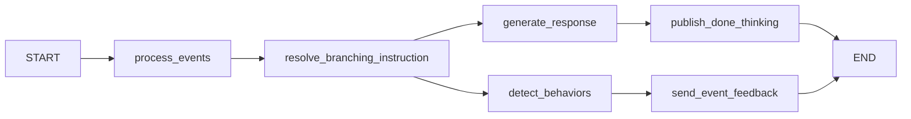
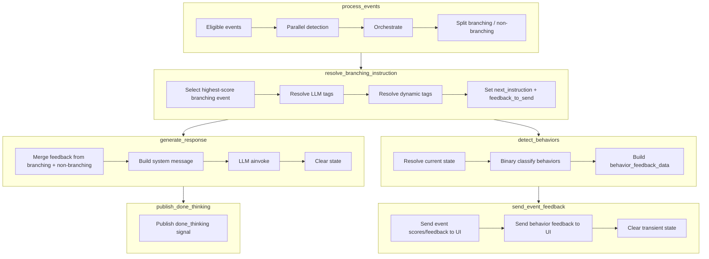

# Graph Pipeline

**Purpose.** This document describes the LangGraph pipeline: the `SimulationState` model, the six graph nodes (including parallel execution), subgraph design, report graph, and data flow.

---

## Overview

The conversation pipeline is a LangGraph `StateGraph` with six nodes. After `resolve_branching_instruction`, execution **fans out** to `generate_response` and `detect_behaviors` in parallel, then **fans in** before `send_event_feedback`:



Two nodes (`resolve_branching_instruction` and `retrieve_knowledge`) are wrapped in **subgraphs** to prevent their internal LLM calls from being streamed to the user. See [Architecture](architecture.md) for the rationale.

Every model call a node makes (and every call in a task a node spawns) records its usage to
`llm_usage` under the room `instrumented_node` sets from the run's config -- the subgraph wrapping
does not lose it. `retrieve_knowledge`'s title selector records as `knowledge_retrieval`, and passes
the room explicitly to its detached refresh (`KNOWLEDGE_RETRIEVAL_ASYNC`). See
[Queue Messaging](11-queue-messaging.md) for the label list.

## SimulationState

`SimulationState` is a Pydantic `BaseModel` that serves as the typed state for the graph. Each field has an associated **reducer** that controls how updates are merged.

| Field | Type | Reducer | Description |
|-------|------|---------|-------------|
| `messages` | `List[AnyMessage]` | `add_messages` (LangGraph built-in) | Conversation messages |
| `permitted_events` | `List[BaseEvent]` | `add_permitted_events` | Events allowed for detection (deduplicated by event_id) |
| `events_accumulator` | `List[Tuple[str, BaseEvent]]` | `add_events_accumulator` | Historical detected events with timestamps (deduplicated) |
| `new_events` | `List[BaseEvent]` | `add_new_events` | Events detected in the current turn (replaced each turn) |
| `current_score` | `int` | `add_scores` | Cumulative score (replaced each turn) |
| `branching_and_feedback_data` | `List[BranchingAndFeedbackData]` | `add_branching_and_feedback_data` | Branching events for sequential processing |
| `non_branching_feedback_data` | `List[BranchingAndFeedbackData]` | `add_non_branching_feedback_data` | Non-branching events (async, no blocking) |
| `next_instruction` | `Optional[str]` | `replace_next_instruction` | Resolved branching instruction text for the LLM |
| `feedback_to_send` | `Optional[EventFeedback]` | `replace_feedback_to_send` | Feedback selected for UI delivery |
| `behavior_feedback_data` | `List[BehaviorInstructionFeedbackData]` | `add_behavior_feedback_data` | Behavior detection results (from detect_behaviors) |
| `advancing_behaviour_ids` | `List[str]` | `replace_advancing_behaviour_ids` | SHOULD_DO behaviour ids that advanced the score this turn, snapshotted by `resolve_branching_instruction` from `behavior_feedback_data` before `send_event_feedback` clears it. Read by `update_working_memory`, which runs after `behavior_feedback_data` has already been cleared. |

### Key Data Classes

**`EventFeedback`** -- UI feedback payload:
- `emoji`: display emoji
- `message`: feedback text
- `show_feedback`: visibility flag

**`BranchingAndFeedbackData`** -- unified event data:
- `branching_instruction`: `BranchingInstruction` object (for LLM guidance)
- `feedback`: `EventFeedback` object (for UI display)
- `score`: event score (for priority selection)
- `event_id`: event identifier

**`BehaviorInstructionFeedbackData`** -- behavior detection result:
- `behavior_instruction_id`: ID from core service
- `score`: score for this behavior instruction
- `category`: `SHOULD_DO` or `SHOULD_NOT_DO`

## Node 1: process_events

**File:** `app/core/graph/nodes.py:process_events`

This node detects events and updates the registry. Steps:

1. **Prepare context** -- convert messages to `ChatMessage` list, calculate elapsed time and live score
2. **Detect events** -- run `detect_event()` on all eligible events **in parallel** using `asyncio.create_task()`, with a 10-second timeout per event
3. **Orchestrate** -- call `EventOrchestrator.orchestrate_events()` which updates the registry, evaluates combination expressions, sends events to Core (SQS), and handles termination
4. **Split events** -- separate detected events into branching (have `branching_instruction`) and non-branching (feedback only)
5. **Calculate score** -- sum direct event scores and additional scores from triggered events
6. **Build state update** -- return updated state dict

### Event Eligibility

Before detection, each event is checked against:
- **Time window**: `start_time` <= elapsed <= `end_time`
- **Score window**: `min_score` <= current_score <= `max_score`
- **Cooldown**: time since last occurrence >= `min_gap_time`
- **Max occurrences**: occurrence count < `max_occurrences`

## Node 2: resolve_branching_instruction (subgraph)

**File:** `app/core/graph/nodes.py:resolve_branching_instruction`

This node resolves branching instructions that guide the LLM response. Steps:

1. **Select highest-score branching event** from `branching_and_feedback_data`
2. **Resolve LLM response tags** -- if the instruction contains `<llm_response(...)>` tags, call the LLM to generate content (blocking)
3. **Resolve dynamic tags** -- substitute `<last_helper_utterance>` and `<chat_summary>` from conversation history
4. **Select feedback** -- pick the selected branching event's feedback for UI
5. **Snapshot advancing behaviours** -- capture the SHOULD_DO ids from `behavior_feedback_data` into `advancing_behaviour_ids`, since this is the last point before the graph fans out to `send_event_feedback`, which unconditionally clears `behavior_feedback_data`

Returns `next_instruction`, `feedback_to_send`, and `advancing_behaviour_ids`.

The two substitution calls record their tokens to `llm_usage` as `branching_instruction` and
`branching_chat_summary`.

## Node 3a: generate_response

**File:** `app/core/graph/nodes.py:generate_response`

This node generates the AI client response. Steps:

1. **Merge feedback** -- if no branching feedback was selected, fall back to highest-score non-branching event feedback
2. **Build system message** -- `generate_system_message()` creates the system prompt from scenario `PromptData` and the resolved `next_instruction`
3. **Get LLM client** -- from config or create dynamically
4. **Generate response** -- `llm_instance.ainvoke(messages)` with system message prepended
5. **Clear state** -- reset `branching_and_feedback_data`, `non_branching_feedback_data`, `next_instruction`, and `feedback_to_send`

**Note:** UI feedback (score, emoji) is sent by `send_event_feedback`, not by this node. This separation allows the core nodes to be reused by the report graph without UI concerns.

### Per-turn simulation state (turn metrics)

After the system prompt is built, `generate_response` stamps the resolved
simulation state onto the turn-metrics record via
`turn_metrics.record(room, metadata={...})`:

| Key | Meaning |
|---|---|
| `stateId` | The resolved state's id, or `null` in branching mode where no scored state applies |
| `stateIndex` | Its position in `scenario.state_instructions` |
| `stateCount` | How many states the scenario defines |
| `stateIsTerminal` | True when the resolved state is the last one |
| `stateScore` | The cumulative score the resolution was made against |

States are score-windowed — `_resolve_current_state` picks the state whose
(`scoreLower`, `scoreUpper`) window contains the cumulative score — so the state
a turn ran in is a function of the score at that turn. Recording it per turn
makes conversational progression derivable downstream in SQL without a second
event stream: a state that differs from the previous turn's is an advance,
consecutive turns sharing one give time-in-state, no change across N turns is
"stuck", and a final turn sitting in the terminal state is a resolved session.

`stateIndex`/`stateCount` are carried because state ids are author-defined
strings whose order is not inferable downstream; "state 3 of 3" is what
separates arriving at the end from merely moving.

The write is wrapped in a `try/except` and shares `metadata` with the retrieval
and generation call sites — `turn_metrics.record` merges dicts rather than
last-writer-wins, so these keys cannot erase the glossary/retrieval ones.

### LLM timeout fallback

If the main LLM call in step 4 does not return inside `LLM_RESPONSE_TIMEOUT`
(30s), the turn still has to say something. The fallback line is resolved from
the session's language via `llm_timeout_fallback_line()`
(`app/core/fallback_lines.py`) rather than a hardcoded English sentence — a
non-English session hearing English at the exact moment something is already
going wrong was the single most jarring failure the graceful-failure audit
found, made worse by Indic TTS voices spelling untranslated Latin script out
letter-by-letter. Every non-English entry in that table is currently still the
English string pending a human translation; an unknown/absent language code
resolves to English, unchanged from the pre-existing behavior.

### Glossary word swaps on the reply

When room metadata carries `promptData.glossarySwaps` (ally-be: published one-word glossary rules
that a mechanical swap cannot break), the session's Agent is a `GlossarySwapAgent`
(`app/core/agent/factory.py`). Its `llm_node` rewrites whole words in the LLM stream **before**
LiveKit tees it into TTS and the transcript, so audio, transcript and judge see the same text;
the trailing partial word is held back until the next chunk (`app/core/agent/glossary_swap.py`,
one swapper per reply). `generate_response` applies the same swap to the `AIMessage` it returns
and to the pause re-speak line, so the actor's own history is colloquial too. Swaps are recorded
per turn as `turn_metrics.metadata.glossary_swaps` and logged as `[GLOSSARY_SWAP]`. No swaps are
sent → pass-through.

### System Prompt Modes

The system prompt has two modes:

- **With branching instruction**: minimal directive-focused prompt (the instruction guides the conversation direction)
- **Without branching instruction**: comprehensive prompt with full character details (name, age, context, personality, emotional needs, cultural context, speaking style, etc.)

In both modes a **text-chat** session (`Scenario.is_text_chat`) gets one more block,
`system/text_chat_guidance`, appended after the audio-tag guidance and before the rolling
summary: it re-frames the call-oriented prompt as texting. Voice sessions never carry it. See
[Text-Chat Roleplays](text-chat.md).

### Per-state dialogue length (`dialogueLength`)

A scenario state may carry `dialogueLength`: `short`, `medium` or `long`. `_build_behavior_prompt`
reads it off the active state (the score-band match, resolved only when the selected prompt has
states) and renders it
through `_format_dialogue_length_instruction` into a one-line `{dialogue_length_instruction}`
("Keep the response short." etc.), which `main_agent_prompt.txt` places just before "Generate the
next dialogue." Unset, unknown values, or no active state render an empty string, so prompts
without the placeholder — and states without the setting — behave exactly as before.

### `messages_to_send` shape and provider prompt caching

`generate_response` sends `messages_to_send = [system_message] + history` to the LLM. Because
OpenAI's automatic prompt caching only extends as far as the first byte that differs from a
previously-cached request (scanning from position 0), any volatile content inside `system_message`
— which always precedes `history` — caps the cache there and the growing, otherwise-static
conversation history behind it never gets cached.

`retrieved_context` is the fastest-churning volatile block (refreshes every
`KNOWLEDGE_RETRIEVAL_REFRESH_TURNS` turns). When `RETRIEVED_CONTEXT_DEFER_TO_SUFFIX` is `True`
(`app/core/config.py`), `generate_system_message()` returns `(system_message,
retrieved_context_message)` instead of a single message, and `generate_response` appends the
second element AFTER `history`:

```
messages_to_send = [system_message] + history + [retrieved_context_message?]
```

This lets the cache cover the entire static prefix + growing history, with only the small trailing
block ever volatile — instead of the whole history-caching value resetting on every
retrieved_context refresh. Branching turns (`next_instruction` set) always get `None` for the
second element — they swap templates every turn and bust the cache regardless, so there's nothing
to win there. `ragEnabled`-based gating (a simulation state blanking `retrieved_context`) is
preserved identically whether the flag is on or off — both paths deliver the gated
`effective_retrieved_context` that `_build_behavior_prompt` computes, never the raw parameter, and
`tests/unit/graph/test_prompt_with_retrieved_context.py` pins that in each mode. Default `True`;
see the setting's docstring for the rollout plan.

### Trainer-locked memories (`unlocksFromStateId`)

A Knowledge Source may carry `unlocksFromStateId`: the scenario state from which the client may
talk about it. `app/core/graph/knowledge_locks.py` owns the rule; the pipeline touches it in
three places.

- **`retrieve_knowledge`** drops locked sources before the title selector runs, so their content
  is never selected, cached or rendered. The lock resolves against the scenario's `states`
  whatever the selected prompt declares — it fails closed.
- **The session's high-water mark** (`RetrievedContextStore.unlocks`) makes unlocks sticky: once
  a state is reached, memories unlocked by it stay unlocked even if the score falls back. The
  set only grows, so a reused `retrieved_context` can never hold something now locked. When the
  mark rises, the reuse countdown is zeroed so a newly opened memory is selectable at once.
- **`generate_response`** passes the locked TITLES (never content) to the working-memory
  `{working_memory_withheld}` section as topics the client is not ready to discuss, and
  `update_working_memory` passes the same list to the internal-monologue panel. Prompts without
  working memory simply never see a locked memory.

An unlocked memory still has to be *selected*. The title selector frames Knowledge Sources as the
client's own memories, each shown with a short content preview, and asks which the client would
draw on to answer the counselor's latest message, including indirectly
(`_MEMORY_FRAMING` / `_MEMORY_RULE` in `knowledge_retrieval.py`). The earlier "directly relevant to
what is being discussed" wording recalled a family memory on 0/9 family questions with
gpt-4o-mini. Change that prompt only against
`tests/integration/test_knowledge_selector_live.py`, which scores the real model on a recorded
v2v conversation (`LIVE_OPENAI_API_KEY=... -m openai_api`).

Unset means always available. A lock naming a state that doesn't exist keeps the memory locked
and logs `[MEMORY_LOCK] ... unknown state`; ally-be rejects such a lock on save. Grep
`[MEMORY_LOCK] reached rung` to see a session's unlocks.

## Node 3b: detect_behaviors

**File:** `app/core/graph/nodes.py:detect_behaviors`

This node runs in **parallel** with `generate_response`. It detects counselor behaviors from `SimulationBehaviorInstruction` (SHOULD_DO / SHOULD_NOT_DO) defined in the scenario. Steps:

1. **Get behavior instructions** -- from scenario `behavior_instructions`
2. **Resolve current state** -- select `SimulationStateInstruction` based on score window
3. **Detect behaviors** -- for each instruction, run binary classification on the last counselor utterance
4. **Build feedback data** -- populate `behavior_feedback_data` with `BehaviorInstructionFeedbackData`

Results are consumed by `send_event_feedback`, which sends behavior scores to the UI and clears the state.

Each classification records its tokens to `llm_usage` as `behaviour_detection`.

## Node 4: publish_done_thinking

**File:** `app/core/graph/nodes.py:publish_done_thinking`

This terminal node on the reply path publishes the `done_thinking` AGENT_STATE
signal once `generate_response` has finished streaming the reply. It makes no LLM
calls, so it needs no subgraph isolation and streams nothing to TTS/UI.

ElevenLabs v3 voices stay expressive via inline audio tags emitted directly by
`generate_response` (the persona prompt carries the tag guidance); non-v3 voices
speak plain text with the provider's default voice parameters.

## Node 5: send_event_feedback

**File:** `app/core/graph/nodes.py:send_event_feedback`

This node runs after `detect_behaviors` (and the deferred-event branch) complete. It sends feedback to the UI and clears transient state:

1. **Send event feedback** -- cumulative score from ACTIVE events, emoji, message via LiveKit data channel
2. **Send behavior feedback** -- behavior instruction scores to UI
3. **Clear state** -- reset `branching_and_feedback_data`, `non_branching_feedback_data`, `feedback_to_send`, `behavior_feedback_data`

Kept separate from `generate_response` so the core nodes (process_events, resolve_branching_instruction, generate_response, detect_behaviors) can be reused by the report graph without UI concerns.

## Report Graph

**File:** `app/core/graph/graph_builder.py:build_report_graph()`

A separate graph for scenario report generation (N-turn text-only simulation). Reuses the core simulation nodes but omits:

- `publish_done_thinking` (LiveKit done_thinking signal)
- `send_event_feedback` (UI score/emoji feedback sending)

Flow: `START` → `process_events` → `resolve_branching_instruction` → [generate_response, detect_behaviors] (parallel) → `END`

Used by `ScenarioReportService` for webhook-based report delivery.

## Data Flow Diagram



## Graph Construction

The graph is built in `app/core/graph/graph_builder.py`:

```python
def build_simulation_graph() -> StateGraph[SimulationState]:
    graph = StateGraph(SimulationState)
    graph.add_node("process_events", process_events)
    graph.add_node("resolve_branching_instruction", build_resolve_branching_subgraph())
    graph.add_node("generate_response", generate_response)
    graph.add_node("detect_behaviors", detect_behaviors)
    graph.add_node("publish_done_thinking", publish_done_thinking)
    graph.add_node("send_event_feedback", send_event_feedback)

    graph.add_edge(START, "process_events")
    graph.add_edge("process_events", "resolve_branching_instruction")
    graph.add_edge("resolve_branching_instruction", "generate_response")
    graph.add_edge("resolve_branching_instruction", "detect_behaviors")
    graph.add_edge("generate_response", "publish_done_thinking")
    graph.add_edge("publish_done_thinking", END)
    graph.add_edge("detect_behaviors", "send_event_feedback")
    graph.add_edge("send_event_feedback", END)
    return graph
```

The sketch above is the reply path only. Four more nodes are wired in the
real builder, and the difference between them is *when* they are added:

| Node | Position | Added |
|---|---|---|
| `retrieve_knowledge` (subgraph) | fans out from `START`, joins at `sync_events_and_behaviors_node` | always |
| `update_working_memory` (subgraph) | after `publish_done_thinking` | **always** |
| `compact_history` (subgraph) | after `publish_done_thinking` | only when `ROLLING_SUMMARY_ENABLED` |

Both post-reply nodes sit strictly after `publish_done_thinking` — the reply
has fully streamed and the done-thinking signal is already out — and they are
parallel to each other, not chained: one records what was said, the other who
said it, and chaining would make working memory wait on the summarizer's gate
for no reason. When `ROLLING_SUMMARY_ENABLED` is false, `publish_done_thinking`
gets its own edge to `END` instead.

`update_working_memory` is unconditional as of the removal of
`CLIENT_WORKING_MEMORY_ENABLED`. It used to be added only when that env flag
was true, which was read at BUILD time against a graph compiled once at import
— so the flag could only be turned on by a restart, and a scenario correctly
pointed at a working-memory prompt on a worker built without it ran silently
without the feature. The opt-in is now the selected main-agent prompt's body:
the node returns immediately unless that prompt declares
`{client_working_memory}` or a `working_memory_*` section placeholder, so the
cost for every other simulation is one no-op node visit.

The working-memory updater also plans how the character STARTS its next reply
(`ProposedUpdate.delivery`, see [Turn Openers](turn-openers.md)): the filler and
the interim pieces. Scenarios without working memory get no plan — fillers and
pauses, plus the interim generator's line where it is enabled — so there is no
second planner node.

`generate_response` also appends one trailing system line when a filler or an
interim played this turn (`TurnDelivery.reply_note`): it names the filler, quotes
the interim, and tells the reply to continue straight on from it rather than
open with a second hesitation.

The updater passes the character's last few lines (`_recent_character_lines`)
and last turn's interim into `validate_delivery`, which skips an interim piece
that replays one of them and keeps the rest — in prod a holding line once
repeated a reply from two turns earlier word for word, and the same opening was
proposed turn after turn.

---

## Key Source Files

- `app/core/graph/graph_builder.py` -- `build_simulation_graph()`, `build_report_graph()`, subgraph builders
- `app/core/graph/nodes.py` -- `process_events`, `resolve_branching_instruction`, `generate_response`, `detect_behaviors`, `publish_done_thinking`, `send_event_feedback`
- `app/core/graph/state.py` -- `SimulationState`, reducers, data classes
- `app/core/graph/prompt.py` -- `generate_system_message()`
- `app/core/graph/utils.py` -- `is_event_eligible()`, `convert_messages_to_chat_messages()`
- `app/core/scenario/simulation_instructions.py` -- `SimulationBehaviorInstruction`, `SimulationStateInstruction`
