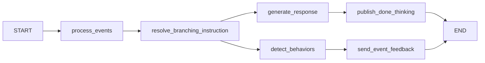
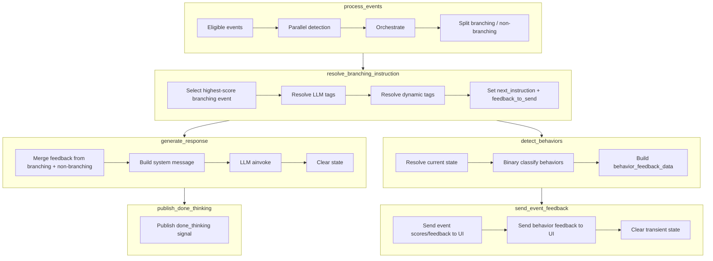

# Graph Pipeline

**Purpose.** This document describes the LangGraph pipeline: the `SimulationState` model, the six graph nodes (including parallel execution), subgraph design, report graph, and data flow.

---

## Overview

The conversation pipeline is a LangGraph `StateGraph` with six nodes. After `resolve_branching_instruction`, execution **fans out** to `generate_response` and `detect_behaviors` in parallel, then **fans in** before `send_event_feedback`:



Two nodes (`resolve_branching_instruction` and `retrieve_knowledge`) are wrapped in **subgraphs** to prevent their internal LLM calls from being streamed to the user. See [Architecture](architecture.md) for the rationale.

## SimulationState

`SimulationState` is a Pydantic `BaseModel` that serves as the typed state for the graph. Each field has an associated **reducer** that controls how updates are merged.

| Field | Type | Reducer | Description |
|-------|------|---------|-------------|
| `messages` | `List[AnyMessage]` | `add_messages` (LangGraph built-in) | Conversation messages |
| `permitted_events` | `List[BaseEvent]` | `add_permitted_events` | Events allowed for detection (deduplicated by event_id) |
| `events_accumulator` | `List[Tuple[str, BaseEvent]]` | `add_events_accumulator` | Historical detected events with timestamps (deduplicated) |
| `new_events` | `List[BaseEvent]` | `add_new_events` | Events detected in the current turn (replaced each turn) |
| `current_score` | `int` | `add_scores` | Cumulative score (replaced each turn) |
| `branching_and_feedback_data` | `List[BranchingAndFeedbackData]` | `add_branching_and_feedback_data` | Branching events for sequential processing |
| `non_branching_feedback_data` | `List[BranchingAndFeedbackData]` | `add_non_branching_feedback_data` | Non-branching events (async, no blocking) |
| `next_instruction` | `Optional[str]` | `replace_next_instruction` | Resolved branching instruction text for the LLM |
| `feedback_to_send` | `Optional[EventFeedback]` | `replace_feedback_to_send` | Feedback selected for UI delivery |
| `behavior_feedback_data` | `List[BehaviorInstructionFeedbackData]` | `add_behavior_feedback_data` | Behavior detection results (from detect_behaviors) |

### Key Data Classes

**`EventFeedback`** -- UI feedback payload:
- `emoji`: display emoji
- `message`: feedback text
- `show_feedback`: visibility flag

**`BranchingAndFeedbackData`** -- unified event data:
- `branching_instruction`: `BranchingInstruction` object (for LLM guidance)
- `feedback`: `EventFeedback` object (for UI display)
- `score`: event score (for priority selection)
- `event_id`: event identifier

**`BehaviorInstructionFeedbackData`** -- behavior detection result:
- `behavior_instruction_id`: ID from core service
- `score`: score for this behavior instruction
- `category`: `SHOULD_DO` or `SHOULD_NOT_DO`

## Node 1: process_events

**File:** `app/core/graph/nodes.py:process_events`

This node detects events and updates the registry. Steps:

1. **Prepare context** -- convert messages to `ChatMessage` list, calculate elapsed time and live score
2. **Detect events** -- run `detect_event()` on all eligible events **in parallel** using `asyncio.create_task()`, with a 10-second timeout per event
3. **Orchestrate** -- call `EventOrchestrator.orchestrate_events()` which updates the registry, evaluates combination expressions, sends events to Core (SQS), and handles termination
4. **Split events** -- separate detected events into branching (have `branching_instruction`) and non-branching (feedback only)
5. **Calculate score** -- sum direct event scores and additional scores from triggered events
6. **Build state update** -- return updated state dict

### Event Eligibility

Before detection, each event is checked against:
- **Time window**: `start_time` <= elapsed <= `end_time`
- **Score window**: `min_score` <= current_score <= `max_score`
- **Cooldown**: time since last occurrence >= `min_gap_time`
- **Max occurrences**: occurrence count < `max_occurrences`

## Node 2: resolve_branching_instruction (subgraph)

**File:** `app/core/graph/nodes.py:resolve_branching_instruction`

This node resolves branching instructions that guide the LLM response. Steps:

1. **Select highest-score branching event** from `branching_and_feedback_data`
2. **Resolve LLM response tags** -- if the instruction contains `<llm_response(...)>` tags, call the LLM to generate content (blocking)
3. **Resolve dynamic tags** -- substitute `<last_helper_utterance>` and `<chat_summary>` from conversation history
4. **Select feedback** -- pick the selected branching event's feedback for UI

Returns `next_instruction` (resolved instruction text) and `feedback_to_send`.

## Node 3a: generate_response

**File:** `app/core/graph/nodes.py:generate_response`

This node generates the AI client response. Steps:

1. **Merge feedback** -- if no branching feedback was selected, fall back to highest-score non-branching event feedback
2. **Build system message** -- `generate_system_message()` creates the system prompt from scenario `PromptData` and the resolved `next_instruction`
3. **Get LLM client** -- from config or create dynamically
4. **Generate response** -- `llm_instance.ainvoke(messages)` with system message prepended
5. **Clear state** -- reset `branching_and_feedback_data`, `non_branching_feedback_data`, `next_instruction`, and `feedback_to_send`

**Note:** UI feedback (score, emoji) is sent by `send_event_feedback`, not by this node. This separation allows the core nodes to be reused by the report graph without UI concerns.

### System Prompt Modes

The system prompt has two modes:

- **With branching instruction**: minimal directive-focused prompt (the instruction guides the conversation direction)
- **Without branching instruction**: comprehensive prompt with full character details (name, age, context, personality, emotional needs, cultural context, speaking style, etc.)

## Node 3b: detect_behaviors

**File:** `app/core/graph/nodes.py:detect_behaviors`

This node runs in **parallel** with `generate_response`. It detects counselor behaviors from `SimulationBehaviorInstruction` (SHOULD_DO / SHOULD_NOT_DO) defined in the scenario. Steps:

1. **Get behavior instructions** -- from scenario `behavior_instructions`
2. **Resolve current state** -- select `SimulationStateInstruction` based on score window
3. **Detect behaviors** -- for each instruction, run binary classification on the last counselor utterance
4. **Build feedback data** -- populate `behavior_feedback_data` with `BehaviorInstructionFeedbackData`

Results are consumed by `send_event_feedback`, which sends behavior scores to the UI and clears the state.

## Node 4: publish_done_thinking

**File:** `app/core/graph/nodes.py:publish_done_thinking`

This terminal node on the reply path publishes the `done_thinking` AGENT_STATE
signal once `generate_response` has finished streaming the reply. It makes no LLM
calls, so it needs no subgraph isolation and streams nothing to TTS/UI.

ElevenLabs v3 voices stay expressive via inline audio tags emitted directly by
`generate_response` (the persona prompt carries the tag guidance); non-v3 voices
speak plain text with the provider's default voice parameters.

## Node 5: send_event_feedback

**File:** `app/core/graph/nodes.py:send_event_feedback`

This node runs after `detect_behaviors` (and the deferred-event branch) complete. It sends feedback to the UI and clears transient state:

1. **Send event feedback** -- cumulative score from ACTIVE events, emoji, message via LiveKit data channel
2. **Send behavior feedback** -- behavior instruction scores to UI
3. **Clear state** -- reset `branching_and_feedback_data`, `non_branching_feedback_data`, `feedback_to_send`, `behavior_feedback_data`

Kept separate from `generate_response` so the core nodes (process_events, resolve_branching_instruction, generate_response, detect_behaviors) can be reused by the report graph without UI concerns.

## Report Graph

**File:** `app/core/graph/graph_builder.py:build_report_graph()`

A separate graph for scenario report generation (N-turn text-only simulation). Reuses the core simulation nodes but omits:

- `publish_done_thinking` (LiveKit done_thinking signal)
- `send_event_feedback` (UI score/emoji feedback sending)

Flow: `START` → `process_events` → `resolve_branching_instruction` → [generate_response, detect_behaviors] (parallel) → `END`

Used by `ScenarioReportService` for webhook-based report delivery.

## Data Flow Diagram



## Graph Construction

The graph is built in `app/core/graph/graph_builder.py`:

```python
def build_simulation_graph() -> StateGraph[SimulationState]:
    graph = StateGraph(SimulationState)
    graph.add_node("process_events", process_events)
    graph.add_node("resolve_branching_instruction", build_resolve_branching_subgraph())
    graph.add_node("generate_response", generate_response)
    graph.add_node("detect_behaviors", detect_behaviors)
    graph.add_node("publish_done_thinking", publish_done_thinking)
    graph.add_node("send_event_feedback", send_event_feedback)

    graph.add_edge(START, "process_events")
    graph.add_edge("process_events", "resolve_branching_instruction")
    graph.add_edge("resolve_branching_instruction", "generate_response")
    graph.add_edge("resolve_branching_instruction", "detect_behaviors")
    graph.add_edge("generate_response", "publish_done_thinking")
    graph.add_edge("publish_done_thinking", END)
    graph.add_edge("detect_behaviors", "send_event_feedback")
    graph.add_edge("send_event_feedback", END)
    return graph
```

---

## Key Source Files

- `app/core/graph/graph_builder.py` -- `build_simulation_graph()`, `build_report_graph()`, subgraph builders
- `app/core/graph/nodes.py` -- `process_events`, `resolve_branching_instruction`, `generate_response`, `detect_behaviors`, `publish_done_thinking`, `send_event_feedback`
- `app/core/graph/state.py` -- `SimulationState`, reducers, data classes
- `app/core/graph/prompt.py` -- `generate_system_message()`
- `app/core/graph/utils.py` -- `is_event_eligible()`, `convert_messages_to_chat_messages()`
- `app/core/scenario/simulation_instructions.py` -- `SimulationBehaviorInstruction`, `SimulationStateInstruction`
