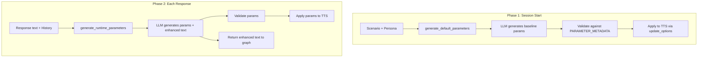
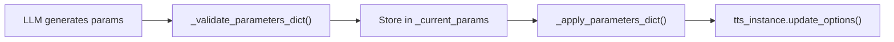

# Speech Prosody

**Purpose.** This document describes the speech prosody system: how voice expression parameters are generated, validated, and applied to TTS providers, and how text enhancement works.

---

## Overview

The speech prosody system generates voice expression parameters (speed, pitch, tone, etc.) and enhanced text (SSML tags, etc.) to make the AI client sound natural and emotionally appropriate. It operates in two phases:

1. **Default generation** -- at session start, generates baseline parameters from the persona description
2. **Runtime generation** -- for each response, generates parameters and enhanced text based on conversation context

Both phases use an LLM to determine appropriate voice expression.

## Architecture



## SpeechProsodyService

**File:** `app/speech_prosody/service.py`

The main orchestrator for prosody generation:

```python
class SpeechProsodyService:
    def __init__(self, tts_client: BaseTTSClient): ...

    async def generate_and_set_defaults(self, scenario, llm_client): ...
    async def generate_and_apply_runtime(self, response_text, llm_client, ...): ...
    def get_current_parameters(self) -> Dict[str, Any]: ...
    def get_default_parameters(self) -> Dict[str, Any]: ...
```

### generate_and_set_defaults()

Called once during `AgentWorker.configure()`:

1. Gets `PARAMETER_METADATA` from TTS provider
2. If provider has no metadata, skips (e.g., Deepgram)
3. Calls `generate_default_parameters()` with scenario and metadata
4. Validates the LLM-generated dict against metadata
5. Stores as `_default_params` and `_current_params`
6. Applies to TTS via `_apply_parameters_dict()`
7. On failure, falls back to safe defaults from metadata

### generate_and_apply_runtime()

Called for each response via `generate_and_apply_prosody_for_message()` from the `apply_voice_expressions` graph node:

1. **Skip when under pressure** (optional): If response is too short, too long, or events were detected this turn, skip the prosody LLM call and keep last params. Reduces latency; see "Skip thresholds" below.
2. Gets `PARAMETER_METADATA` and `TEXT_ENHANCEMENT_METADATA` from TTS provider
3. Calls `generate_runtime_parameters()` with response text, conversation history, persona context, current parameters, and `backend_prompts` (from `scenario.prompt_data.prompts`)
4. The LLM returns both parameters and enhanced text in a single call
5. Validates parameters, applies to TTS
6. Returns enhanced text (or `None` if provider does not support text enhancement)

**Persona context** is extracted by `extract_persona_context_from_prompt_data()` and includes: `personality`, `tone`, `emotional_needs`, `starting_state`, `context`, `cultural_context`, `speaking_style`. These fields shape the prosody generation.

### Skip thresholds (when under pressure)

When skipped, TTS keeps `_current_params` from the last turn (no fallback to defaults).
Current params are re-applied to TTS when skipping to ensure they persist.

**Important:** Skip is **disabled** when the provider supports text enhancement (SSML/audio tags).
Skipping would send plain text instead of enhanced text, losing pauses and rate variations,
which makes speech sound noticeably faster and less natural.

| Setting | Default | Description |
|---------|---------|-------------|
| `PROSDY_SKIP_ENABLED` | true | Master switch. When false, always run prosody (no skip). |
| `PROSDY_SKIP_MIN_RESPONSE_LENGTH` | 50 | Skip when response shorter than N chars |
| `PROSDY_SKIP_MAX_RESPONSE_LENGTH` | 0 (disabled) | Skip when response longer than N chars (0 = disabled) |
| `PROSDY_SKIP_WHEN_EVENTS_DETECTED` | true | Skip when events detected this turn |

Providers with text enhancement (Google, ElevenLabs) always run prosody; skip is never applied.

## Parameter Validation

`BaseTTSClient._validate_parameters_dict()` validates LLM-generated parameters:

- **Unknown parameters** are skipped with a warning
- **Type validation** ensures floats are actually numeric
- **Range clamping** clamps values to `[min, max]` range from metadata
- **None values** are skipped

## Text Enhancement

Some providers support markup in the response text for expressive speech:

| Provider | Enhancement Type | Example |
|----------|-----------------|---------|
| ElevenLabs | Custom tags | Emphasis, pauses, breaks |
| Google Cloud | None | Parameters only (streaming mode; SSML would be spoken aloud) |
| Hume | None | Parameters only (description-based) |
| Deepgram | None | No prosody support |
| Sarvam | None | No prosody support |

When text enhancement is supported, the `apply_voice_expressions` node replaces the message content with the enhanced text before it reaches TTS.

## Convenience Function and Entry Point

`generate_and_apply_prosody_for_message()` (`app/speech_prosody/service.py`) is the main entry point for runtime prosody:

1. Creates a temporary `SpeechProsodyService(tts_client)`
2. Extracts persona context from `scenario.prompt_data` via `extract_persona_context_from_prompt_data()`
3. Passes `backend_prompts` from `scenario.prompt_data.prompts` for template resolution
4. Calls `generate_and_apply_runtime()` to generate and apply prosody
5. Returns enhanced text or original on failure

**Used by:**
- `apply_voice_expressions` graph node (each response)
- `AgentWorker._handle_termination_in_entrypoint_context()` (termination message)

## Backend Prompt Overrides

Prosody templates can be overridden per scenario via `promptData.prompts`:

| Backend Key | Local Template | Use |
|-------------|----------------|-----|
| `ally_ai_learn_prosody_generation` | `prosody/default_generation_prompt` | Default parameter generation |
| `ally_ai_learn_prosody_unified` | `prosody/unified_prompt_with_enhancement` | Runtime (params + enhanced text) |
| `ally_ai_learn_prosody_parameters_only` | `prosody/parameters_only_prompt` | Runtime (params only) |

When `SYNC_PROMPTS_TO_LOCAL` is true and the backend provides a different template, that template is used instead of the local `.txt` file. See [Prompts System](12-prompts-system.md).

## Parameter Flow



Parameters go **only** to `update_options()`. They never appear in message content. The message content receives only the enhanced text (if supported).

---

## Key Source Files

- `app/speech_prosody/service.py` -- `SpeechProsodyService`, `generate_and_apply_prosody_for_message()`
- `app/speech_prosody/generator.py` -- `generate_default_parameters()`, `generate_runtime_parameters()`
- `app/speech_prosody/constants.py` -- `DEFAULT_CONVERSATION_HISTORY_LIMIT`, skip thresholds
- `app/speech_prosody/utils.py` -- `extract_persona_context_from_prompt_data()`, `build_prosody_prompt()`, `PERSONA_CONTEXT_FIELDS`
- `app/tts/base.py` -- `BaseTTSClient._validate_parameters_dict()`, `_apply_parameters_dict()`
- `app/prompts/resolver.py` -- `resolve_template()` for prosody template resolution
