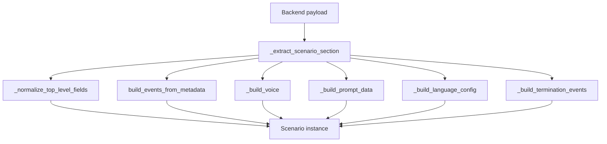

# Scenario Engine

**Purpose.** This document describes the Pydantic models that represent a scenario and the metadata parsing pipeline that converts backend payloads into runtime `Scenario` objects.

---

## Overview

A **scenario** defines a simulated client persona for counselor training. It includes the persona's background, personality, events to detect, voice configuration, and language settings. The backend sends scenario metadata as JSON; the `Scenario.create()` class method parses it into a typed runtime object.

## Data Models

### Scenario

**File:** `app/core/scenario/base.py`

The top-level model that holds everything for a session:

| Field | Type | Description |
|-------|------|-------------|
| `name` | `str` | Scenario title (alias: `scenarioName`) |
| `events` | `List[BaseEvent]` | Instantiated event objects |
| `trigger_events` | `List[str]` | Event IDs that should be sent to UI/Core |
| `termination_events` | `List[TerminationEvent]` | Auto-termination configurations |
| `metadata` | `Dict[str, Any]` | Raw metadata dict |
| `voice` | `Optional[ScenarioVoice]` | TTS voice configuration |
| `prompt_data` | `PromptData` | Client persona definition |
| `language_config` | `Optional[LanguageConfig]` | Language-specific STT/LLM overrides |

### PromptData

Defines the simulated client persona:

| Field | Required | Description |
|-------|----------|-------------|
| `name` | Yes | Client name |
| `age` | Yes | Client age |
| `gender` | Yes | Client gender |
| `current_location` | Yes | Where the client is |
| `context` | Yes | Presenting problem / reason for therapy |
| `opening_statements` | Yes | List of possible opening lines |
| `gender_identity` | No | Gender identity if specified |
| `sexual_orientation` | No | Sexual orientation if specified |
| `profession` | No | Client's occupation |
| `life_history_summary` | No | Background story |
| `core_memories` | No | Key memories that shape behavior |
| `personality` | No | Personality traits |
| `starting_state` | No | Emotional state at session start |
| `emotional_needs` | No | What the client needs from the counselor |
| `tone` | No | How the client speaks |
| `session_behavior_guidelines` | No | Behavioral rules for this session |
| `agent_goal` | No | What the AI should try to accomplish |
| `custom_fields` | No | Dynamic key-value pairs |
| `prompt` | No | Custom prompt override |
| `response_length` | No | `VERY_BRIEF`, `BRIEF`, `MEDIUM`, or `ELABORATE` |
| `agent_dialogues` | No | Pre-scripted dialogue options |
| `previous_memory` | No | Summary from a previous session |

### ScenarioVoice and VoiceConfig

Voice configuration for TTS:

```python
class ScenarioVoice(BaseModel):
    name: str          # Voice name
    provider: str      # TTS provider (e.g., "elevenlabs", "deepgram")
    config: VoiceConfig

class VoiceConfig(BaseModel):
    model: Optional[str]              # TTS model ID
    voice_id: Optional[str]           # Provider-specific voice ID
    speaker: Optional[str]            # Speaker identifier
    voice_name: Optional[str]         # Google TTS voice name
    gender: Optional[str]             # Google TTS gender
    voice_cloning_key: Optional[str]  # Google TTS custom voice key
    instant_mode: Optional[bool]      # Hume TTS instant mode
    voice_provider: Optional[str]     # Hume TTS: "HUME_AI" or "CUSTOM_VOICE"
```

### LanguageConfig

Language-specific provider overrides:

```python
class LanguageConfig(BaseModel):
    language_code: str = "en-IN"                        # BCP 47 code
    stt_config: Optional[Dict[str, Any]] = None         # STT provider override
    llm_config: Optional[Dict[str, Any]] = None         # LLM provider override
    branching_llm_config: Optional[Dict[str, Any]] = None  # Branching LLM override
```

### TerminationEvent

Configures auto-termination when a specific event fires:

```python
class TerminationEvent(BaseModel):
    id: str                              # Event ID that triggers termination
    termination_message: str             # Message to speak before disconnecting
    score: Optional[float] = None        # Priority when multiple termination events fire
```

## Scenario.create() Pipeline



Steps:

1. **Extract scenario section** -- unwrap `{"scenario": {...}}` envelope if present
2. **Normalize fields** -- map `title` to `scenarioName`
3. **Build events** -- `build_events_from_metadata()` creates `BaseEvent` instances (see [Event System](03-event-system.md))
4. **Build voice** -- parse `voice` dict into `ScenarioVoice` with `VoiceConfig`
5. **Build prompt data** -- map camelCase keys (`promptData.lifeHistory` to `life_history_summary`, etc.) into `PromptData`
6. **Build language config** -- parse `languageCode`, `stt`, `llm` overrides
7. **Build termination events** -- parse both `autoTerminationEvent` (deprecated, single) and `autoTerminationEvents` (new, list)

## Key Mapping: Backend to PromptData

| Backend Key (camelCase) | PromptData Field (snake_case) |
|------------------------|-------------------------------|
| `promptData.name` | `name` |
| `promptData.age` | `age` |
| `promptData.gender` | `gender` |
| `promptData.genderIdentity` | `gender_identity` |
| `promptData.sexualOrientation` | `sexual_orientation` |
| `promptData.currentLocation` | `current_location` |
| `promptData.profession` | `profession` |
| `promptData.context` | `context` |
| `promptData.sessionBehaviorGuidelines` | `session_behavior_guidelines` |
| `promptData.lifeHistory` | `life_history_summary` |
| `promptData.coreMemories` | `core_memories` |
| `promptData.personality` | `personality` |
| `promptData.startingState` | `starting_state` |
| `promptData.emotionalNeeds` | `emotional_needs` |
| `promptData.tone` | `tone` |
| `promptData.openingStatements` | `opening_statements` |
| `promptData.agentGoal` | `agent_goal` |
| `promptData.customFields` | `custom_fields` |
| `promptData.prompt` | `prompt` |
| `promptData.responseLength` | `response_length` |
| `promptData.agentDialogues` | `agent_dialogues` |
| `promptData.previousMemory` | `previous_memory` |

---

## Key Source Files

- `app/core/scenario/base.py` -- `Scenario`, `PromptData`, `ScenarioVoice`, `VoiceConfig`, `LanguageConfig`, `TerminationEvent`
- `app/core/events/factory.py` -- `build_events_from_metadata()`
- `app/utils/metadata_parser.py` -- `parse_room_metadata()`
