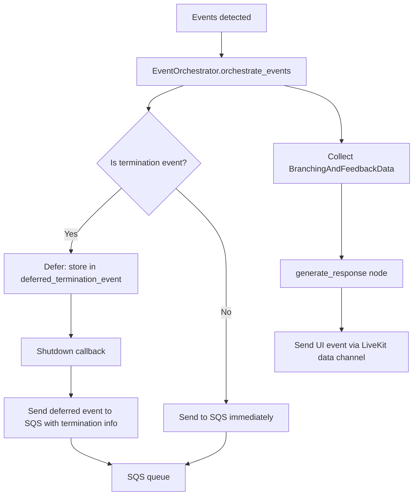

# Queue Messaging

**Purpose.** This document describes the AWS SQS integration for event delivery, the message format, deferred termination events, and LocalStack setup for local development.

---

## Overview

The system publishes events to AWS SQS so the backend can process them for analytics, scoring, and session management. Events are sent via the `SQSQueue` class, which wraps the `boto3` SQS client.

## SQSQueue

**File:** `app/core/queue/sqs.py`

```python
class SQSQueue:
    def __init__(self, queue_url: str, region_name: str = "us-east-1"): ...
    async def send_message(self, message_body: str, ...) -> bool: ...
    def send_message_sync(self, message_body: str, ...) -> bool: ...
```

### Initialization

The `SQSQueue` constructor:

1. Creates a `boto3` SQS client
2. If `AWS_ENDPOINT_URL` is set (LocalStack), uses it as the endpoint
3. If the provided `queue_url` is a queue name (not a URL), resolves it to a URL via `get_queue_url()`

### Async Sending

`send_message()` uses `asyncio.to_thread()` to run the synchronous `boto3` call in a thread pool, avoiding blocking the event loop:

```python
async def send_message(self, message_body: str, ...) -> bool:
    response = await asyncio.to_thread(
        self.sqs.send_message,
        QueueUrl=self.queue_url,
        MessageBody=message_body,
        ...
    )
    return response.get("MessageId") is not None
```

## Message Format

### Core Event Message

Sent to SQS for each triggered event:

```json
{
  "message_type": "event",
  "data": {
    "chat_message": null,
    "event": {
      "event_data": {
        "event_id": "empathy_statement",
        "visibility_type": "ACTIVE",
        "detection_type": "SENTENCE_SIMILARITY",
        "score": 5,
        "emoji": "star",
        "emoji_message": "Great use of empathy!"
      },
      "timestamp": "2024-01-15T10:30:00.000000Z"
    }
  },
  "room_id": "room_abc123",
  "timestamp": 1705312200
}
```

**Schema:** `CoreEventMessageType` (`app/core/events/schemas.py`)

| Field | Type | Description |
|-------|------|-------------|
| `message_type` | `"message"` or `"event"` | Discriminator |
| `data.event.event_data` | `dict` | Serialized event fields |
| `data.event.timestamp` | `str` | ISO timestamp |
| `room_id` | `str` | LiveKit room name |
| `timestamp` | `int` | Unix timestamp |

### UI Event Message

Sent to the frontend via LiveKit data channel (not SQS):

```json
{
  "version": "1.0",
  "data": {
    "score": 5,
    "emoji": "star",
    "message": "Great use of empathy!",
    "show_feedback": true,
    "detected_event_ids": ["empathy_statement"]
  },
  "timestamp": "2024-01-15T10:30:00.000000Z"
}
```

**Schema:** `CustomUIEventMessageType` (`app/core/events/schemas.py`)

## Event Delivery Flow



### Deferred Termination Events

Termination events are **deferred** -- they are not sent to SQS immediately. Instead:

1. The event is stored in `EventSender.deferred_termination_event`
2. The agent plays the termination audio message
3. In the shutdown callback, the deferred event is sent to SQS with `autoTerminationStatus=true`

This prevents the backend from closing the room before the agent finishes speaking the termination message.

If a termination event is also in `trigger_events`, it is sent immediately **without** termination info. The deferred version (with termination info) is sent separately during shutdown.

## Configuration

| Variable | Description | Default |
|----------|-------------|---------|
| `AWS_ACCESS_KEY_ID` | AWS access key | -- |
| `AWS_SECRET_ACCESS_KEY` | AWS secret key | -- |
| `AWS_REGION` | AWS region | `us-east-1` |
| `AWS_ENDPOINT_URL` | Custom endpoint (for LocalStack) | -- |
| `SQS_MESSAGE_EVENT_QUEUE_NAME` | SQS queue name or URL | -- |

## LocalStack Setup

For local development, use LocalStack to emulate SQS:

```bash
docker-compose up -d
```

This starts LocalStack on port `4566` with SQS enabled.

Configure `.env`:
```
AWS_ACCESS_KEY_ID=test
AWS_SECRET_ACCESS_KEY=test
AWS_REGION=ap-southeast-1
AWS_ENDPOINT_URL=http://localhost:4566
SQS_MESSAGE_EVENT_QUEUE_NAME=your-queue-name
```

The `SQSQueue` constructor detects `AWS_ENDPOINT_URL` and uses it as the boto3 endpoint, routing all SQS calls to LocalStack instead of AWS.

When running inside Docker Compose, the app reaches LocalStack at `http://localstack:4566`. When running outside Docker Compose, use `http://localhost:4566`.

---

## Key Source Files

- `app/core/queue/sqs.py` -- `SQSQueue`
- `app/core/events/schemas.py` -- `CoreEventMessageType`, `CustomUIEventMessageType`
- `app/core/events/event_orchestrator/event_sender.py` -- `EventSender._send_events_to_core()`
- `app/core/graph/utils.py` -- `serialize_event()`
- `app/utils/event_handler.py` -- `send_event_to_ui()`
- `docker-compose.yml` -- LocalStack configuration
