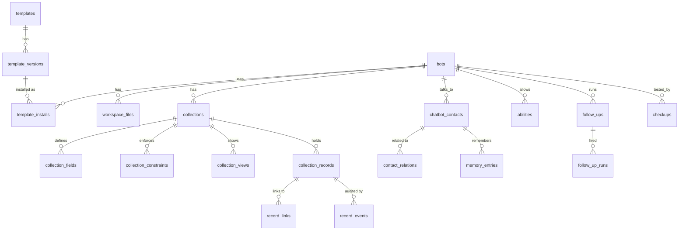

# Templates, lists and records: the low-level design

> How Ally lets an owner build **any** kind of assistant (booking, review collection, lead capture, orders, classes, training…) without anyone writing code per template. Read with `BUILDING-BLOCKS.md` (what the blocks are) and `v2-chunks.md` (when each is built). This file is the data model and the mechanics.

## 1. The core idea: templates are data, never code

Every template is a **package of definitions**. Installing it writes rows into a small, fixed set of tables. One generic engine reads those definitions and does everything: validates records, enforces rules, generates the agent's tools, runs follow-ups, draws the dashboard views.

So the database never grows a new table for "appointments" or "reviews". It has one `collections` table that says *a list called appointments exists, with these fields and these rules*, and one `collection_records` table that holds every entry of every list for every bot.

Three layers:

| Layer | What it is | Example |
|---|---|---|
| **Definitions** | What exists and the rules | "Appointments has a slot, a person, a status; one booking per slot" |
| **Instances** | The business's actual data | "Rahul, Saturday 11:30 with Rohan, booked" |
| **Package** | Definitions bundled for sharing (`template.yaml`) | "Clinic appointments v1.2.0" |

## 2. The tables

All in ally-be's Postgres. Every row carries `org_id` and `bot_id`; every query is scoped by them (and row-level security as a second guard). Names follow repo conventions; adjust prefixes as the code map dictates.



### Packages

| Table | Key columns | Notes |
|---|---|---|
| `templates` | `id`, `slug`, `title`, `author_org_id`, `visibility` (`private`, `org`, `link`, `official`; `public` in v3), `share_token` | One row per template |
| `template_versions` | `template_id`, `version` (semver), `manifest jsonb`, `files jsonb`, `checksum`, `status` (`draft`, `published`), `evals_passed_at` | Immutable once published; publishing requires its evals to pass with 0 hard fails |
| `template_installs` | `bot_id`, `template_version_id`, `setup_answers jsonb`, `installed_at` | Records where a bot came from; the bot owns its copy after install |

### Workspace (the filesystem agent, Stage 2)

| Table | Key columns | Notes |
|---|---|---|
| `workspace_files` | `bot_id`, `path` (`/org/ORG.md`, `/knowledge/fees.md`, `/skills/reschedule.md`), `layer` (`platform`, `org`, `agent`, `roles`, `knowledge`, `updates`, `skills`, `scratch`), `content text`, `source jsonb` (page URL, document, owner, learned), `expires_at`, `version` | Unique on (`bot_id`, `path`). Indexed for `grep` (trigram) and `search_knowledge` (embeddings in the existing vector store, keyed by path and version) |
| `workspace_file_versions` | `file_id`, `version`, `content`, `changed_by` (user, agent run, learning proposal), `created_at` | History and restore |

### Lists (Collections, Stage 4)

| Table | Key columns | Notes |
|---|---|---|
| `collections` | `id`, `bot_id`, `key` (`appointments`), `name`, `kind` (`list`, `rules`, `people`), `settings jsonb` (record title field, default sort, recurrence on or off), `schema_version` | `kind = people` is the system list behind profile fields |
| `collection_fields` | `collection_id`, `key`, `label`, `type`, `options jsonb`, `required`, `default jsonb`, `privacy jsonb` (`never_store`, `masked`, `retention_days`), `agent_read`, `agent_write`, `position`, `archived_at` | Types: text, long_text, number, money, date, datetime, duration, select, multi_select, boolean, phone, email, url, file, relation, rollup, formula |
| `collection_constraints` | `collection_id`, `kind` (`unique`, `capacity`, `limit_per_person`, `transitions`, `range`), `config jsonb` | Enforced in code inside the write transaction (§6) |
| `collection_views` | `collection_id`, `kind` (`table`, `board`, `calendar`, `list`), `config jsonb` (filters, group by, date field) | Dashboard only |
| `collection_records` | `id`, `bot_id`, `collection_id`, `data jsonb`, `status`, `contact_id` (who it belongs to, if anyone), `recurrence_id`, `created_by jsonb` (user, agent run id, import, follow-up), `version`, `deleted_at` | **Every entry of every list.** GIN index on `data`; expression indexes added automatically for fields used in constraints or frequent filters |
| `record_links` | `record_id`, `field_key`, `target_kind` (`record`, `contact`), `target_id` | Relations, queried both ways; rollups read from here |
| `record_events` | `record_id`, `op`, `before jsonb`, `after jsonb`, `actor jsonb`, `run_id`, `created_at` | Audit, Undo and "Why?" |

### People and memory (Stage 2)

| Table | Key columns | Notes |
|---|---|---|
| `chatbot_contacts` (from chunk 12) | plus `profile jsonb` | Profile values; field definitions live in the bot's `people` collection |
| `contact_relations` | `contact_id`, `relation` (`parent_of`, `client_of`…), `other_contact_id`, `verified` | Parent and child, client and therapist |
| `memory_entries` | `contact_id`, `section` (`preferences`, `context`, `open_items`, `relations`), `text`, `source_message_id`, `confidence`, `expires_at`, `status` (`active`, `merged`, `forgotten`) | USER.md is rendered from these rows; the nightly tidy merges and expires them |

### Behaviour

| Table | Key columns | Notes |
|---|---|---|
| `abilities` | `bot_id`, `key` (`create_appointments`, `update_appointments.cancel_late`), `mode` (`do_it`, `ask_me_first`, `never`), `approver` | Read by the tool gateway on every call |
| `follow_ups` | `bot_id`, `key`, `trigger jsonb`, `audience jsonb`, `action jsonb`, `rules jsonb`, `enabled` | Stage 4 (6F) |
| `follow_up_runs` | `follow_up_id`, `record_id`, `contact_id`, `due_at`, `status`, `sent_message_id` | One per person per trigger; idempotent |
| `checkups` | `bot_id`, `case jsonb`, `origin` (`template`, `owner`, `learned`, `onboarding`), `paused` | Q1 |

**Why one records table with JSONB, and not a real table per list:** templates appear at runtime and differ per bot, so per-template tables would mean a migration every time an owner adds a field. JSONB plus typed definitions gives the same safety (validation in code, constraints in transactions, indexes where needed) with no migrations, and keeps tenant isolation simple. Limits keep it fast: for example 50 lists per bot, 100 fields per list and 200,000 records per bot in v2, raised per plan.

## 3. A template, file by file: clinic appointments

```
clinic-appointments/
  template.yaml
  pages/ORG.md, pages/AGENT.md, pages/roles/patient.md
  collections/slots.yaml
  collections/appointments.yaml
  follow_ups/reminder.yaml
  skills/reschedule.md
  evals/cases.yaml
```

`template.yaml` (the manifest; shape as in `BUILDING-BLOCKS.md`):

```yaml
template: clinic-appointments
version: 1.2.0
title: Clinic appointments
purpose: enquiries
safety_pack: medical            # minimum; can be raised, never lowered
setup_questions:
  - key: practitioners
    ask: Who takes appointments, and on which days?
    fills: collections/slots.yaml#seed
collections:
  - collections/slots.yaml
  - collections/appointments.yaml
people:
  contact_fields:
    - { key: preferred_practitioner, type: relation, to: contact, label: Preferred practitioner }
    - { key: language, type: select, options: [English, Hindi, Marathi] }
memory:
  remember: [preferences, language, open_items]
  never_store: [symptoms, diagnosis, medication]
abilities:
  create_appointments: { mode: do_it }
  update_appointments.cancel_late: { mode: ask_me_first, approver: owner }
follow_ups: [follow_ups/reminder.yaml]
skills: [skills/reschedule.md]
evals: evals/cases.yaml
```

`collections/slots.yaml`:

```yaml
key: slots
name: Slots
fields:
  - { key: practitioner, type: relation, to: contact, required: true }
  - { key: starts_at, type: datetime, required: true }
  - { key: duration, type: duration, default: 50m }
  - { key: open, type: boolean, default: true }
recurrence: true                # "every Tuesday 10:00–17:00 until 31 March"
agent: { read: true, write: false }
views:
  - { kind: calendar, date_field: starts_at, group_by: practitioner }
```

`collections/appointments.yaml`:

```yaml
key: appointments
name: Appointments
title_field: slot
fields:
  - { key: slot, type: relation, to: slots, required: true }
  - { key: client, type: relation, to: contact, required: true }
  - { key: service, type: select, options_from: knowledge:services }
  - { key: status, type: select, options: [booked, confirmed, completed, cancelled, no_show], default: booked }
  - { key: notes, type: long_text, privacy: { never_store: false, retention_days: 365 }, agent: { read: false } }
constraints:
  - { kind: unique, fields: [slot], where: "status != cancelled" }       # no double booking
  - { kind: limit_per_person, field: client, max: 2, window: open }       # at most 2 upcoming
  - kind: transitions
    field: status
    allowed:
      booked: [confirmed, cancelled]
      confirmed: [completed, cancelled, no_show]
agent: { read: true, write: [slot, service, status] }
views:
  - { kind: board, group_by: status }
  - { kind: calendar, date_field: slot.starts_at }
```

`follow_ups/reminder.yaml`:

```yaml
key: appointment_reminder
trigger: { collection: appointments, time: "slot.starts_at - 24h", when: "status in [booked, confirmed]" }
audience: record.client
action:
  channel: whatsapp
  whatsapp_template: appointment_reminder_v1     # pre-approved; variables below
  variables: { name: client.name, time: slot.starts_at, practitioner: slot.practitioner.name }
  fallback: bot_page_message
rules: { quiet_hours: "21:00-08:00", once_per: record, respect_opt_out: true }
```

## 4. What it looks like in the database after install

Installing for Sunrise Mind writes definitions once:

```text
collections        (id: c_slots, bot: sunrise, key: slots, kind: list)
                   (id: c_appts, bot: sunrise, key: appointments, kind: list)
collection_fields  (c_appts, key: slot,   type: relation, options: {to: c_slots}, required: true)
                   (c_appts, key: client, type: relation, options: {to: contact}, required: true)
                   (c_appts, key: status, type: select,   options: {values: [booked, …]}, default: "booked")
collection_constraints
                   (c_appts, kind: unique,  config: {fields: [slot], where: "status != cancelled"})
                   (c_appts, kind: transitions, config: {field: status, allowed: {…}})
abilities          (sunrise, create_appointments, do_it)
                   (sunrise, update_appointments.cancel_late, ask_me_first, approver: owner)
follow_ups         (sunrise, appointment_reminder, trigger: {…}, action: {…})
workspace_files    (/org/ORG.md, /agent/AGENT.md, /skills/reschedule.md, …)
```

Then every booking is one row:

```json
// collection_records
{
  "id": "r_8f21",
  "bot_id": "sunrise",
  "collection_id": "c_appts",
  "contact_id": "ct_rahul",
  "status": "booked",
  "data": { "slot": "r_slot_sat_1130", "client": "ct_rahul", "service": "Individual therapy" },
  "created_by": { "kind": "agent", "run_id": "run_7c0e" },
  "version": 1
}
// record_links
{ "record_id": "r_8f21", "field_key": "slot",   "target_kind": "record",  "target_id": "r_slot_sat_1130" }
{ "record_id": "r_8f21", "field_key": "client", "target_kind": "contact", "target_id": "ct_rahul" }
// record_events
{ "record_id": "r_8f21", "op": "create", "actor": { "kind": "agent", "run_id": "run_7c0e" }, "after": { … } }
// follow_up_runs (scheduled by the follow-up engine)
{ "follow_up": "appointment_reminder", "record_id": "r_8f21", "due_at": "Fri 11:30", "status": "scheduled" }
```

## 5. Other template types: same tables, different rows

| Template | Lists (and key fields) | Constraints and links | Follow-ups and extras |
|---|---|---|---|
| **Review collection** | Reviews: `about` (relation to an appointment or order), `rating` (number 1–5), `comment`, `routed_to` (select: google, owner) | `unique` on `about` (one review per visit); `range` 1–5 | Trigger: 2 hours after `appointments.status → completed`; ask for a rating with buttons; 4–5 → send the Google link, 1–3 → notify the owner |
| **Lead capture** | Leads: `name`, `phone`, `interest` (select from services), `budget` (money), `status` (new → contacted → qualified → won or lost), `owner` (relation to a team member) | `transitions` on status; `unique` on phone (no duplicate leads) | Owner alert on create; a follow-up after 2 days if still `new` |
| **Orders and products** | Products: `name`, `price`, `stock`, `tags`; Orders: `number`, `client`, `items` (relation to products, many), `total` (rollup sum), `status`, `courier_ref` | `unique` on order number; stock checked on create | "Where is my order" = `find_orders` by number or phone; reorder nudge 30 days after delivery |
| **Class enrolment** | Classes: `name`, `starts_at`, `teacher`, `seats` (recurring); Bookings: `class`, `member`, `status` | `capacity` on `class` = `class.seats`, with `waitlist: true`; `limit_per_person` by plan | Waitlist promotion on cancel; renewal reminder 5 days before a package ends |
| **Property listings** | Listings: `area`, `price`, `size`, `bhk`, `status`, photos (file); Visits: `listing`, `buyer`, `agent`, `at` | `unique` on (`agent`, `at`) | Reminder the evening before a visit |
| **Staff training** | No lists needed; optional Quiz results (`person`, `topic`, `score`) | — | `/knowledge` and `/skills` pages; profile field `training_progress` (rollup over quiz results) |
| **Eligibility or pricing** | A `rules` collection: rows of conditions → outcome (age band, plan, city → price) | — | `check_rules` tool; the model never decides eligibility itself |

A review record, for comparison:

```json
{ "collection_id": "c_reviews", "contact_id": "ct_asha", "status": "received",
  "data": { "about": "r_8f21", "rating": 5, "comment": "Rohan was wonderful", "routed_to": "google" } }
```

## 6. How the agent uses a list: generated tools

When a list allows the agent to read or write, the tool gateway generates tools from its definition. Nothing is coded per template. For appointments, the agent sees:

```json
{
  "name": "create_appointments",
  "description": "Book an appointment. Fails with a reason if the slot is taken or the client has 2 upcoming bookings.",
  "input_schema": {
    "type": "object",
    "required": ["slot", "client"],
    "properties": {
      "slot":    { "type": "string", "description": "id from find_slots" },
      "client":  { "type": "string", "description": "contact id; defaults to the person in this chat" },
      "service": { "type": "string", "enum": ["Individual therapy", "Couples therapy", "…"] }
    }
  }
}
```

What happens on a call (ally-be, never the model):

1. **Gateway checks:** the run token is valid; `create_appointments` is allowed; the ability mode is `do_it` (or it becomes an approval request for `ask_me_first`).
2. **Validation:** types, required fields, select options, fields the agent may write.
3. **Constraints, inside one transaction:** a lock on the constraint key (here, the slot id), then the checks: is the slot still free, does the client have fewer than 2 upcoming, is the status transition allowed.
4. **Write:** the record, its links and an event row; follow-ups for it are scheduled.
5. **Result to the agent:** the new record, or a plain-language reason with options ("That slot was just taken. 12:15 or 2:00 is free."). The agent cites the record in its reply.

`find_<list>` returns only fields the agent may read, masked where the definition says so, as passages it must cite. `update_<list>` allows only permitted fields and transitions.

## 7. How an owner creates any template they want

There are three ways in, and all produce the same definitions:

1. **Ask the builder.** "After each appointment, ask for a review, and send happy clients to Google." The builder proposes a **patch**: a new Reviews list with its fields, a follow-up, and two checkup cases. The owner sees it as a before and after, and taps Apply. The builder only proposes; ally-be validates and writes.
2. **Build it in the dashboard, Notion-style.** Add a list, add fields with types, set rules ("only one per slot", "max 20, then waitlist"), choose views. Each change is a versioned patch with Undo.
3. **Install and adapt.** Start from an official or shared template, answer its setup questions, then change anything.

**Saving and sharing:** "Save as template" exports the bot's definitions (pages, lists, fields, constraints, abilities, follow-ups, skills, checkups and safety pack) into a new `template_version`, **without** records, contacts, memory or conversations. The owner names it, writes the setup questions (the builder suggests them), and shares it inside the organisation or by link. Someone who installs it gets their own copy.

**What every template must pass before it can be published:**
- The manifest validates against the template JSON Schema.
- Limits are respected (lists, fields, follow-ups).
- The safety pack is at least the platform minimum for its business type, and nothing weakens the platform safety layer.
- WhatsApp follow-ups reference approved message templates only.
- Its evals pass with 0 hard fails.

## 8. Changing a list after it has data

| Change | What happens |
|---|---|
| Add a field | Instant; existing records get the default or stay empty |
| Rename a label | Instant; the key stays the same |
| Change a field's type | A background migration converts values; records that can't convert are listed for the owner, nothing is lost |
| Remove a field | Archived (hidden, kept 30 days for Undo), then purged |
| Add a constraint | Checked against existing records first; violations are shown before it's turned on |
| Delete a list | Soft delete with Undo for 30 days; tools and follow-ups for it switch off at once |

## 9. When each piece is built

| Piece | Chunk | Stage |
|---|---|---|
| `workspace_files`, versions, `list`/`read`/`grep` tools | 4 Workspace | 2 |
| `chatbot_contacts.profile`, `contact_relations`, `people` collection | 7 Profiles | 2 |
| `memory_entries` and USER.md | 8 Memory | 2 |
| `collections`, fields, constraints, views, records, links, events | 5 Collections | 4 |
| Generated tools, `abilities` in the gateway | 6 (gateway from 3b) | 4 (2) |
| `follow_ups`, `follow_up_runs` | 6F | 4 |
| `templates`, versions, installs, save and share | 18–19 | 5 |
| `checkups` | Q1 | 3 |
