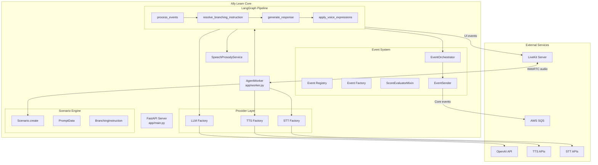

# Architecture

**Purpose.** This document describes the high-level architecture of Ally Learn Core, the component inventory, factory patterns used throughout the codebase, and key design decisions.

---

## System Diagram



## Component Inventory

| Component | Location | Responsibility |
|-----------|----------|----------------|
| FastAPI Server | `app/main.py` | Health check endpoint, CORS middleware |
| AgentWorker | `app/worker.py` | Session lifecycle: configure, initialize, start |
| LangGraph Pipeline | `app/core/graph/` | 4-node conversation processing graph |
| EventOrchestrator | `app/core/events/event_orchestrator/` | Registry, scoring, event delivery |
| Event Factory | `app/core/events/factory.py` | Build `BaseEvent` instances from metadata |
| Event Types | `app/core/events/event_types/` | 9 concrete event implementations |
| TTS Factory | `app/tts/factory.py` | Create TTS clients (5 providers) |
| STT Factory | `app/stt/factory.py` | Create STT clients (3 providers) |
| LLM Factory | `app/llms/factory.py` | Create LLM clients (4 providers) |
| Scenario Engine | `app/core/scenario/base.py` | Parse metadata into `Scenario` objects |
| Branching System | `app/core/branching_instructions/` | Variable substitution in instructions |
| Speech Prosody | `app/speech_prosody/` | Voice expression parameter generation |
| SQS Queue | `app/core/queue/sqs.py` | Async message delivery to AWS SQS |
| Configuration | `app/core/config.py` | Pydantic `Settings` from environment |

## Factory Pattern

The codebase uses the factory pattern extensively to decouple provider selection from business logic. Each provider subsystem follows the same structure:

```
app/<subsystem>/
    base.py      # Abstract base class (BaseTTSClient, BaseSTTClient, BaseLLMClient)
    factory.py   # Factory function (create_tts_client, create_stt_client, create_llm_client)
    <provider>.py  # Concrete implementations
```

The factory reads a config dict (typically from scenario metadata) and returns the appropriate client instance. All clients implement the same abstract interface, so consuming code never depends on a specific provider.

The event factory (`app/core/events/factory.py`) follows a similar pattern: `build_events_from_metadata()` reads event dicts from scenario metadata and returns `BaseEvent` instances via `_create_event_by_detection_type()`.

## Design Decisions

### Why subgraphs for resolve_branching_instruction and apply_voice_expressions?

LangGraph's `LLMAdapter` (used by LiveKit) streams all LLM outputs from every node in a graph. The `resolve_branching_instruction` and `apply_voice_expressions` nodes make internal LLM calls that should not be streamed to the user. By wrapping these nodes in subgraphs and using `subgraphs=False` (default in LLMAdapter), their outputs are isolated from the main streaming pipeline.

This is a workaround for [LiveKit agents issue #2836](https://github.com/livekit/agents/issues/2836).

### Why is OpenAI always required?

OpenAI is always required because:

1. **Embeddings**: The `OpenAIEmbeddingClient` is used for semantic similarity event detection. There is no alternative embedding provider currently.
2. **Default LLM**: OpenAI (`gpt-4o-mini`) is the default LLM provider and the fallback when other providers fail.
3. **Branching resolution**: The default branching LLM config uses OpenAI for structured output support.

Even when using Ollama or vLLM for the main conversation LLM, OpenAI is needed for embeddings and branching resolution.

### Why LangGraph?

LangGraph provides:

- **Stateful conversation management** with typed state and reducers
- **Node-based processing pipeline** that clearly separates concerns
- **Checkpoint/thread support** for conversation persistence
- **Streaming integration** with LiveKit via `LLMAdapter`

### ACTIVE vs PASSIVE events

- **ACTIVE** events have UI feedback (emoji, message, score) and are displayed to the counselor
- **PASSIVE** events are logged for analytics but have no UI feedback

Both types are sent to Core (SQS). Only ACTIVE events generate `BranchingAndFeedbackData` with feedback objects.

---

## Key Source Files

- `app/main.py` -- FastAPI application
- `app/worker.py` -- AgentWorker lifecycle
- `app/core/graph/graph_builder.py` -- Graph construction
- `app/core/config.py` -- Settings from environment
- `app/core/constants.py` -- Enums and constants
