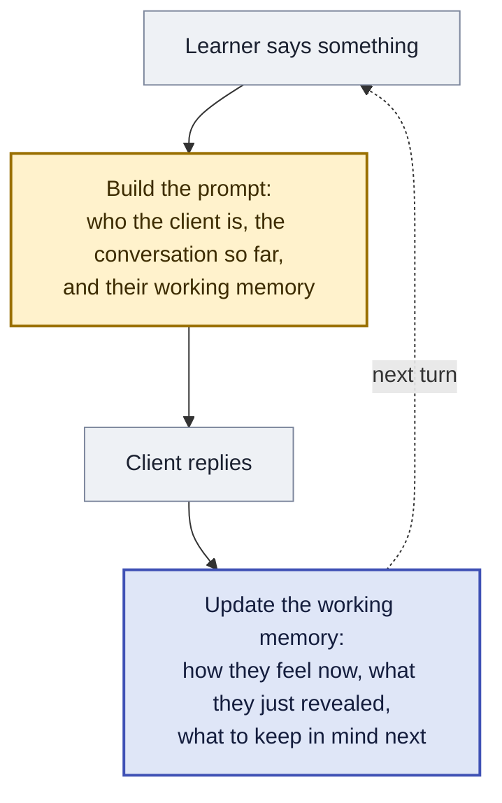
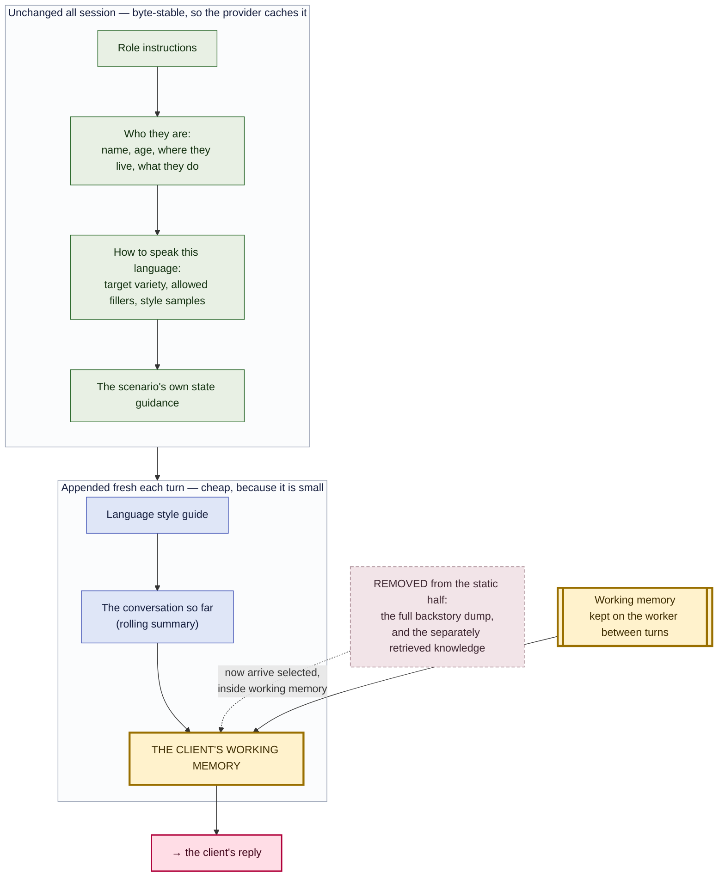
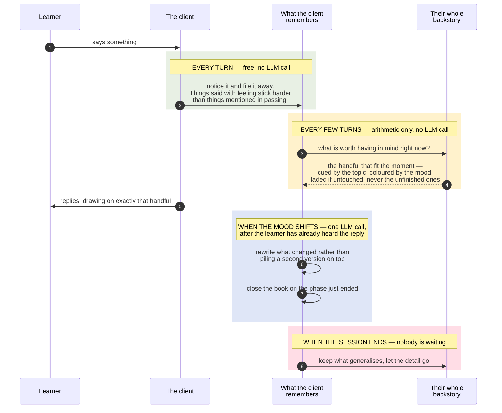

# The Client's Working Memory — one rolling structured context

**Status**: design proposal, not built
**Scope**: `ally-ai-learn` actor prompt assembly, memory, and the session-end write-out
**Target template**: **Main Agent Prompt #2** — `ally_ai_learn_system_main_agent_prompt_full`, live at **version 6** with `useDashboardOverride: true`, so the authoritative text is in `prompts_versions`, **not** the file of the same name. Not the original `ally_ai_learn_system_main_agent_prompt` (v17).
**Related**: [`02-graph-pipeline.md`](02-graph-pipeline.md) · [`03-event-system.md`](03-event-system.md) · [`12-prompts-system.md`](12-prompts-system.md) · [`knowledge-source-retrieval-policies.md`](knowledge-source-retrieval-policies.md) · [`events-off-gate-design.md`](events-off-gate-design.md)

---

## 1. The problem, measured

Every number here is from production, queried 2026-08-19. They are the reason for the design; if they change, revisit it.

**Quality degrades with conversation depth, in every language and on both models.** Share of judged AI turns carrying any fault:

| Depth | All languages | en-IN (gpt-4o-mini, n=1,764) | ta-IN (gpt-4.1-mini) |
|---|---|---|---|
| turns 0–3 | 4.63% | 3.72% | 7.37% |
| turns 4–7 | 6.01% | 2.54% | 15.34% |
| turns 8–11 | 11.20% | 4.93% | 29.51% |
| turns 12–19 | 12.20% | 8.06% | 31.03% |
| turns 20+ | 14.77% | 9.28% | 39.66% |

Broken out, across all languages: repetition rises 1.10% → 7.67% (7×), role slip 0.73% → 3.00% (4×), context lock-in 0.00% → 1.31%, persona/social errors 5.37% → 9.38%. The inflection sits at turns 8–11.

**The actor does not respond to counsellor skill.** Turns preceded by a scored event — the system's own judgement that the learner made a skilled intervention — introduce new information at **65.52%**. Turns with no scored event: **65.51%**. That is 583 versus 2,427 turns, and the difference is 0.01 points.

What the actor *does* do in response to skill is talk more:

| | no scored event | after a skilled move |
|---|---|---|
| all languages, turns 8–15 | 176 chars | 233 chars |
| en-IN only, turns 8–15 | 172 chars | 218 chars |
| en-IN only, turns 16+ | 176 chars | 278 chars |

More words, no more substance. The actor-evaluation rubric already names this: *"Penalize uniform responsiveness that ignores intervention quality."*

**Persona failures at depth are all one failure.** Every critical `persona_social` annotation read at turns 8+ was the client collapsing into the assistant:

> *"That was helpful to notice. Thanks!"* — judge: breaks from a subdued, weary man in severe distress
> *"I'm starting to see the pattern a little more clearly now. Thank you for today!"* — judge: meta-comment, attempting to end the role-play
> *"I can sense that heaviness…"* — judge: **the AI adopted a therapist's persona**

This is not only a quality defect. A client who declares insight at turn 14 hands the trainee a fake success and inflates their score.

**We made role slip worse.** The rolling summary shipped 2026-08-06. en-IN, turns 8+, before versus after: repetition **4.62% → 3.00%** (the feature worked), role slip **0.46% → 3.00%**.

The mechanism is visible in the code. `nodes.py` drops verbatim history once the summary covers it, and `rolling_summary.txt` carries situation, disclosures, counsellor_actions, emotional_arc and unresolved — **no voice**. We removed the actor's own prior turns, which were its only in-context style exemplars, and kept only its facts.

**Prompt size drives latency, and latency drives faults.**

| Prompt tokens | Turns | Cached | TTFT | Total latency |
|---|---|---|---|---|
| under 1,500 | 711 | 17% | 2,256ms | 3,796ms |
| 1,500–2,199 | 617 | 47% | 3,231ms | 4,391ms |
| 2,200–2,999 | 601 | 71% | 2,801ms | 4,034ms |
| 3,000+ | 404 | 66% | 3,726ms | 5,446ms |

+1,650ms across the range. Turns slower than 8.7s carry a fault **49.8%** of the time, against 31.5% in the 5.3–8.7s band and 16.7% below. Our p50 is 5.8s and p75 is 9.2s, so a large share of turns sit at the edge of the worst band.

Note what caching does *not* buy: the 3,000+ bucket is the slowest despite 66% cached. Caching is reducing cost, not latency.

The static prompt is the majority of the context. First-turn prompt tokens vary **710 to 2,041** across scenarios while conversation growth is only **340 to 1,140** — so roughly 1,300 tokens of spread is authoring difference, not necessity.

**Prompt size does not directly predict faults.** Tested: the 1,800+ token bucket faulted *less* (0.88%) than the under-900 bucket (5.14%). Trimming is a latency play, not a quality play. It reaches quality *through* latency, which is the strongest single predictor we have.

---

## 2. What the client's working memory is

One structured block, assembled off the critical path, appended last in the system prompt by default, replacing the static backstory dump.

It holds the client's inner state and the subset of their history that is currently live. It rolls forward on triggers rather than being rebuilt per turn, and it is the single thing the actor reads to know who it is and where it stands.

**Why "working memory".** The name places this beside what the worker already has
rather than competing with it. *Episodic* memory is taken: it is the shipped rolling
summary, named that throughout `rolling_summary.py` and shipped to Core as
`session_memory`. *Semantic* memory is the cross-session `previous_memory` slot (§10).
The layer missing between them is the small, currently-active set the client actually
has in mind while speaking — and that is what this is. The mechanics follow: a 4±1
capacity cap (§7.4), decay-based eviction rather than truncation, and selection driven
by cue and mood. §7.7 lays the three layers out together.

It is deliberately **not** an internal monologue. Nothing here runs a per-turn
reasoning pass; the state is emitted by a call that already happens (§5), and the one
monologue-shaped field, `appraisal`, is also the one field that must never reach the
prompt verbatim.

**Its central property is that it is derived, not authored.** Stance, disclosures and
unresolved threads are inferred from the conversation as it happens. That is a
deliberate choice against the alternative, and the evidence for it is in this
repository: `roleplay_v2` built a structurally similar per-turn card whose power came
from *authored* per-scenario content — a disclosure ledger with hand-written
deflections, and a state machine. In six weeks nobody authored any of it. Five specs
have versions, all DRAFT, none published, **zero secrets and zero states between them**
(§9.1). A design that requires content per scenario has to be authored 58 times before
one learner benefits; a design that derives it ships once.

**Topically retrieved** knowledge is **inside** it, not beside it. Today
`{retrieved_context}` is its own block, computed independently of any notion of the
client's state. But it draws on the same source its own `salient_backstory` draws on
(`scenario_characters.knowledge_sources`), so two blocks means two headers, two
framings, and duplicated content — against the whole point of trimming. It also
makes mood-congruent recall (§7) decorative rather than operative: a separately
computed block cannot be weighted by a stance it does not know about.

The qualifier matters. Only knowledge that is *topically* retrieved belongs in working
memory. Content that applies on every turn regardless of subject — how to speak this
language, global safety rails — is not something the client recalls; it is how they
speak. It stays in the static prefix, where it costs nothing per turn. §9.2 draws that
line, and it is the line that resolves the overlap with the retrieval-policies
proposal.


It is appended **last** in the system prompt by default, nearest the reply — §2.2 shows where and why, and §2.3 makes that position authorable so it can be tested.

### 2.1 One turn



Working memory is **read** when the prompt is built and **written** after the reply has
gone out. It is the only thing in the turn that carries across from the last one.

Everything else in this document is detail about those two boxes: what it holds
(§3), what makes it change (§4), where the update runs so it never delays the reply (§5),
and how it decides what to keep in mind (§7).

<details>
<summary>Which code each step corresponds to</summary>

| Step | Code |
|---|---|
| Learner says something | STT, then `process_gating_events` / `detect_behaviors` / `retrieve_knowledge` in parallel |
| Build the prompt | `prompt.py` assembly; `main_agent_prompt_full` v6 plus appended blocks. `resolve_branching_instruction` runs just before |
| Client replies | `generate_response`, then TTS |
| Update the working memory | proposed `update_working_memory`, detached, writing `ClientWorkingMemoryStore` — alongside the existing `compact_history` |

</details>

### 2.2 Inside "build the prompt"

Zooming into the second box. The prompt is assembled top to bottom; **the top half never
changes during a session and stays cached, the bottom half is appended fresh each turn.**



**Working memory goes last by default**, nearest the reply. Stacks, *Rolling Context
Window for Agent Memory*: *"place relevant context near the prompt end to increase
likelihood of use."* Today the persona sits at the very top — furthest from generation —
which is backwards, because persona failures are exactly what rise with conversation
depth (§1).

That is a default, not a property of the design. Position is exposed as a template
placeholder so it can be moved and tested — §2.3.

**Two things leave the static half.** The full backstory dump and the separately retrieved
knowledge both stop being their own blocks and reappear *inside* working memory, reduced
to what the client currently has in mind. That is where the token saving comes from: the
static half of the prompt is 710–2,041 tokens depending on the scenario, and the
difference is authoring, not necessity.

**Appending does not break the cache.** Everything above the append point stays
byte-identical all session, so the provider still caches it — which is already how the
rolling summary and glossary work today. Only the small tail changes.

<details>
<summary>Which code each piece corresponds to</summary>

| In the diagram | Code |
|---|---|
| Role instructions · who they are · how to speak · state guidance | `main_agent_prompt_full` v6 in `prompts_versions` (`useDashboardOverride`) |
| The full backstory dump *(removed)* | `{character_profile_text}` |
| Separately retrieved knowledge *(removed)* | `{retrieved_context}` — inline on #2, suffix on the default template |
| Language style guide | `_ensure_language_glossary`, appended after templating |
| The conversation so far | `_append_rolling_summary` ← `RollingSummaryStore` |
| THE CLIENT'S WORKING MEMORY | `{client_working_memory}` placeholder, else appended ← `ClientWorkingMemoryStore` (§2.3, §6) |

</details>

### 2.3 Position is authorable: the `{client_working_memory}` placeholder

The claim that last is the best position is a hypothesis, and it is cheap to test — so
the block ships as a **real placeholder** rather than a hardcoded append. An author moves
`{client_working_memory}` in the template, and the block renders there.

**The mechanism already exists.** `prompt.py` has a dual-delivery contract used by three
blocks today: render at the placeholder if the template carries one, otherwise append to
the volatile suffix. The idempotence check is the whole trick —
`_append_retrieved_context` and `_ensure_language_glossary` both begin `if text in
message.content: return message`, so a template that rendered the block already
suppresses the append. One code path, and placement belongs to whoever edits the
template. `_append_working_memory` follows it exactly.

**Registering the variable is mandatory, not housekeeping.** `SafeFormatter.__missing__`
in `app/prompts/resolver.py` returns the **literal** `"{key}"` when a key is absent from
the prompt's `availableVariables`, and empty string when it is present but unset. So an
unregistered placeholder does not degrade quietly — it puts the raw text
`{client_working_memory}` into the system prompt the model reads. It has to be added to
`availableVariables` on every template that may carry it, which is also what surfaces it
in the studio's variable list and therefore what makes the experiment possible for
someone who is not editing Python.

An empty model renders the named empty state from §3 — `(first turn — no history yet)` —
never a blank and never a leaked placeholder.

**Default placement, and the ordering rule.** Absent a placeholder, the block appends to
the volatile suffix, and within that suffix the existing rule is ascending churn
frequency: rolling summary (~4 turns), retrieved context (~2 turns), working memory
(**every** turn). Fastest churn goes last, so working memory is last.

**Moving it up is a latency footgun, and that is the point of measuring.** `prompt.py`
records the measured consequence for the block that churns half as often: rendering it
mid-template *"invalidated the provider prompt cache for everything after it on almost
every turn."* Prefix caching means everything after the first changed byte is
re-processed, and working memory changes every turn — so an author who moves it to the
top converts every turn into a full cache miss. §1's bands price that at up to +1,650ms,
and turns over 8.7s fault 49.8% of the time.

So the position experiment **must read the latency distribution alongside quality**, not
quality alone. A position that improves persona adherence and moves the >8.7s share is
not a win; it is a trade, and §1 says the latency side of that trade usually wins.

The branching template is the exception, and gets inline placement for free: branching
turns swap templates and bust the cache regardless, so there is nothing to preserve —
the same reasoning `prompt.py` already applies to `{retrieved_context}` there.

**One variable is coupled to position and must not be read as noise.** §5.1 makes
guardrail precedence a concern *because* the block sits last, at the position of highest
attention, where it can compete with a guardrail arriving through `next_instruction`.
Moving the block earlier weakens that competition; moving it last maximises both the
intended benefit and that risk. Any position test therefore has to check guardrail
adherence, not just clienthood — otherwise "last is best" gets adopted on a quality
number while a safety regression sits inside the same change.

---

### Two update paths, because the parts churn at different rates

`prompt.py` today orders the volatile suffix by **ascending churn frequency** —
summary before retrieved context — so the slower-changing content sits earlier and
more of the prompt stays byte-stable. Folding retrieval into the block would make
the whole block churn at its fastest member's rate and give some of that back.

So the block keeps the same discipline internally, and the updater has two paths:

| Path | Cadence | Writes | Cost |
|---|---|---|---|
| **State update** | client-side event, or summary cadence | `stance`, `affect`, `appraisal`, `register`, `speech_fragments`, `unresolved`, `withheld` | structured output on an existing call |
| **Recall refresh** | ~every 2 turns, as retrieval does today | `salient_backstory` — cue-matched **and stance-weighted** | the existing retrieval call, scoped to semantic sources (§9.2) |

The recall refresh is the existing `retrieve_knowledge` subgraph, given the current
stance and cue set as input and writing into working memory instead of into its own
prompt block. It is not new work; it is the same work with a destination and a
weighting it did not have before.

Slow fields first, fast fields last: the reader still gets the freshest content
nearest generation, and the stable half of the block can still cache.

---

## 3. Schema

Every field exists to serve a measured failure. Nothing is here for completeness.

```python
class ClientWorkingMemory(BaseModel):
    # ── inner state ──────────────────────────────────────────────
    stance: Literal["guarded", "testing", "opening", "disclosing", "reflecting"]
    affect: str                    # one line, current felt state
    appraisal: str                 # why the stance is where it is

    # ── voice: repairs the 6.5x role-slip regression ─────────────
    register: str                  # how this person speaks, now
    speech_fragments: list[str]    # 2-3 VERBATIM fragments of their own recent speech

    # ── the client's own history, as cues ────────────────────────
    disclosed: list[Fact]          # said already — the anti-repetition index
    unresolved: list[Thread]       # opened, not finished  (Zeigarnik)
    withheld: list[WithheldTopic]  # topic + deflection ONLY — never the content

    # ── retrieved, not dumped ────────────────────────────────────
    salient_backstory: list[Fact]  # semantic-bucket retrieval output (§9.2)

    # ── bookkeeping ──────────────────────────────────────────────
    revision: str                  # SHA-256, optimistic lock
    updated_at_turn: int
```

`stance` does the real work. Transitions must be **earned** — `reflecting` is unreachable until the unresolved threads that justify it have actually been worked. That is a structural block on the *"Thank you for today"* failure, which prose instructions have not stopped.

`speech_fragments` is the direct repair for what we broke on 6 August: verbatim examples of the character's own voice, carried across every compaction boundary.

An earlier version of this schema also carried a `glossary_slice` — the Tier 0 language
glossary narrowed to the terms live in the current stance and topic. It is **dropped**,
for reasons §9.2 sets out: a client does not forget how to speak their language, so
running vocabulary through a decay function is the one place the memory analogy breaks;
and §11's own evidence says glossary volume is not the lever on register anyway.

`withheld` follows `roleplay_v2`'s ledger contract verbatim. A withheld item renders
its **topic and its deflection, never its content** — so the actor knows a subject exists and how to move away from it
without having the material in context to leak. `_render_ledger_section` in
`app/roleplay_v2/actor/prompt_compiler.py` is the reference implementation.

**Framing.** The block is introduced as a *"directors' note for your next reply
only"* — also borrowed from v2's turn card. It is the clearest way found so far to tell
the model this is ephemeral guidance rather than fact, and it is worth keeping the
exact wording.

**Empty states.** Every field renders an explicit sentence rather than a blank, again
following v2: `(nothing is being withheld in this scenario)`, `(no additional memories
retrieved this turn)`, and for turn 1 before any state exists, `(first turn — no
history yet)`. A blank section reads to the model as an absence of constraint; a named
absence does not.

---

## 4. Triggers: a new client-side event type

The existing event vocabulary is about the **counsellor**. Measured: 27,422 events across 405 of 517 sessions, 53 per session, 172 distinct types — but only 6.3% carry a non-zero score, **96% of unscored events carry no message at all**, and the messages that do exist read:

> *"Ask questions that encourage further thinking about meaning, feelings, or patterns."*
> *"Listen before you fix — the student needs to feel heard."*

Those are assessments of the learner's technique. They cannot key retrieval of *client* memories — the cue and the encoding context don't match. So this design adds a second, client-side event type:

| Event | Fires when | Drives |
|---|---|---|
| `disclosed(topic)` | the client reveals something new | move topic → `disclosed`; retrieval cue |
| `withheld(topic)` | the client deflects | `withheld`; keeps a thread live |
| `affect_shift(from→to)` | felt state changes | `affect`, re-weights retrieval |
| `rupture` | client feels judged or misunderstood | stance regresses |
| `repair` | client feels heard after a rupture | stance may advance |
| `resistance_softened` | a defence gives way | stance advances |
| `thread_opened` / `thread_closed` | a topic opens or genuinely resolves | `unresolved` |

These are the runtime counterpart of what the actor-evaluation rubric already grades offline — *Rupture & Repair Responsiveness*, *Disclosure Pacing*, *Resistance Calibration*, *Contingent Reactivity*. We are instrumenting the thing we already score.

**Trigger composition.** A stance transition requires a client-side event, which is itself gated on the counsellor's move. That is the contingency the 65.51/65.52 null says does not currently exist.

**Cadence fallback is mandatory.** The median session fires **zero** scored events; 317 of 517 have none, average 3.3, p90 of 11. Event-only triggering would leave 61% of sessions with a frozen state. So: update on a client-side event, **or** on the existing rolling-summary cadence, whichever comes first — the same both-triggers shape `compact_history` already uses.

---

## 5. Where it runs

Three properties of the runtime decide this, and between them only one shape is left.

### The updater is not a graph node

LangGraph schedules nodes in **supersteps** with a hard barrier between them: nothing in
the next superstep starts until everything in the current one finishes, including
branches nothing downstream reads.

Nodes *within* a superstep do run concurrently — `detect_behaviors`, the events node and
`retrieve_knowledge` genuinely overlap today. What does not happen is the next superstep
starting early, which is how `process_deferred_events` came to delay the reply every
turn while it was a parallel node, confirmed in production. `Send` is scheduled as tasks
inside the same model, so no fan-out primitive in the framework changes the answer.

So the update work takes one of the two escapes this repo already uses:

1. **Detached asyncio task** via `orchestrator._spawn_background`, as
   `_run_deferred_events` does — outside the scheduler, cannot join a superstep.
2. **Terminal on the reply path**, as `compact_history` does — schedules, never awaits.
   That node's comment records the cost of getting it wrong: a synchronous version
   *"measurably added ~1s to the next turn's voice-to-voice latency in the Malayalam A/B
   run."*

A node is still needed as the *trigger* — something has to fire the update, and
something has to read working memory during prompt assembly. Declare it with
`add_node(..., defer=True)`, which tells the scheduler to run it as the run is about to
end, rather than hand-wiring it after `publish_done_thinking`. With two terminal nodes
both claiming to be last, an ordering that only a comment explains is the thing that
breaks first.

### Store, not graph state

A worker-owned `ClientWorkingMemoryStore`, sibling to `RollingSummaryStore`.

The structural reason is that `agent_graph` is compiled **once at import**
(`app/core/graph/__init__.py`) and shared by every concurrent session in the worker
process. Per-session identity therefore exists in exactly one place: the config that
`LLMAdapter` holds per session (`app/core/agent/factory.py`). That is how
`RollingSummaryStore`, `ScoreKeeper`, `SessionClock` and `retrieved_context_store` all
arrive, and the `ClientWorkingMemoryStore` follows them. The rolling summary's own reason holds
as well — state-sync versioning cost ~1s/turn under the default checkpoint durability.

One consequence worth recording: phase 4 removes `retrieved_context` and
`turns_until_knowledge_refresh` from `SimulationState`, and that is free here.
`PruningCheckpointer` keeps a single in-process checkpoint per (thread, namespace) and
it dies with the session, so there is no migration and no stale checkpoint to
deserialize. Behind a durable checkpointer the same edit would be a compatibility
question.

### No per-turn LLM call — and not on the reply call

The state is emitted as structured output by a call that already runs, never a second
round trip. Latency is a fault driver, so an internal monologue costing a generation
pass would trade Actor responsiveness for Actor clienthood, and responsiveness has the
larger denominator.

The reply call cannot be the one that carries it. `generate_response` is the single
LLM-calling node deliberately **not** wrapped in a subgraph, because its tokens are what
LiveKit's `LLMAdapter` streams to TTS (`astream(..., stream_mode="messages")` with
`subgraphs=False` — the reason every other LLM-calling node *is* wrapped, LiveKit issue
#2836). Structured output on that call would be spoken aloud, and scrubbing afterwards
does not save it: by the time a scrubber sees a token, the synthesiser has it too.

So the emitter is the **consolidation call** — subgraph-isolated, or detached outright —
and never the streamed reply. The `think_scrubber.py` pattern still applies to whatever
that call returns and must not reach the prompt verbatim (`appraisal`, the content of
`withheld`), but it is a prompt-assembly filter, not a TTS one.

### Mechanisms considered and not used

| Mechanism | Why not |
|---|---|
| `durability="exit"` to cut checkpoint writes | The adapter owns the `astream` call and does not expose the parameter, and the config fallback is a private symbol. It is also not free: a run cancelled mid-turn would persist nothing, and `events_accumulator`, `current_score` and `permitted_events` live only in checkpoint state — an interrupted turn would lose triggered-event history and score |
| Node `CachePolicy` instead of the refresh countdown | Caching keys on input content; recall is deliberately cadence- and cue-driven. The existing exact-content-hash cache is already documented as rarely hitting during live conversation for that reason |
| A compile-time `BaseStore` for the live model | On a module-level graph a compile-time store is process-global across concurrent sessions, and the in-memory implementation is per-process anyway — it would trade the per-session isolation config already gives us for no durability gain. The store's *namespace shape* is still worth adopting for the cross-session half (§10) |

---

### 5.1 Operational contract

Nine things this needs in order to be shippable, each following an existing precedent
in this repo rather than inventing one.

**Feature flag — and the separate per-session lever.** `CLIENT_WORKING_MEMORY_ENABLED`,
defaulting off, exactly as `ROLLING_SUMMARY_ENABLED`, `EVENTS_OFF_GATE`,
`BEHAVIORS_OFF_GATE` and `KNOWLEDGE_RETRIEVAL_*` do. Nothing here ships without a
kill-switch.

That flag is read while the graph topology is built, at import, so it is a
**deploy-time** switch: one topology per worker process. The phasing in §14 wants
per-language and per-cohort comparison, which a topology flag cannot express. The lever
that can is the one `compact_history` already uses — `store =
configurable.get("client_working_memory_store")`, and `if store is None: return {}`. Presence of
the store handle in the per-session config is the per-session switch. Ship both: the
flag decides whether the machinery exists, the store handle decides who gets it.

**Guardrail precedence — the safety-relevant one.** Guardrails are not prompt text;
they are `GuardrailEvent`s that reach the reply through `next_instruction`. Because the
working-memory block sits **last** in the prompt, at the position of highest attention, it can
compete with a guardrail instruction arriving by that route. So: **a guardrail
instruction outranks stance, unconditionally.** When one is active, the block must not
contradict or soften it, and the STT-coherence guard and anti-tutor text keep
precedence over any mood. This is the one place where the design's central mechanism —
put it last so it gets used — works against us.

**Pause.** `compact_history` is pause-gated via `session_clock.is_paused`, and sessions
carry `pausedAt` / `totalPausedMs`. Consolidation takes the same gate. Decay is
turn-based rather than wall-clock, so it needs no adjustment — but that is a
consequence of the choice, not an accident, and changing to wall-clock would require
subtracting paused time.

**The report graph.** It reuses these nodes and has no LiveKit room;
`rolling_summary_store` is explicitly *"absent in the report graph"*. The
`ClientWorkingMemoryStore` degrades identically — absent store means the block renders nothing
and the reply proceeds.

**Language.** `rolling_summary.txt` instructs *"Write in the same language as the
conversation turns."* Working memory takes the same rule. Without it the block
becomes a code-switching vector, and codeswitch errors are already measured (en-IN 2.8,
ta-IN 2.5 per 100 turns).

**Cost.** Consolidation adds one LLM call per ~4 turns, on top of the rolling
summary's. Both are off the reply path, so the cost is money and tokens rather than
latency — but it roughly doubles the off-path spend per session and should be stated
rather than discovered on a bill.

**Observability, and how §7 gets tuned.** The coefficients in §7.3 and the decay curve
in §7.4 are invented starting points, so the first version must make them tunable from
production. `turn_metrics.record(get_room_id(), metadata={...})` already writes to a
metadata jsonb needing no migration — the same route
`knowledgeRetrievalReused` uses. Record per turn: the chosen `stance`, the transition
trigger, the salience score of each selected item, and how many candidates were
considered, plus the **resolved position** of the block (§2.3) and whether it came
from a placeholder or the default append — without that field a position experiment
cannot be attributed.

This has to be written as it happens; there is no reconstructing it afterwards.
`PruningCheckpointer` retains only the latest checkpoint, so state history, time-travel
and superstep replay are all unavailable. Without the per-turn record the tuning in
§7.8 is guesswork twice over.

**State conventions, if any of this ever does enter graph state.**
`app/core/graph/state.py` encodes a three-way contract that cost real debugging: from a
subgraph, `[]` means *"this node did not return the field"* and must be a no-op, while
`None` means *"clear it"*. Every reducer there implements it. A new `Annotated` field
that treats `[]` as "clear" silently wipes state at every subgraph boundary.

**Tests.** The stance machine and the salience function are pure functions over a
snapshot — the most testable part of this design, and they belong in `tests/unit/`.
Specifically worth pinning: an unresolved thread never decays out; a locked withheld
item never renders its content; the selected set never exceeds the 4±1 cap; and a
failed consolidation leaves the previous model intact.

---

## 6. What it replaces

The live #2 template is **761 characters**. Almost all of its weight is in the
placeholders, and only two of them are large. **Today:**

```
## Role
{role_instructions}

## About you
You are {name}, a {age}-year-old {gender} currently located in {current_location}. …
Your character backstory is {character_profile_text}.

Output language: {language_label} (locale: {language_code}).
Use the target language naturally and idiomatically.
Match how a real person from that region would actually speak.

Use any of the following filler words when appropriate: {allowed_fillers}
Use the following samples as reference for tone, and style:
{linguistic_samples}

## Guidelines for generating your next dialogue
{state_x_guidelines}
{retrieved_context}

## Next step
Generate the next dialogue.
```

**After.** Three edits — one line removed, one placeholder retired, one added:

```
## Role
{role_instructions}

## About you
You are {name}, a {age}-year-old {gender} currently located in {current_location}. …

Output language: {language_label} (locale: {language_code}).
Use the target language naturally and idiomatically.
Match how a real person from that region would actually speak.

Use any of the following filler words when appropriate: {allowed_fillers}
Use the following samples as reference for tone, and style:
{linguistic_samples}

## Guidelines for generating your next dialogue
{state_x_guidelines}

## Next step
Generate the next dialogue.

{client_working_memory}
```

| Edit | Why |
|---|---|
| `Your character backstory is {character_profile_text}.` — **removed** | The whole dump becomes the selected 4±1 inside the block (§7.4) |
| `{retrieved_context}` — **removed** | Becomes the `salient_backstory` field, so the stance can weight it (§2) |
| `{client_working_memory}` — **added, last** | The position §2.2 argues for, and the one §2.3 exists to test |

**Note where "last" actually is.** The placeholder sits *after* `Generate the next
dialogue.`, which looks wrong until you check what the appended blocks do today: the
rolling summary and retrieved context are concatenated onto the finished template, so
they already land after that closing line. The placeholder version has to reproduce the
append byte-for-byte, or switching from the default to the placeholder changes the prompt
in a second way and the §2.3 position test loses its baseline.

**Phase order.** Phase 2 adds only the placeholder and registers the variable; both
removals wait for phase 5, when retrieval actually moves inside. Until then the block
renders without `salient_backstory` and the two old blocks stay where they are — which is
what makes phase 2 readable on its own.

So on #2, two blocks collapse into one: `character_profile_text` and
`{retrieved_context}` both become `salient_backstory`. Retrieval stops being an
independent block and becomes a field of working memory, which is what lets the stance
weight it.

**The glossary already reaches the actor.** The live v6 template has no
`{language_glossary}` placeholder, which looks like the glossary is computed and
discarded. It is not. `prompt.py` has a **second delivery path**, `_ensure_language_glossary`, appended after templating for exactly this case:

> *"the runtime body may instead be a dashboard override, a legacy per-language
> variant row, or a translated body — none of which carry the placeholder. Append
> AFTER templating so no studio prompt ever needs editing for the glossary to work."*

It is idempotent — if the template did render the placeholder, the append skips
itself, so the template keeps control of placement when it wants it. Confirmed in
production: a Hindi dispatch carried **1,130 characters** of glossary; the 19 English
dispatches carried none, which is correct because English has no published glossary.

So any change here would be a **scoping** change, not a delivery fix — and §9.2 argues
against making it at all. The figures are worth keeping on the record regardless, because
they size the always-on block. All four non-English
languages have a published glossary, each with ~1,100–1,300 characters injected on
**every turn**:

| Language | always-injected (Tier 0) | retrieved (Tier 1) |
|---|---|---|
| hi-IN | 2 sections, 1,082 chars | 3 sections, 1,879 chars |
| kn-IN | 2 sections, 1,206 chars | 3 sections, 1,372 chars |
| mr-IN | 2 sections, 1,322 chars | 3 sections, 1,518 chars |
| ta-IN | 2 sections, 1,181 chars | 3 sections, 1,594 chars |

Against a static prompt of 710–2,041 tokens, an unconditional ~1,200 characters is a
real share of the budget. But it is *the same content every turn*, which is precisely
what makes it cheap: it sits in the cache-stable region and is paid for once. Moving it
into a per-turn scoped block would trade a cached 300 tokens for volatile ones and a new
way to drop a term the actor needed. The ~1,300-token authoring spread worth attacking is
`character_profile_text`, not the glossary.

**And it sharpens §11 rather than softening it.** Kannada and Tamil have published
glossaries — 1,206 and 1,181 always-injected characters — and still carry the worst
register error rates by a wide margin (49.4 and 35.3, against 0.0 for Hindi and 1.2
for Marathi, which also have them). So register failure is **not** glossary absence.
It tracks `diglossia` exactly, and the input that is genuinely missing is
`targetVariety`. The glossary being present and not fixing it is evidence that a
term list is not a substitute for naming the variety.

---

## 7. The rolling strategy

The mechanical question — *when does working memory update* — has a principled answer
rather than an arbitrary cadence. Human memory does not maintain one buffer; it runs
distinct operations at distinct timescales, and the mapping is close enough to be
useful.

**Complementary Learning Systems** (McClelland, McNaughton & O'Reilly) is the
backbone: a fast store that encodes specific episodes quickly but is labile, and a
slow store that extracts regularities and is stable. Within-session state is the
fast store; the session-end write-out (§10) is the slow one. Everything below sits
inside that frame.

### 7.1 What the client remembers, and when

Four operations at four different rhythms. Only the two slowest cost an LLM call, and
neither of those is in the waiting zone above.



Read the middle band as the heart of it: the client does not consult their whole life
before speaking. They bring a handful of things to mind, chosen by what is being talked
about and by how they currently feel — and whatever they left unfinished stays with them
whether they want it or not.

The rest of this section gives each of those rules a name, a source and a formula.

### 7.2 Four operations, four timescales

| Operation | Memory analogue | When | Cost |
|---|---|---|---|
| **Encode** | trace formation | every turn | none — a client-side event writes a trace |
| **Recall** | retrieval / rehearsal | ~every 2 turns | the existing retrieval call, already detached — see below |
| **Consolidate** | reconsolidation | stance transition, or summary cadence | one LLM call, off-path |
| **Transfer** | systems consolidation | session end | one LLM call, no learner waiting |

Three of the four cost an LLM call and none of them sits on the reply gate. The recall
row carries one exception. Selection is arithmetic over existing traces, but getting
the *candidates* is the knowledge-retrieval call, and `KNOWLEDGE_RETRIEVAL_ASYNC`
(default **on**) serves that stale-while-revalidate from a detached task — except for
**the first computation of a session, which stays synchronous**. So turn 1 pays it, and
turn 1 is precisely the turn with no history to select over. The cold start wants
reading separately from §12's "turns 8+".

This is the constraint from §5 expressed as a schedule: latency is a fault driver, so
the expensive operations run at the slowest timescales.

### 7.3 Encode — what gets written, and how strongly

**Levels of processing** (Craik & Lockhart): semantically and affectively processed
material is retained better than shallow material. So traces are not equal. A fact
disclosed alongside an `affect_shift` encodes at higher strength than one mentioned
in passing.

```
encoding_strength = 1.0                       # baseline mention
                  + 0.5 if co-occurring affect_shift    # affect-laden
                  + 0.5 if it answered a scored move    # deep processing
                  + 1.0 if it opened a thread           # see Zeigarnik below
```

This is the design's answer to *"what deserves to be remembered"*. Today everything
in the backstory is equally present, which is the same as nothing being salient.

### 7.4 Recall — the salience function

Every ~2 turns, candidates are re-scored and the top few selected. No LLM: this is
arithmetic over traces that already exist.

```
salience = encoding_strength
         × recency_decay(turns_since_last_recall)   # Ebbinghaus
         × phase_diversity(distinct_stances_seen)   # spacing effect
         × cue_match(current_client_cues)           # encoding specificity
         × mood_congruence(current_stance, affect)  # Bower
         + spreading_activation(neighbours_recalled)
```

Each term is doing real work:

- **Ebbinghaus decay** — retention falls off without rehearsal. This is the eviction
  policy. Facts that stop being cued fade out of the block, which is what keeps the
  context concise *by construction* rather than by a hard truncation that discards
  arbitrarily.
- **Spacing effect** — retrieval distributed across intervals strengthens retention
  more than massed repetition. So salience counts **distinct stance phases** a fact
  has surfaced in, not raw hit count. A fact raised three times in one phase is one
  rehearsal; raised once in three phases it is durable.
- **Encoding specificity** (Tulving) — retrieval succeeds when the cue matches the
  encoding context. The formal reason client-side cues work as a key and
  counsellor-technique events do not (§4).
- **Mood-congruent recall** (Bower) — state biases accessibility. A `guarded` client
  should not have warm memories equally available. This term is the whole reason
  retrieval must live *inside* working memory (§2): a separately computed block has no
  stance to be congruent with.
- **Spreading activation** (Collins & Loftus) — activating a concept primes its
  neighbours. Recalling one fact lifts related ones, so the next turn's recall is
  both cheaper and more coherent than an independent top-k.

**Zeigarnik exemption.** Unfinished business is retained better than finished
business. `unresolved` threads are **exempt from decay** — they cannot fade out no
matter how long since they were cued. That is the structural mechanism against the
failure in §1: a client still carrying live threads has no route to *"Thank you for
today"*, because the thing that would have to be true is written down and false.

**Capacity ceiling.** Cowan's revision of Miller puts focal attention at about
**4±1** chunks. That is the cap on `salient_backstory` — not a token budget guessed
at, but a cognitive one. It is also the sharpest expression of the design's first
expectation: concise context is not a smaller dump, it is a *selected* few.

### 7.5 Consolidate — rewrite, do not append

**Reconsolidation**: a retrieved memory becomes labile and is re-stored, possibly
altered. So when a fact is revisited it should be **rewritten in place**, not
duplicated beside its earlier form.

This is exactly QM's `foldCapture` contract — normalise, dedup by key, and emit
`UPDATE` / `DELETE` / `ADD` rather than only appending — and reconsolidation is why
that shape is right rather than merely tidy. A `disclosed` set that appends is a set
that will eventually contain three versions of the same fact and no way to choose.

Consolidation fires on **stance transition** by preference, and on the summary
cadence as a fallback. Transition-triggered consolidation also produces the phase
summary (§10), so the episodic record is a by-product of the state machine rather
than separate work — Pi's branch-summarisation shape.

### 7.6 Transfer — session end

Systems consolidation moves episodic detail into semantic structure. At session end
the client-side event log plus phase summaries become the episodic record, and
`disclosed` facts consolidate into the character's accumulated history for recurring
scenarios. Detail is deliberately lost; regularities are kept.

### 7.7 Where this maps onto the harness research

| Layer | Here | Status |
|---|---|---|
| Episodic | the rolling summary, plus the client-side event log, phase summaries, `disclosed`, `unresolved` | rolling summary **shipped** 2026-08-06; the rest is new |
| Semantic | `salient_backstory` from the semantic bucket of `knowledge_sources` (§9.2); the session-end write-out into `previous_memory` | the slot exists; the write side is new (§10) |
| Working | **this block** — last in the prompt, capped at 4±1 salient items | new; this is the missing layer |
| Procedural | stance transition rules; the salience function | new |
| Scratchpad | `appraisal`, filtered out of the rendered block | new |

### 7.8 Honest limits

These are **design analogies grounded in named effects**, not claims that the system
implements human memory. Three specific cautions:

- The coefficients in §7.3 and the decay curve in §7.4 are **invented starting
  points**. The effects are real; these numbers are not measured. They need tuning
  against the metrics in §12, and the first version should log its own salience
  scores so that tuning is possible.
- Cowan's 4±1 describes human focal attention, not an LLM's. It is a defensible
  *starting* cap because it forces selection, not because a transformer shares the
  constraint.
- Nothing here has been A/B tested in this product. The measured facts are in §1;
  §7 is the strategy proposed to move them.

## 8. Patterns taken from the harness research

| Pattern | Source | Applied as |
|---|---|---|
| `CompactionDetails` metadata preservation | Pi | `stance`/`affect`/`register`/`speech_fragments` survive **every** compaction, exactly as `readFiles`/`modifiedFiles` do |
| `KEEP_RECENT_FRACTION = 0.25` | OpenWorker | Reserve budget for recent **verbatim** turns — the direct fix for dropping history entirely |
| Branch summarisation on transition | Pi | On stance transition, summarise the span of the outgoing stance; each phase produces its own episode |
| `foldCapture` | QM | Write path for `disclosed`: normalise → dedup by key → cap → periodic `UPDATE`/`DELETE`/`ADD` consolidation |
| `replaceIfRevision` (SHA-256) | QM | The `revision` field. The detached updater and the live turn will race |
| No-summary trim fallback (`_TRIM_FRACTION`) | OpenWorker | A failed update keeps the previous model and retries; a turn never blocks on it |
| Dual-view / never mutate raw transcripts | OpenWorker | Working memory is derived. Transcripts stay authoritative |
| Head/tail protection | Hermes | Protect the persona (head) and recent verbatim turns (tail) |
| `think_scrubber.py` | Hermes | `appraisal` and withheld content are filtered out of the rendered block (§5) |
| Single external memory provider | Hermes | One store, one block. Serves the trimming goal |
| `WakeStore` zero-cost waking | OpenWorker | Event-woken updates rather than polling |

---

## 9. What this can replace, and what it cannot

The branching path is the interesting case, because it overlaps this design in one
way that is a clear win and one that is not.

### The duplication is worth removing

`branching_agent_prompt.txt` is not a small resolver output. It is a **second, nearly
complete copy of the persona surface** — character context, backstory, output
language, glossary, linguistic samples, the whole filler-word rule block, competency,
and retrieved context — ending in `Important Instruction: {next_instruction}`.

So the persona is authored twice, in two templates that must be kept in agreement by
hand. They already disagree: the branching prompt renders `{language_glossary}` and
`{linguistic_samples}` inline, while live #2 (v6) renders neither and relies on the
append path. Any change to how the client is described has to be made in both places
or the client becomes a different person on branching turns.

One appended working-memory block fixes that by construction. Both templates shrink to
their genuinely distinct part — *"generate the next dialogue"* versus *"…following
this instruction"* — and the persona has one source. That is a consistency win before
it is a token win, and it is the same argument for merging retrieved context and
glossary into the block (§2, §6).

### The resolver call is a different question

`resolve_branching_instruction` sits between `sync_events_and_behaviors_node` and
`generate_response` — a **blocking LLM call on the voice-to-voice path**, every turn
it evaluates. Given latency is our strongest fault predictor (§1), that is the most
expensive thing in the pipeline that this design comes anywhere near.

But it cannot simply be absorbed. Branching instructions are **authored content** —
scenario `stateInstructions`, `behaviorInstructions`, guardrails — encoding what the
scenario designer intends. They are inputs to the client's behaviour, not properties
derivable from the client's psychology. A stance cannot invent them, and guardrails in
particular (the STT coherence guard, anti-jailbreak text) must never be softened into
a mood.

What *is* plausible, and worth stating as a hypothesis rather than a plan: the
resolver's actual job is **matching** — comparing the last helper message against
trigger conditions. If client-side events (§4) already classify what the learner did
and what it did to the client, the match may reduce to a deterministic lookup over
those events rather than an LLM call. That would take a blocking generation off the
hot path without touching the authored content at all.

That is a real possibility and an unproven one. It needs its own investigation, and it
should not be bundled into this design's phasing — but it is the largest latency prize
visible anywhere in the pipeline, so it belongs on the record.

### 9.1 Relationship to `roleplay_v2` — build on v1

`roleplay_v2` already contains a per-turn structured card that is most of this design.
`app/prompts/actor/turn_card.txt`:

```
# TURN CARD (directors' note for your next reply only)
## Your current state: {state_name}
## Disclosure ledger
   NEVER reveal locked items — if the counselor probes one, use its deflection instead.
## Background memories (yours; draw on them when relevant)
## Stage direction for this reply
```

Backed by `spec.state_machine`, `spec.disclosure_ledger.secrets` with per-secret
`locked_deflection`, and `RuntimeSessionState.ledger` tracking LOCKED/UNLOCKED per
secret at runtime. As a design it covers much of what §3 specifies.

**As an asset it is empty.** Production, as of 2026-08-19:

| | |
|---|---|
| Sessions ever on `engine='roleplay_v2'` | **5**, all test-org, none since 2026-07-15 |
| Sessions on v1, same 90 days | 1,979 (949 non-test), current |
| `roleplay_specs` | 16 rows; 5 have versions |
| Spec status | **all DRAFT, none published**, `roleplay_spec_tenants` empty |
| Authored `disclosure_ledger.secrets` | **0** across every spec |
| Authored `state_machine.states` | **0** across every spec |
| Last spec edit | 2026-07-24 |

The five specs are one prototype character iterated 22 times. So `_render_ledger_section`
renders *"(nothing is being withheld in this scenario)"* for all of them, and the state
machine falls back to its initial state.

**Decision: build on v1.** Three reasons.

1. **The authoring never happened, and that is the finding.** v2's value is contingent
   on per-scenario secrets, deflections and states being written. Six weeks produced
   none. Reviving it means a content programme across the 58 scenarios that actually run
   before any learner sees a difference. This design derives the same fields from the
   conversation, which is why it can ship without that programme.
2. **The evidence is all v1.** Every number in §1 — the depth curve, the contingency
   null, the role-slip regression, the latency bands — is measured on v1. Justifying a
   design on one runtime and building it on another leaves it unevaluable.
3. **v2 would currently regress the language metrics.** Its compiler calls
   `_format_language_samples([])` and `_format_allowed_fillers_for_prompt(None)` —
   hardcoded empty. Against register and fluency, our worst measures, that is a step
   backwards.

**Take three things from it**, all in §3 and §4: the ledger contract (topic and
deflection, never content), the *"directors' note for your next reply only"* framing,
and its named empty states.

**Do not delete v2, and not on this doc's recommendation.** Sixty-six spec versions is
real effort, and whether the path is paused, abandoned or planned is a question for
whoever built it — not something to infer from a traffic count. Keep it as reference
until the working-memory layer has shipped and been measured; retiring the alternative before
the replacement is proven leaves neither. Its one live liability is the hardcoded
language fields above, which deserve a comment so a future revival does not quietly
ship the regression.

### 9.2 Relationship to the retrieval-policies proposal

[`knowledge-source-retrieval-policies.md`](knowledge-source-retrieval-policies.md)
proposes giving each knowledge source a `retrieval` descriptor — `always`, `attribute`,
`state` or `semantic` — so a source declares *when* it enters the prompt instead of every
source sharing one trigger. Both documents currently say they own
`state.retrieved_context`. That reads as a conflict and is not one: the two proposals
operate at different layers, and both are right about their own.

**Policy answers eligibility. Salience answers ranking.** A policy is authored,
deterministic and per-source: *may this content enter the prompt this turn at all*.
Salience (§7.4) is derived, psychological and per-turn: *of the content that is eligible,
what does this client currently have in mind*. Ranking without eligibility gates has no
way to express "language guidance applies unconditionally"; eligibility without ranking
is the flat, everything-equally-present state §1 is about.

So the four policies route to four different places, and only one of them reaches working
memory:

| Policy | Destination | Resolved | In working memory? |
|---|---|---|---|
| `always` | static prefix | once per session | no |
| `attribute` (language, region) | static prefix — the language block | once per session | no |
| `state` | with `{state_x_guidelines}` | on state transition | no |
| `semantic` | the candidate pool the salience function ranks into `salient_backstory` | ~every 2 turns | **yes** |

**This resolves the field collision by removing the field from both designs.** The
policies doc proposes `state.retrieved_context` become a bucketed struct; this doc retires
the field. Neither is necessary once the routing above is explicit:

- `always` and `attribute` are **session-invariant** — language does not change mid-session
  and `always` is unconditional. They are resolved once at session start and rendered into
  the static prefix. They never become per-turn work and never touch graph state, which is
  strictly better than the struct: it takes content off the per-turn path entirely.
- `state` already has a home in the state guidance block.
- `semantic` goes to the worker-owned `ClientWorkingMemoryStore`, for the reasons in §5.

The composer's bucketed output is therefore a **return value**, not a state channel.
`retrieved_context` and `turns_until_knowledge_refresh` leave `SimulationState` under both
designs, and the struct is never added.

**Sequencing: the policies proposal ships first, and it is a prerequisite rather than a
competitor.** Three reasons.

1. **It is behaviour-safe by construction.** A source with no `retrieval` field is treated
   as `semantic`, so existing scenarios render byte-for-byte identically. It can deploy
   before any authoring happens — the opposite of the `roleplay_v2` trap in §9.1.
2. **It delivers phase 1 of §14.** The `attribute` policy is a plausible mechanism for the
   `targetVariety` fix — the item in this document with the largest measured gap (49.4
   register errors per 100 turns in Kannada against 0.0 in Hindi, §11), and the one that
   should ship regardless of anything here.
3. **Phase 5 depends on it.** Folding retrieval into `salient_backstory` needs a clean
   `semantic` bucket to point at. Without policies, the candidate pool arrives as one
   undifferentiated blob of domain knowledge, language guidance and force-fed
   `role_instructions` content, and the salience function would be ranking things that
   should never have been ranked.

**What this costs the policies proposal: its §7 "Preferred" placement gets simpler.** That
option has the composer return sectioned output and the template grow policy-aware slots.
Under the routing above only `semantic` is volatile, so the sectioning it needs is smaller
than it thought — and the placement mechanism already exists as the
`availableVariables` + placeholder contract in §2.3, which both proposals should use
rather than inventing separate ones.

**What it costs this document: `glossary_slice` is dropped.** The Tier 0 glossary is
`attribute`-policy content keyed by language, and the policy framing makes clear why
scoping it per turn was wrong. Three reasons, in ascending order of importance: it would
move ~300 cache-stable tokens into the volatile region; §11's evidence says glossary
volume is not the lever on register, so narrowing it cannot fix what it was pointed at;
and a client does not forget how to speak their own language. Running vocabulary through
a decay function is the one place the memory analogy in §7 breaks down, and a design
should not ship the place it knows its own metaphor fails. Tier 1 glossary — already
topic-retrieved — rides the `semantic` bucket and is ranked like any other recalled
content.

### Summary

| Current pattern | Fate under this design |
|---|---|
| Persona surface duplicated across main + branching templates | **Replaced** — one appended block, one source of truth |
| `{retrieved_context}` as an independent block | **Replaced** — its `semantic` bucket becomes `salient_backstory`, stance-weighted (§2, §9.2). The state field is retired, not restructured |
| Always-injected Tier 0 glossary, ~1,200 chars every turn | **Left alone** — it is session-invariant and cache-stable; `glossary_slice` is dropped (§9.2) |
| `character_profile_text` full backstory dump | **Replaced** — becomes the selected 4±1 (§7.4) |
| `rolling_summary` | **Kept**, and given the `voice` field it lacks (§1) |
| Authored branching instructions, `stateInstructions`, guardrails | **Kept unchanged** — inputs, not derived state |
| `resolve_branching_instruction` LLM call on the hot path | **Open** — possibly reducible to a deterministic match over client-side events. Unproven; separate investigation |
| Simulation states (`hasStates`, `state_x_guidelines`) | **Kept.** The stance layer sits beside them, not instead of them — authored states say what the scenario wants, stance says where the client actually is |
| `roleplay_v2` turn card | **Borrowed from, not built on** — ledger contract, framing and empty states move into §3; the runtime stays v1 (§9.1) |
| `roleplay_v2` runtime | **Left alone.** Not revived, not deleted, pending its owner's input |

---

## 10. Session end: episodic and semantic write-out

Two things are wrong at the end of a session today. The actor decides when to wrap up — which is the failure in §1. And what the session *learned* is written as prose the next session cannot use.

**Ending.** Termination belongs to the scenario and the learner, never the actor. `unresolved` being non-empty is a hard block on the actor proposing closure. Existing termination machinery ([`13-event-termination.md`](13-event-termination.md)) stays the authority.

**Episodic write-out.** The client-side event log plus one summary per stance phase — a session becomes a readable arc rather than a transcript, following Pi's branch-summarisation shape.

**Semantic write-out.** `disclosed` facts, consolidated via `foldCapture`, become the
character's accumulated history across sessions for recurring-client scenarios.

Store the semantic half under a `(tenant, case, session)` namespace. That is the shape
LangGraph's own long-term-memory store uses, so the in-process implementation can later
be swapped for a durable one without the write side changing — which is what turns this
from a session artefact into a real cross-session read.

**There is already a slot for this.** `previous_memory` is an existing `PromptData`
field, preformatted by ally-be as a full sentence — *"You remember from your last
session: …"* — and substituted verbatim into the template. So the semantic write-out
should populate that path rather than invent one, which also means the cross-session
half of this design is a change in ally-be's write side, not a new prompt block on the
worker.

There is a second use worth naming. Feedback groundedness currently runs at **33% of improvement claims contradicted by the transcript**, with only 25 of 230 citing it. A client-side event log gives the feedback generator an independent, checkable record: *"you built rapport"* is verifiable against a `repair` event. That is a second grounding source alongside the transcript quote.

---

## 11. What this does not solve

**Language realism.** Register error tracks the `diglossia` flag exactly:

| | diglossia | register errors /100 turns |
|---|---|---|
| kn-IN | true | **49.4** |
| ta-IN | true | **35.3** |
| en-IN | false | 0.5 |
| hi-IN | false | 0.0 |
| mr-IN | false | 1.2 |

`languages.evalConfig.targetVariety` holds *"colloquial spoken Kannada"* and appears **nowhere in `ally-ai-learn`**. We grade the actor against a target we never give it.

This is not the glossary being missing. All four non-English languages have a
published glossary and it is verified to reach the model (§6) — Kannada's is 1,206
always-injected characters. Kannada still runs at 49.4 register errors per 100 turns
while Hindi, which also has one, runs at 0.0. A term list is not a substitute for
naming the variety, and only the two diglossic languages fail. Separately, fluency is worse in mr-IN (74.7) and hi-IN (59.4) than en-IN (46.4) on the *same model*, and `linguistic_style_samples` lives on `scenario_characters` — per character, not per language.

No memory architecture fixes never being told what variety to speak. That is a separate, much cheaper change, and it should ship first regardless of this design.

---

## 12. Expected effect, and how we would know

| Metric group | Expected | Measured by |
|---|---|---|
| **Actor clienthood** | Largest. Earned stance transitions attack over-compliance structurally; Zeigarnik resists premature closure; `speech_fragments` repairs role slip | role_inversion / over-compliance / role_slip at turns 8+. Baseline en-IN 1.16% / 2.32% / 0.96%; mr-IN 5.13% / 6.54% / 4.49% |
| **Progression & resolution** | Strong. `disclosed` is an anti-repetition index; `unresolved` supplies forward motion | repetition at turns 8+ (3.0% post-summary); stuck and circling series |
| **Feedback groundedness** | Moderate, via the event log as a second grounding source | contradicted improvement claims (33%) |
| **Actor responsiveness** | Indirect, via trimming → latency | latency distribution; share of turns above 8.7s |
| **Language realism** | **None** | — |

**Guard rail.** The latency distribution must not move. If any of this leaks onto the critical path it will show in the >8.7s band before it shows anywhere else. The turn-conditions panel reads this directly. The position experiment in §2.3 is the most likely way to trip this, because moving the block above the static half invalidates the prompt cache on every turn — so read that experiment against latency and guardrail adherence, never against quality alone.

---

## 13. Open questions

**Retrieval helps, and the turn-level comparison that suggests otherwise is
mis-specified.**

The tempting query — fault rate where `knowledgeRetrievalMs > 100` against everything
else — returns 39% against 15% and reads as an indictment of retrieval. It is not
measuring that. Retrieval is **cadence-based**: `turns_until_knowledge_refresh` counts down and on
non-refresh turns the previous `retrieved_context` is *reused*. So
`knowledgeRetrievalMs > 100` does not separate "has retrieved context" from "has
none" — **both cohorts have it**. It separates *recomputed this turn* from *reused a
cached one*.

The comparison that actually asks the question is at session level: sessions where
retrieval is active at all against sessions that never get it. en-IN, model-clean:

| Cohort | Sessions | Turns | Fault rate |
|---|---|---|---|
| no retrieval at all | 100 | 422 | **12.56%** |
| retrieval active | 154 | 1,930 | **5.44%** |

Less than half. Retrieval is associated with substantially *better* turns, so folding
it into working memory (§2) inherits no quality debt. One caveat in the other direction:
sessions without knowledge sources may be less well-authored generally, which would
inflate the gap.

**What does survive is narrower and cheaper.** Refresh turns fault more than reuse
turns, and the gap persists inside every latency band (+3.31, +2.74, +1.55, +4.26
points), so it is not simply the cost of the extra call. The likely cause is in the
code: the default `main_agent_prompt` moved `{retrieved_context}` into the
cache-friendly suffix, while **`main_agent_prompt_full` — our target #2 — deliberately
keeps it inline** next to `{state_x_guidelines}`. On #2, every refresh therefore
swaps content mid-template and invalidates the provider prompt cache for everything
after it.

Moving `{retrieved_context}` to the suffix on #2 is a small change, independent of
this design, and it is what the design wants anyway (§2: the block goes last). It is
the right pre-work.

Two related facts worth recording: `KNOWLEDGE_RETRIEVAL_REFRESH_ENABLED`,
`KNOWLEDGE_RETRIEVAL_ASYNC` (stale-while-revalidate, detached recompute) and
`KNOWLEDGE_RETRIEVAL_REFRESH_TURNS = 2` are all at their defaults in production — no
env overrides on `ally-prd-td-learn-core` — so the title-selection call is already off
the reply gate. Which in turn means `knowledgeRetrievalMs` is most likely timing the
*detached* task, so the +1,099ms latency correlation drawn from it is not evidence of
blocking cost either.

**The Tamil population is confounded.** ta-IN runs entirely on gpt-4.1-mini from 2026-07-14; every other language runs gpt-4o-mini. So "Tamil is harder" and "that model is worse" are one population. The April–May Tamil cohort — **161 sessions** from before the pin, 154 of them with AI turns and therefore judgeable — is the only thing that separates them, and as of 2026-08-20 00:25 IST **none of it is judged yet**. The backfill runs newest-first and has reached 2026-07-05; that cohort is scheduled to land later the same day. Any Tamil-derived number here stays provisional until it does.

**English is underpowered on contingency.** The 65.51/65.52 null is solid at 2,427 versus 583 turns, but the depth-controlled English cells hold only 11–57 skilled turns each. A dramatic depth effect visible across all languages — repetition rising to 27.7% after skilled moves at turns 16+ — **does not reproduce in en-IN**, where the same figures are 0.0–4.3%. That effect is probably the gpt-4.1-mini population and must not be quoted as product-wide.

---

## 14. Phasing

1. **Ship the Language realism fix first.** Inject `targetVariety`; add per-language exemplars. Independent of this design, addresses a 100× gap between diglossic and non-diglossic languages. The `attribute` policy from the retrieval-policies proposal (§9.2) is the natural delivery mechanism, and that proposal is behaviour-safe on its own, so it can land here.
2. **`stance` + `register` + `speech_fragments` + `withheld`, no retrieval.** Repairs the 6.5× role-slip regression and adds earned transitions. Detached updater behind `CLIENT_WORKING_MEMORY_ENABLED`, cadence fallback, v2's ledger contract and framing (§3), guardrail precedence and the rest of §5.1. No new retrieval. Read against clienthood at turns 8+.
3. **Test position.** With the placeholder registered (§2.3), move
   `{client_working_memory}` and read clienthood, the latency distribution and guardrail
   adherence together. Cheap, reversible in the studio, and it settles a hypothesis phase
   2 otherwise just assumes.
4. **Move `{retrieved_context}` to the cache-friendly suffix on #2**, matching what the default `main_agent_prompt` already does. Small, independent of this design, and the direction the design goes anyway. Read against the refresh-versus-reuse gap in §13.
5. **Fold retrieval in.** Point the composer's `semantic` bucket at `salient_backstory` instead of its own prompt block, pass it the stance to weight against, and retire `{retrieved_context}` and `character_profile_text`. Requires phase 1's policy work to have landed, so the bucket exists (§9.2). Read against the latency distribution as much as against quality — this is the phase with the measured effect size, ≈1,000–1,500ms.
6. **Session-end write-out**, episodic and semantic, plus the groundedness cross-check.

Phase 2 is the one with a mechanism confirmed in both the data and the code. Phase 5 has the larger measured effect size. Phases 3 and 4 sit between them because they are the cheapest things on the list and they test the prompt-position hypothesis on its own, before phase 5 changes the same block for different reasons.

The order is not arbitrary: phases 2 and 5 both touch the same prompt block, so doing them together would leave a regression in either one indistinguishable from a regression in the other.
